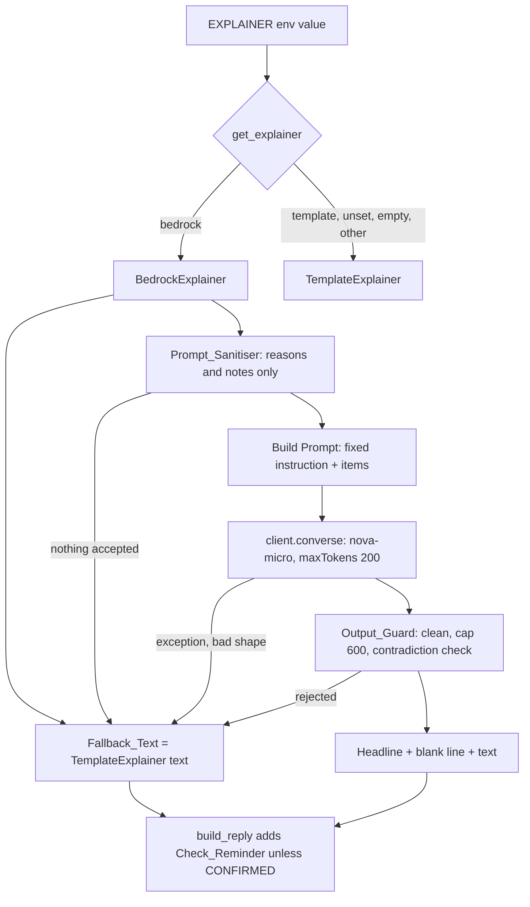

# Design Document

## Overview

The AI_Explainer is one new module, `src/ghost_credit/ai_explainer.py`. It adds `BedrockExplainer`, a second implementation of the `Explainer` interface in `src/ghost_credit/verdict.py`, and the factory `get_explainer`. `verdict.py` is not changed. `build_reply`, `TemplateExplainer` and `CHECK_REMINDER` are reused as they are.

The idea in one line: fixed code decides and frames, the model only rewords.

```
reply text = Headline (fixed code)  +  blank line  +  guarded model text
reply      = build_reply(...) adds the bank-app reminder for every code except CONFIRMED
```

Design decisions and reasons:

| Decision | Reason |
|---|---|
| One new module, no change to `verdict.py` | The Explainer interface already exists and `build_reply` already enforces the reminder (Requirement 4.3, 4.4). Less risk, one file to read. |
| Headline = first line of `TemplateExplainer().explain(...)` | Reuses the exact fixed wording and its unknown-code rule without touching the private `_HEADLINES` table (Requirements 1.4, 1.5, 4.2). `TemplateExplainer` writes the headline as its first line, which the verdict-engine design fixes. |
| The prompt is built from a sanitised list of reasons and notes, and unsafe items are dropped, not edited | Editing text risks leaving half a name or number behind. Dropping is simple and easy to prove (Requirement 3.2, 3.4). |
| The model is told what to say, not what to decide | The instruction asks for a rewording of the listed points only and forbids "release" advice. The Headline already carries the action (Requirement 3.9). |
| Output guard is a deny-list plus cleaning | A small conservative list is cheap, testable and has no AI in it. It can reject good text, which only costs a fallback. It can never decide a verdict (Requirement 5). |
| One catch-all around the whole `explain` body | The product rule is "never raise". One outer `try/except Exception` returns the Fallback_Text. Only the exception type name is logged (Requirement 6.6, 6.7). |
| Lazy `import boto3` inside a private method | The module imports and tests run without boto3 (Requirement 2.5, 8.2). |
| Client is injectable, region is a constructor argument | Tests pass a Fake_Client. A fake `boto3` module in `sys.modules` lets a test check the region and `Config` without the real library (Requirement 2.3, 2.4, 2.6). |
| No retries, 5 second timeouts | A slow model must not hold up a shop owner. The fallback is instant and safe (Requirement 2.4). |
| Factory defaults to template for anything unknown | Money-costing behaviour must be switched on by name, never by accident (Requirement 7.3). |
| `boto3` only in `[project.optional-dependencies] aws` | Lambda already ships boto3. Local and test installs stay light (Requirement 8.1). |

Research: no outside sources were needed beyond the brief. The request shape follows the Bedrock Converse API (`modelId`, `messages`, `system`, `inferenceConfig`) and the response path `output.message.content[0].text`. The repo files read were `verdict.py`, `parser.py`, `pyproject.toml`, the four steering files and the verdict-engine design.

### Open points carried from the brief

| Point | Position taken here |
|---|---|
| Ayobami's approval and a quoted cost are required before any paid call (`tech.md`, `boundaries.md`). | The code is built and tested with fakes only. `EXPLAINER` defaults to template. No live call is part of any task. The cost quote is still needed before `EXPLAINER=bedrock` is used against real Bedrock. |
| `build_reply` falls back to reasons text if an Explainer returns an empty string. | Not needed, because BedrockExplainer never returns empty text (the Headline is always present). |
| Region setting by environment variable. | Not added. Region is a constructor argument defaulting to `us-east-1`, which meets the brief with no extra setting. |

## Architecture



Every path out of `explain` ends in either the Headline-plus-text reply or the Fallback_Text. There is no path that returns a string without a Headline.

## Components and Interfaces

All names live in `src/ghost_credit/ai_explainer.py`.

Imports: `Explainer`, `TemplateExplainer` and the four code constants from `ghost_credit.verdict`; `RED_FLAG_CODES` from `ghost_credit.parser`; `FLAG_REASONS` from `ghost_credit.verdict` (its keys are the known flag codes). Standard library only: `logging`, `os`, `re`, `copy` and `dataclasses`. `boto3` and `botocore` are imported inside `_make_client` only.

Module constants:

| Name | Value |
|---|---|
| `MODEL_ID` | `"amazon.nova-micro-v1:0"` |
| `DEFAULT_REGION` | `"us-east-1"` |
| `MAX_TOKENS` | `200` |
| `TIMEOUT_SECONDS` | `5` |
| `MAX_OUTPUT_CHARS` | `600` |
| `MAX_ITEMS` | `3` (reasons) and `3` (notes) |
| `MAX_ITEM_CHARS` | `160` |
| `SYSTEM_INSTRUCTION` | Fixed text, see below |

### Fixed instruction (system message)

One fixed string. It says, in plain words: you reword the points below for a shop owner reading on WhatsApp; use plain, friendly English; speak directly to the shop owner as "you"; write exactly 2 short sentences, the reason first, then what to do now; never say "we"; never say anyone is investigating or looking into it; never promise a follow-up or a later update; talk about the alert, never about the customer; do not accuse anyone; do not say a screenshot or text message proves money is real; do not give legal advice; do not say whether to release goods; do not add facts, names or numbers; output the reworded text only. The text contains no Verdict_Code, no Red_Flag_Code and no Owner_Label (Requirement 3.3, 3.8, 3.9, 3.10). The user message is the heading `Points:` followed by one `- ` line for each accepted reason and Risk_Note.

### Prompt_Sanitiser

```
_sensitive_values(verdict, parsed) -> list[str]        # lower-case strings to look for
_is_clean(item, sensitive) -> bool
_prompt_items(verdict, parsed, risk_notes) -> list[str]
```

`_sensitive_values` collects, all lower-cased:

- The four Verdict_Code strings, and `verdict.code` when it is a string.
- Every code in `RED_FLAG_CODES`, every key of `FLAG_REASONS`, and every string in `parsed.red_flags`.
- Every string field of the ParsedAlert (`currency`, `claimed_bank`, `sender_id`, `account_masked`, `narration`, `claimed_reference`, `screenshot_phash`) that has 3 or more characters after trimming.
- The decimal digits of `amount_kobo` and `available_balance_kobo`, and of those values divided by 100 (whole naira), when the digit string has 3 or more digits.

`_is_clean(item, sensitive)` is True when the item is a `str`, is not blank, contains none of the sensitive strings (case-insensitive substring), and has no digit run of 7 or more. The digit check first removes spaces, commas, full stops and hyphens that sit between two digits, so `012 345 6789` and `45,000.00` are caught too.

`_prompt_items` keeps the first 3 clean reasons and the first 3 clean notes (reasons first, then notes), each cut to 160 characters. A value that is not a list gives no items. If the result is empty, no call is made.

A ParsedAlert of None gives no parsed-based values. Everything is read with `getattr` inside the outer try block, so a broken object leads to the fallback.

### Output_Guard

```
_clean_text(text) -> str                 # control characters, newlines, 600-character cut
_contradicts(text, code) -> bool         # Contradiction_Check and the other deny-lists
guard_output(text, code) -> str | None   # cleaned text, or None when rejected
```

`guard_output` steps, in order:

1. Not a `str`, or blank after trimming: return None.
2. Replace each control character other than newline with a space (`ch < " "` or `ch == "\x7f"`, plus the Unicode `Cc` and `Cf` categories). Turn `\r\n` and `\r` into `\n`. Squeeze 3 or more newlines to 2. Squeeze runs of spaces to one. Trim.
3. If the cleaned text is empty: None.
4. If longer than 600 characters: cut to 600, then cut back to the last `.`, `!` or `?` that is followed by the end or a space inside those 600 characters. If there is none, cut back to the last space. If there is no space either, hard cut at 600. Trim.
5. If `_contradicts` or the digit-run test is true: None.
6. Return the text.

Step 5 runs after the cut, so a banned word that sat in the cut-off part cannot cause a needless rejection, and a banned word cannot be cut into a harmless fragment, because whole-word matching runs on the final text.

`_contradicts(text, code)` uses whole-word, case-insensitive regexes (`(?<!\w)word(?!\w)`):

| Applies when | Rejected words or phrases |
|---|---|
| Code is not CONFIRMED | `confirmed`, `verified`, `alive`, `payment is real`, `money is real`, `payment is genuine`, `money has arrived`, `safe to release`, `you can release`, `payment went through` |
| Code is CONFIRMED | `ghost`, `fake`, `forged`, `suspicious` |
| Always | Owner_Labels of the other three codes (for example `ghost` when the code is SUSPICIOUS), and `fraudster`, `scammer`, `thief`, `criminal`, `lawyer`, `legal action`, `sue`, `police` |
| Always (substring, case-insensitive) | `looking into`, `investigat` (so "investigating" and "investigation" are caught) |
| Always (whole word, case-insensitive) | `we`, `we're`, `we'll`, `our team`, with a straight or a curly apostrophe |

The substring rows use plain `in` checks on the lower-cased text. The `we` row is whole-word, so "answer" and "weekend" are allowed. "unverified" does not match `verified` because of the `(?<!\w)` check. An unknown code is treated as UNVERIFIED for this table, the safe side.

### BedrockExplainer

```
class BedrockExplainer(Explainer):
    def __init__(self, client=None, region=DEFAULT_REGION, model_id=MODEL_ID) -> None
    def explain(self, verdict, parsed, risk_notes) -> str
    def _make_client(self)                    # lazy boto3 import, Config, region
    def _request(self, items) -> dict         # the Converse arguments
    def _read_text(self, response) -> str|None
```

`explain` flow, all inside one `try/except Exception`:

1. `fallback = TemplateExplainer().explain(verdict, parsed, risk_notes)`. Computed first, so every later failure can return it. If even this raises, the outer handler returns the plain headline-free text `"Check first before you release anything."` plus nothing else. (It is the only literal in the module that is not derived from `verdict.py`; the Reply_Builder still appends the Check_Reminder.)
2. `items = _prompt_items(...)`. If empty, log `NoUsableText` and return `fallback`.
3. `client = self._client or self._make_client()`. The made client is kept on the instance for later calls.
4. `response = client.converse(**self._request(items))`. This is the only Bedrock call, once per `explain`.
5. `text = guard_output(self._read_text(response), code)`. None leads to a logged `GuardRejected` (or `NoUsableText` for a bad shape) and `fallback`.
6. `headline = fallback.split("\n", 1)[0]`. Return `f"{headline}\n\n{text}"`. The headline is never built here, so for a NOT_FOUND verdict whose reasons hold the Already_Used_Reason it is automatically "GHOST. Hold the goods. This payment was already used." from `TemplateExplainer` (Requirement 4.7, 4.8).

The request:

```
{
  "modelId": "amazon.nova-micro-v1:0",
  "system": [{"text": SYSTEM_INSTRUCTION}],
  "messages": [{"role": "user", "content": [{"text": "Points:\n- ...\n- ..."}]}],
  "inferenceConfig": {"maxTokens": 200}
}
```

`_make_client`:

```
import boto3
from botocore.config import Config
cfg = Config(read_timeout=5, connect_timeout=5, retries={"max_attempts": 0})
return boto3.client("bedrock-runtime", region_name=self._region, config=cfg)
```

No keys are passed. boto3 finds credentials itself (Lambda role or local profile). `ImportError` or a credentials error is caught by the outer handler.

`_read_text(response)` returns `response["output"]["message"]["content"][0]["text"]` and returns None on any `KeyError`, `IndexError`, `TypeError`.

Logging: a module `logging.getLogger("ghost_credit.ai_explainer")`. One `warning` per fallback: `"ai explainer fallback: %s"` with `type(exc).__name__` or one of the two fixed words. No `exc_info`, no message text (an exception message could hold prompt text).

### get_explainer

```
get_explainer(env=None, client=None) -> Explainer
```

Reads `EXPLAINER` from `env` (or `os.environ` when `env` is None) with `.get`, trims and lower-cases it if it is a `str`. Exactly `"bedrock"` gives `BedrockExplainer(client=client)`. Everything else, including a non-string value or a broken mapping, gives `TemplateExplainer()`. It builds no client and imports nothing from boto3.

### Packaging

- `pyproject.toml`: add `aws = ["boto3"]` under `[project.optional-dependencies]`.
- `.env.example`: add the line `EXPLAINER=` (create the file with empty values if it does not exist yet, without touching `.env`).

## Data Models

No new stored data. Types used:

| Type | Source | Use here |
|---|---|---|
| `Verdict` | `pattern_network.py` | Read `code` and `reasons`. Never changed. |
| `ParsedAlert` | `parser.py` | Read only to build the Sensitive_Text list. Its values never enter the Prompt. |
| `list[str]` risk notes | `verdict.py` | Cleaned, capped, then passed on. |
| Converse request and response | Bedrock | Plain `dict`s as shown above. |

## Correctness Properties

*A property is a characteristic or behavior that should hold true across all valid executions of a system-essentially, a formal statement about what the system should do. Properties serve as the bridge between human-readable specifications and machine-verifiable correctness guarantees.*

Reflection: 1.3 and 6.6 merge into the never-raises property. 3.1 to 3.6 and 4.6 merge into one prompt-privacy property. 6.1 to 6.5, 6.9 and 3.7 merge into one fallback property. 5.1 to 5.4 and 5.8 merge into one guard-output property. 5.5 to 5.7 and 5.9 merge into one rejection property. 2.1, 2.2, 2.3, 2.7 and 8.6 merge into one request property. 1.4, 4.1 to 4.3 merge into the layout property. Criteria 1.1, 1.5, 2.4 to 2.6, 2.8, 3.8, 3.9, 6.7, 6.8, 7.4, 7.5, 8.x are examples or smoke checks.

### Property 1: Explain never raises and changes nothing

For any Verdict (any code, any reasons including non-strings), any ParsedAlert or None, any risk_notes list and any Fake_Client behaviour (valid reply, wrong shape, raises any exception, returns non-text), `explain` returns a `str`, does not raise, and the Verdict, ParsedAlert and notes list equal their deep copies taken before the call.

**Validates: Requirements 1.3, 6.6**

### Property 2: The Prompt holds only clean reasons and notes

For any Verdict, any ParsedAlert with an amount, an account and other string fields, and any reasons and notes that may contain the Verdict_Code, Red_Flag_Codes, the parsed strings, the amount digits or digit runs of 7 or more, the Prompt sent to the Fake_Client contains none of those strings (case-insensitive), contains no Headline text or Owner_Label, holds at most 3 reasons and 3 notes each at most 160 characters, and keeps accepted items in their original order.

**Validates: Requirements 3.1, 3.2, 3.3, 3.4, 3.5, 3.6, 4.6**

### Property 3: Any failure returns exactly the template text

For any Verdict, ParsedAlert and notes, and any client behaviour that fails (raises, wrong shape, non-string text, empty text, text rejected by the Output_Guard, missing `boto3`, client creation error, or no clean item to send), `explain` returns a string equal to `TemplateExplainer().explain(...)` for the same arguments, and the Fake_Client was called at most once.

**Validates: Requirements 3.7, 6.1, 6.2, 6.3, 6.4, 6.5, 6.9, 8.6**

### Property 4: The reminder and the verdict survive the AI

For any Verdict with any code, any ParsedAlert, any notes and any Fake_Client behaviour, the reply from `build_reply` with a BedrockExplainer ends with the Check_Reminder with nothing after it whenever the code is not CONFIRMED, and the Verdict code and reasons equal their values before the call.

**Validates: Requirements 4.4, 4.5**

### Property 5: The request has the fixed settings

For any Verdict, notes and region string, when the Fake_Client receives a call, the call has `modelId` equal to `amazon.nova-micro-v1:0`, `inferenceConfig` equal to `{"maxTokens": 200}`, exactly one system block, exactly one user message, and a client created through a fake `boto3` module is created for `bedrock-runtime` with the region given to the BedrockExplainer (`us-east-1` by default). Exactly one `converse` call is made for each `explain` call.

**Validates: Requirements 2.1, 2.2, 2.3, 2.7, 8.6**

### Property 6: Success layout is Headline, blank line, guarded text

For any Verdict code, reasons and notes with at least one clean item, and any model text that the Output_Guard accepts, `explain` returns the first line of the TemplateExplainer text, then one blank line, then the guarded text, and the result does not end with the Check_Reminder added by BedrockExplainer.

**Validates: Requirements 1.4, 1.5, 4.1, 4.2, 4.3**

### Property 7: Accepted model text is clean and short

For any text value, `guard_output` returns None or a string that is non-empty, at most 600 characters, free of control characters other than newline, free of a run of 7 or more digits, and not blank.

**Validates: Requirements 5.1, 5.2, 5.3, 5.4, 5.8**

### Property 8: Contradicting text is rejected

For any clean text and any banned word or phrase from the Contradiction_Check table inserted at any position in any letter case, `guard_output` returns None for a Verdict_Code the table applies to, and "unverified" inside a text never causes a rejection by itself. This also holds for any clean text with the substring "looking into" or "investigat" inserted anywhere in any letter case (including inside a longer word such as "investigation"), and for any clean text with the whole word "we", "we're", "we'll" (straight or curly apostrophe) or the phrase "our team" inserted in any letter case, for every Verdict_Code. A word that only contains "we" inside a longer word, such as "answer", never causes a rejection by itself.

**Validates: Requirements 5.5, 5.6, 5.7, 5.9, 5.11, 5.12**

### Property 9: The factory defaults to template

For any `env` mapping, `get_explainer` returns a BedrockExplainer exactly when the `EXPLAINER` value, trimmed and in lower case, equals `bedrock`, and a TemplateExplainer for every other value, including unset, empty, non-string and unknown text. It does not raise and does not import `boto3`.

**Validates: Requirements 7.1, 7.2, 7.3, 7.5, 7.6**

## Error Handling

| Situation | Behaviour |
|---|---|
| `boto3` not installed | `ImportError` caught, fallback, log `ImportError`. |
| No credentials or client error | Exception caught, fallback, log the type name. |
| Timeout (5 s) or throttling | `converse` raises, fallback, log the type name. No retry, so cost is one call at most. |
| Response is not the expected shape, or text missing | Fallback, log `NoUsableText`. |
| Guard rejects the text | Fallback, log `GuardRejected`. |
| No clean reason or note to send | Fallback, log `NoUsableText`, no call. |
| Verdict has odd code or non-list reasons | Unknown code uses the UNVERIFIED Headline. Non-string reasons are skipped. |
| Anything unexpected inside `explain` | The outer handler returns the fallback. `explain` never raises. |
| Unknown `EXPLAINER` value | Template Explainer. |

Logs never hold the Prompt, the model output, reasons, notes or credentials.

## Testing Strategy

Property-based testing applies: the sanitiser, the guard, the factory and the fallback rule are pure logic with a large input space. The Bedrock service is not tested. Tests use pytest and Hypothesis, with a Fake_Client only. No test calls Bedrock, `boto3` is not needed, and the whole suite passes with `PATTERN_NETWORK=off`. Test data is synthetic.

**Test helpers** (`tests/ai_explainer_helpers.py`): `FakeClient` (records every `converse` kwargs; modes: reply with text, wrong shape, raise given exception, raise a class named `ReadTimeoutError`, return non-text), `make_verdict(code, reasons)`, `make_parsed(...)` with a synthetic amount and account, and Hypothesis strategies for codes, reasons seeded with sensitive text, and notes.

**Property tests** (one test per property, at least 100 examples each, each tagged `Feature: ai-explainer, Property N: <property text>`):

| Property | File |
|---|---|
| 1 | `tests/test_ai_explainer_prop_01_never_raises.py` |
| 2 | `tests/test_ai_explainer_prop_02_prompt_privacy.py` |
| 3 | `tests/test_ai_explainer_prop_03_fallback_exact.py` |
| 4 | `tests/test_ai_explainer_prop_04_reminder_and_code.py` |
| 5 | `tests/test_ai_explainer_prop_05_request_settings.py` |
| 6 | `tests/test_ai_explainer_prop_06_success_layout.py` |
| 7 | `tests/test_ai_explainer_prop_07_guard_output.py` |
| 8 | `tests/test_ai_explainer_prop_08_guard_rejects.py` |
| 9 | `tests/test_ai_explainer_prop_09_factory.py` |

**Example tests:**

- Success: a recorded Converse reply gives Headline, blank line and the model text (Requirement 4.1, 2.8).
- Fallback: `converse` raises a timeout-named error, and the result equals the Template text (Requirement 6.3, 6.9).
- Guard rejection: a reply saying "Your payment is real" for SUSPICIOUS falls back (Requirement 5.5, 5.10).
- Guard cut: a 900-character reply is cut at a sentence end at or before 600 characters (Requirement 5.3).
- Env switch: `{"EXPLAINER": "bedrock"}`, `" Bedrock "`, `"template"`, `""`, `"gpt"` and no key (Requirement 7.2, 7.3); injected client is passed on (Requirement 7.4).
- No `boto3`: with `boto3` blocked in `sys.modules`, `explain` falls back and the module still imports (Requirement 2.5, 6.1).
- Fake `boto3` module: records `Config(read_timeout=5, connect_timeout=5, retries off)` and `region_name` (Requirement 2.3, 2.4).
- Log check: with `caplog`, a fallback logs only the exception type name and no secret text from reasons or output (Requirement 6.7, 6.8).
- Instruction text holds the required rules and none of the sensitive words (Requirement 3.3, 3.8, 3.9, 3.10). It asks for "2 short sentences", forbids "we", and mentions investigating and follow-up (`tests/test_ai_explainer_instruction_examples.py`).
- Guard wording: "We are looking into it.", "Someone is investigating this alert.", "The investigation will take a day.", "We'll update you soon.", "Our team will help." and "We checked it." are all rejected, and plain owner text is kept (Requirement 5.11, 5.12).
- Already-used headline: a NOT_FOUND verdict with the Already_Used_Reason gives the first line "GHOST. Hold the goods. This payment was already used." (Requirement 4.7, 4.8).

**Smoke checks:** `pyproject.toml` has `boto3` only under the `aws` extra (8.1); the module source has no key-like strings (8.3); `.env.example` has `EXPLAINER=` (8.4).
