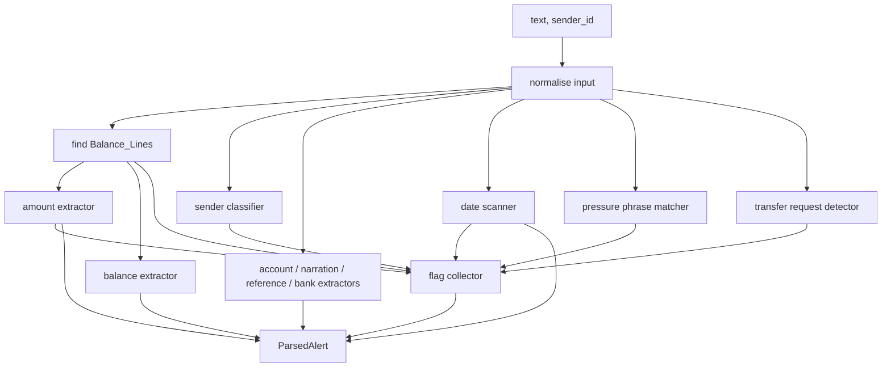
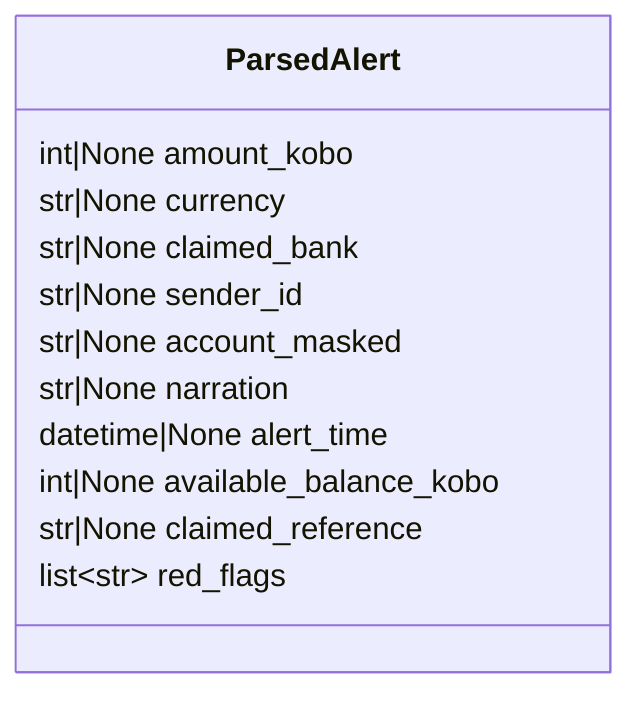

# Design Document: alert-parser

## Overview

`parse_sms_alert(text, sender_id) -> ParsedAlert` in `src/ghost_credit/parser.py` is a pure, total function. It reads a bank credit alert SMS and its sender header, extracts labelled fields, and reports the red flags that text and sender can show: `SENDER_ID_MISMATCH`, `BALANCE_LINE_MISSING`, `AMOUNT_FORMAT_ODD`, `DATE_ODD`, `PRESSURE_LANGUAGE` and `TRANSFER_REQUEST_WORDING`. (`SCREENSHOT_EDIT_SIGNS` is in `RED_FLAG_CODES` but needs an image, so this parser never sets it.) It does not choose the verdict (the Rules_Engine does, per `.kiro/steering/payments-nigeria.md`), and it makes no AI, network or file calls.

Output fields feed the `signals` object in `docs/pattern-network-contract.md`: `amount_kobo`, `currency`, `claimed_bank`, `sender_id`, `claimed_reference` and `red_flags` map by name. Money is an integer in kobo (contract rule 6).

### Design decisions

| Decision | Rationale |
|---|---|
| Standard library only (`re`, `dataclasses`, `datetime`, `calendar`). | Keeps the function pure and the install small. No new runtime dependency. |
| Independent field extractors, no per-bank templates. | Steering says never hard-code one bank's layout. Requirement 3.7 needs every findable field extracted regardless of layout. |
| Amounts parsed to `int` from digit strings, never through `float`. | Requirement 2.3. Floats cannot hold `100.05` exactly. |
| Balance lines are located first, and their character spans are masked out when finding the credit amount. | Requirements 2.7 and 2.8 need "first amount not in a Balance_Line". |
| Account, reference and balance spans are also masked before date-shape detection. | Stops `Ref: 0000-13/26` or a masked account from being read as an odd date. |
| Every regex is written without nested or overlapping quantifiers and runs on a bounded input. | Requirement 9.6 (10,000 characters in 1 second) and no catastrophic backtracking. |
| The function body is wrapped so that any unexpected internal error returns a ParsedAlert built so far instead of raising. | Requirement 9.3 and 9.4 promise totality. The wrapper is a last resort and tests must still treat an internal exception as a bug to fix. |
| Text longer than 10,000 characters is truncated to 10,000 before parsing. | Requirement 1.1 only covers up to 10,000, and this bounds run time. Truncation is documented in the docstring. |

## Architecture



Processing order:

1. Normalise: coerce `None` text to `""`, truncate to 10,000 characters, keep a lower-cased copy for case-insensitive matching.
2. Find Balance_Lines and record their spans.
3. Run the independent extractors. Amount and date extractors each return a value and a flag decision.
4. Classify the sender from `sender_id` alone.
5. Collect flags into a set, then emit them in a fixed order (the order of the Red_Flag_Code list) so output is deterministic and has no duplicates.

## Components and Interfaces

All in `src/ghost_credit/parser.py`, with `src/ghost_credit/__init__.py` present.

### Public interface

```python
RED_FLAG_CODES = (
    "SENDER_ID_MISMATCH", "BALANCE_LINE_MISSING", "AMOUNT_FORMAT_ODD",
    "DATE_ODD", "PRESSURE_LANGUAGE", "SCREENSHOT_EDIT_SIGNS",
    "TRANSFER_REQUEST_WORDING",
)

@dataclass(frozen=True)
class ParsedAlert:
    amount_kobo: int | None
    currency: str | None
    claimed_bank: str | None
    sender_id: str | None
    account_masked: str | None
    narration: str | None
    alert_time: datetime | None      # naive
    available_balance_kobo: int | None
    claimed_reference: str | None
    red_flags: list[str]             # default empty list, unique, subset of RED_FLAG_CODES

def parse_sms_alert(text: str, sender_id: str | None) -> ParsedAlert: ...
```

`frozen=True` gives value equality (Requirement 9.5) and prevents callers changing a shared result. `red_flags` uses `field(default_factory=list)`.

### Module-level named lists

- `PRESSURE_PHRASES`: tuple of lower-case phrases, for example `"release now"`, `"before the owner"`, `"send the goods now"`, `"i am in a hurry"`, `"don't wait"`, `"no time"`. The starting list is a judgement call and is one place to edit.
- `TRANSFER_REQUEST_PHRASES`: tuple of lower-case phrases that say a transfer was requested, kept in one place like `PRESSURE_PHRASES`. The starting list is `"transfer request successful"` and `"transfer request has been"`. Two further module constants hold the proximity rule: `_REQUEST_WORDS = "request successful"`, `_TRANSFER_WORD = "transfer"` and `_NEAR_LIMIT = 40`.
- `KNOWN_BANKS`: tuple of `(canonical_name, (aliases...))` holding the 19 Nigerian banks listed in `parser.py` and no others, for example `("GTBank", ("gtbank", "gtb", "guaranty trust"))`, `("Access Bank", ("access bank", "accessbank"))`, `("Zenith Bank", ...)`, `("UBA", ...)`, `("First Bank", ("first bank", "firstbank"))`, `("Opay", ...)`, `("Kuda", ...)`, `("Moniepoint", ...)`, `("Palmpay", ...)`, `("Wema Bank", ...)`, `("Sterling Bank", ...)`, `("Fidelity Bank", ...)`, `("Stanbic IBTC", ...)`. Aliases match on word boundaries, so `gtb` does not match inside another word. When several banks match, the one whose match starts earliest in the text wins, and the sender_id is searched only if the text has none.
- `DATE_FORMATS`: the Recognised_Date_Formats as compiled patterns plus a builder for each.

### Internal functions

| Function | Responsibility | Requirements |
|---|---|---|
| `_find_balance_lines(text)` | Returns `list[Span]` for each `Bal`, `Avail Bal`, `Available Balance`, `Current Balance`, `Avail. Bal` label (case-insensitive) followed by an optional `:` or `-`, optional currency marker and a number. A label with no figure yields no Balance_Line (Requirement 5.4). | 5.x, 3.4 |
| `_parse_amount_token(marker, number, k, decimals)` | Converts digit text to kobo using integer arithmetic only. | 2.1–2.3 |
| `_find_amounts(text, masked_spans)` | Scans for marker-form and `CR`-form amounts outside masked spans. Returns candidates with a status `ok`, `odd_format`, or `too_many_decimals`. | 2.x, 6.x |
| `_extract_amount(...)` | Picks the first Preferred_Amount (marker or label form) outside the masked spans, or the first CR-form candidate when there is none. If it is `odd_format` or `too_many_decimals`, sets amount to None and records the flag. | 2.5, 2.7–2.9, 2.13–2.15, 6.6 |
| `_find_account_tokens(text)` | New. Returns the Account_Token spans (masked account, digits next to `*`, Account_Label plus its value). | 2.11, 2.12 |
| `_amount_words_kobo(text)` | Parses a small English-words grammar (units, teens, tens, hundred, thousand, million) followed by `naira`, with optional `kobo`. Returns kobo or None. | 6.4 |
| `_extract_account(text)` | `\b\d{3,4}\*{1,6}\d{3,4}\b`, returned as written. | 3.1 |
| `_extract_narration(text)` | Label (`Narration`, `Description`, `Desc`, `Remarks`) then `:` or whitespace, then text to end of line, stripped and cut to 200 characters. | 3.2 |
| `_extract_reference(text)` | Label (`Ref No`, `Ref`, `Reference`, `Session ID`) then optional `:` and `[A-Za-z0-9/-]{4,50}`. Longer labels are tried first so `Ref No` is not read as `Ref` plus `No`. | 3.5 |
| `_extract_bank(text, sender_id)` | Searches `KNOWN_BANKS`. | 3.6 |
| `_scan_dates(text, masked_spans)` | Finds Recognised_Date_Formats dates (each with an optional Recognised_Time) and Unrecognised_Date_Shapes, skips matches that overlap `masked_spans` (balance, account and reference spans), validates the rest, and returns `(alert_time | None, date_odd: bool)`. | 3.3, 7.x |
| `_has_pressure(text)` | Replaces curly quotes with straight ones (so `don’t wait` matches `don't wait`), lower-cases, collapses whitespace runs to one space, then checks each phrase with word-boundary lookarounds. | 8.x |
| `_sender_is_phone(sender_id)` | Phone_Number_Sender test. | 4.x |
| `_has_transfer_request(text)` | Detector for `TRANSFER_REQUEST_WORDING`. Normalises the text the same way as `_has_pressure` (shared helper), then returns True if a phrase from `TRANSFER_REQUEST_PHRASES` matches as whole words, or if a whole-word `request successful` and a whole-word `transfer` are Near each other. | 11.x |

### Key matching rules

**Amount forms.** Number grammar: `\d{1,3}(?:,\d{3})*|\d+`, optional `\.\d+`, optional `[kK]`.

- Marker form: `(?<![A-Za-z])(?:NGN|₦|N)\s?<number>`. The lookbehind stops `N` inside words such as `BANK 500`.
- CR form: `<number>\s?CR\b` (case-insensitive), with no currency marker, so `currency` stays None (Requirement 2.6).
- Label form: a number directly after `Amt` or `Amount` (optional colon), with no marker, is an amount with `currency` None.
- A number with no marker, no `CR` and no `Amt`/`Amount` label is not an amount, except inside a Balance_Line.
- Account_Tokens are never amounts (see Account-span masking below).

**Account-span masking (amount fix).** Bug: for `Acct:012****789 CR Amt: NGN 45,000.00`, `_CR_AMOUNT_RE` matches `789 CR` because the character before `789` is `*`, and the position sort puts it before `NGN 45,000.00`, so `amount_kobo` is 78900. The fix reuses the span approach that `_parse_body` already uses for dates, where account and reference spans go into `date_masks`.

- A new helper `_find_account_tokens(text) -> list[Span]` returns the Account_Token spans: (1) every `_ACCOUNT_RE` match; (2) every digit run directly adjacent to `*`, with its asterisks, using `\d*\*+\d*` (this covers masked forms that `_ACCOUNT_RE` rejects, such as `1****2`); (3) an Account_Label (`(?<![A-Za-z])(?:acct|a/c|account)(?![A-Za-z])\s*:?\s*`, case-insensitive) together with the digit and asterisk run after it, `[\d*]+`. The patterns have no nested quantifiers.
- `_parse_body` calls `_find_account_tokens` and passes the Balance_Line spans plus the Account_Token spans to `_extract_amount` as one `masked_spans` list. The parameter is renamed from `balance_spans` to `masked_spans`. `_find_amounts` already skips any candidate that overlaps `masked_spans`, so no other change to it is needed for masking.
- A new `_AMOUNT_LABEL_RE` (`(?<![A-Za-z])(?:amt|amount)(?![A-Za-z])\s*:?\s*(?P<tok>\d[\d.,]*)(?P<k>[kK](?![A-Za-z]))?`, case-insensitive) finds a labelled number with no Currency_Marker. When a marker sits between label and number (`Amt: NGN 45,000.00`), the existing `_MARKER_AMOUNT_RE` finds it, and the label pattern does not match because a letter follows the label. A labelled match that overlaps a marker candidate is dropped. A labelled number has `has_marker` False, so `currency` stays None.
- Ranking in `_extract_amount`: candidates from the marker pattern and the label pattern are Preferred_Amounts. The first Preferred_Amount by text position decides `amount_kobo`. The CR form decides only when there is no Preferred_Amount. This is a change from the old rule of "first candidate of any kind", and it only matters when a CR-form number appears before a marker or labelled amount. The `any_odd` flag still looks at every non-masked candidate.
- The masked account is still returned unchanged in `account_masked` and is still used as a date mask. Masking for amounts changes only the amount path.

**Odd amount checks** (applied to each digit-bearing amount token after the marker or before `CR`):

1. Contains both `,` and `.` in the wrong roles, for example `1.000,50`: the number matched the loose pattern `[\d.,]+` but not the strict grammar. Flag `AMOUNT_FORMAT_ODD`, amount None (6.1).
2. Decimal part of 3 or more digits. Flag, amount None (2.9, 6.2).
3. Comma groups not exactly 3 digits after a first group of 1 to 3 digits, for example `50,00` or `5,0000`. Flag, amount None (6.3).
4. Words and digits both present and different in kobo. Flag only. The digit amount is kept, because the requirement does not say to clear it (6.4).

To detect these, the amount scan first captures the loose token `[\d][\d.,]*` after a marker or before `CR`, then validates it against the strict grammar. A token that fails strict validation is classified as odd by which check it fails.

**Precedence when odd and valid amounts coexist.** Candidates are examined left to right, skipping Balance_Line spans. The first candidate decides `amount_kobo`. If any candidate in the text (outside Balance_Lines) is odd, `AMOUNT_FORMAT_ODD` is flagged, even when an earlier clean candidate supplies `amount_kobo`. This follows Requirement 6.1–6.3 literally ("an amount in Alert_Text").

**Dates.** `_scan_dates` runs one compiled pattern per Recognised_Date_Format, then one pattern for Unrecognised_Date_Shapes. All patterns are bounded and use no nested quantifiers.

- Recognised layouts: `DD/MM/YYYY`, `DD-MM-YYYY`, `DD-Mon-YYYY`, `DD Mon YYYY` (`Mon` in any letter case) and `YYYY-MM-DD`. Day and month have 1 or 2 digits, the year 4 digits. Each layout may be followed on the same line by spaces or tabs and a Recognised_Time `HH:MM[:SS]`. The time is optional, because real alerts often put it on another line.
- Digit-boundary rules: the character before a date must not be a digit, `/`, `-` or a letter (lookbehind). The character after the date's last digit, and after the time's last digit, must not be a digit (lookahead). So `12/03/20261` is not a date, sets no `alert_time` and adds no `DATE_ODD` (7.9).
- Validation builds `datetime(...)` inside `try/except ValueError`, which covers month 13, 30 February, 29 February in a non-leap year, hour 24, minute 60 and second 60. An impossible value is DATE_ODD whether or not a time follows the date (7.1).
- A numeric shape `\d{1,4}[/-]\d{1,2}[/-]\d{1,4}` with the same boundary rules that matches no recognised layout, such as `12/03/24` or `2026/03/12`, is DATE_ODD (7.2). It is only checked where no recognised layout already matched, so a recognised date is never counted twice. Dot-separated dates are not scanned, so amounts like `1.5.2` are not read as dates.
- A valid date with no time, such as `12/03/2026` alone, gives `alert_time` None and no DATE_ODD (3.3, 7.7). Only a valid date with a time can set `alert_time`.
- A lone time such as `10:45` with no date is ignored: `alert_time` None, no DATE_ODD (7.8). Text with no date at all gives the same result (7.4).
- If any date is flagged, `alert_time` is None and `DATE_ODD` is set once, even when other dates are valid (7.3, 7.6). Otherwise `alert_time` is the valid dated time that appears first in the text, by position and not by layout order (7.5, 7.10).
- Matches that overlap a Balance_Line, the masked account or the claimed reference span are skipped, so they neither set `alert_time` nor add DATE_ODD (7.11). `_parse_body` passes these three kinds of span as `masked_spans`.

Future dates are out of scope (a pure function has no clock).

**Transfer request wording.** `_has_transfer_request` reuses the normalisation helper used by `_has_pressure`: curly quotes to straight quotes, lower-case, runs of whitespace to one space. Whole-word matching uses `(?<!\w)` and `(?!\w)` lookarounds, so `transferred` and `transfers` do not match `transfer`.

1. Phrase test: each phrase in `TRANSFER_REQUEST_PHRASES` is searched as whole words. One hit is enough.
2. Proximity test: collect the match spans of `request successful` and of `transfer`. The flag is set when some pair has `later.start - earlier.end <= 40` (Near, in either order). Overlap cannot happen because the two matches are different words.
3. The result is a bool, so the flag collector lists the code once however many matches exist. The detector reads only the text, never the sender_id.

The search is linear in the text length. Each pattern is a literal with lookarounds, so there is no backtracking risk for the 10,000-character limit.

**Sender classification.** `Phone_Number_Sender`: after `strip()` does not apply (the raw value is kept for output, but classification uses the raw value, per the glossary: only digits, spaces, hyphens and an optional leading `+`). The count of digits is 7 to 15. A string with any letter is a Bank_Sender_Name. `None`, `""` and whitespace-only are not flagged. Everything else is not flagged.

Requirement 4.5 says Nigerian forms `0…`, `+234…` and `234…` with 7 to 15 digits in total are flagged. These are a subset of the Phone_Number_Sender definition, so no separate code path is needed.

## Data Models



Internal, not exported:

- `Span = tuple[int, int]`: start and end offsets into the normalised text.
- `_AmountCandidate(span, kobo | None, has_marker, status)`.

Invariants:

- `currency` is `"NGN"` only when the chosen amount had a Currency_Marker, otherwise None.
- `red_flags` contains no duplicates and only values from `RED_FLAG_CODES`, in that tuple's order.
- `amount_kobo` and `available_balance_kobo` are non-negative integers or None.

## Correctness Properties

*A property is a characteristic or behavior that should hold true across all valid executions of a system-essentially, a formal statement about what the system should do. Properties serve as the bridge between human-readable specifications and machine-verifiable correctness guarantees.*

Reflection on redundancy: the prework found about 30 testable criteria. Totality (1.1, 9.3, 9.4), unchanged `sender_id` (1.5), unique known flags (1.6) and determinism (9.5) all assert facts about the output of one call over arbitrary input, so they merge into one property. SENDER_ID_MISMATCH criteria 4.1, 4.5 and 4.6 merge into one property. Amount criteria 2.1 to 2.4, 2.6, 2.10 and 6.5 merge into the round-trip property. Requirement 10 requires at least one Hypothesis test for each of the nine properties below (see Testing Strategy). Property 9 is an addition for Requirement 11 and keeps the numbers of Properties 1 to 8.

### Property 1: Amount round trip

*For any* integer kobo value from 1 to 10,000,000,000,000 and *for any* Supported_Amount_Format that represents it exactly (`N<n>,<nnn>.<dd>`, `NGN<n>` and `NGN <n>k` when exact, `<n>.<dd> CR`), an alert containing that written amount, optionally followed by a Balance_Line, parses to `amount_kobo` equal to the original integer. The `currency` is `NGN` for marker forms and None for the CR form, and `AMOUNT_FORMAT_ODD` is absent.

**Validates: Requirements 2.1, 2.2, 2.3, 2.4, 2.6, 2.7, 2.10, 6.5, 10.4**

### Property 2: Totality, shape and determinism

*For any* text of 0 to 1,000 characters (including control and non-ASCII characters) and *for any* sender_id that is None or a string of 0 to 100 characters, `parse_sms_alert` returns a `ParsedAlert` without raising. The result has `sender_id` equal to the argument, `red_flags` holds no duplicates and only values from `RED_FLAG_CODES`, and a second call with the same arguments returns an equal value.

**Validates: Requirements 1.1, 1.2, 1.5, 1.6, 9.3, 9.4, 9.5, 10.5**

### Property 3: Phone-number senders are flagged

*For any* sender_id made of an optional leading `+`, then digits, spaces and hyphens with 7 to 15 digits in total (including the forms `0…`, `+234…` and `234…`), and *for any* text of 0 to 1,000 characters, `SENDER_ID_MISMATCH` is in `red_flags`.

**Validates: Requirements 4.1, 4.5, 4.6, 10.6**

### Property 4: Name senders are not flagged

*For any* sender_id containing at least one letter, and *for any* text, `SENDER_ID_MISMATCH` is absent.

**Validates: Requirements 4.2, 4.3, 4.4, 10.7**

### Property 5: Balance line decides BALANCE_LINE_MISSING

*For any* alert text built from a Balance_Label in any letter case followed by a figure, `BALANCE_LINE_MISSING` is absent and `available_balance_kobo` equals the figure in kobo. *For any* text with no Balance_Label followed by a figure, the flag is present.

**Validates: Requirements 3.4, 5.1, 5.2, 5.3, 5.4, 5.5, 10.8**

### Property 6: Valid and invalid dates

*For any* date and time written in a Recognised_Date_Format with valid values, `alert_time` equals that datetime (seconds 0 when omitted) and `DATE_ODD` is absent. *For any* valid date in a Recognised_Date_Format written with no time, `alert_time` is None and `DATE_ODD` is absent. *For any* date written in a Recognised_Date_Format with an impossible month, day, hour, minute or second, with or without a time, `alert_time` is None and `DATE_ODD` is present exactly once. *For any* numeric shape with `/` or `-` that matches no Recognised_Date_Format, `DATE_ODD` is present and `alert_time` is None. *For any* time with no date, `alert_time` is None and `DATE_ODD` is absent. *For any* text with several valid dated times and no flagged date, `alert_time` is the one that appears first in the text.

**Validates: Requirements 3.3, 7.1, 7.2, 7.3, 7.4, 7.5, 7.6, 7.7, 7.8, 7.10, 10.9**

### Property 7: Pressure phrases

*For any* phrase from `PRESSURE_PHRASES`, written with any letter case and any whitespace runs between words, embedded as whole words in any alert text, `PRESSURE_LANGUAGE` is present. *For any* text where every occurrence of a phrase sits inside a longer word, the flag is absent. Adding a Pressure_Phrase to a text changes only the presence of `PRESSURE_LANGUAGE` in `red_flags`.

**Validates: Requirements 8.1, 8.2, 8.3, 8.5, 8.6, 10.10**

### Property 8: Odd amount formats

*For any* amount written with a decimal part of 3 or more digits, with a comma group that is not exactly 3 digits, or with mixed comma and full stop separators outside a Supported_Amount_Format, `AMOUNT_FORMAT_ODD` is present and `amount_kobo` is None when that amount is the first non-balance amount.

**Validates: Requirements 2.9, 6.1, 6.2, 6.3, 6.6, 10.11**

### Property 9: Transfer request phrase adds the flag exactly once

*For any* Clean_Text (text that triggers no flag when parsed with a Bank_Sender_Name sender_id) and *for any* phrase from `TRANSFER_REQUEST_PHRASES`, written with any letter case and any whitespace runs between words, and inserted between the lines of the Clean_Text at any position, `red_flags` contains `TRANSFER_REQUEST_WORDING` exactly once and its other entries equal the `red_flags` of the Clean_Text alone.

**Validates: Requirements 11.1, 11.3, 11.7, 11.9, 10.15**

### Property 10: Account line never changes the amount

*For any* Account_Label (`Acct`, `A/C` or `Account`, in any letter case, with an optional colon), *for any* masked account made of digits around 1 to 6 asterisks, and *for any* alert text with a Supported_Amount_Format amount, placing the account line before the amount text gives the same `amount_kobo` as the same text without the account line.

**Validates: Requirements 2.11, 2.14, 2.15, 10.17**

## Error Handling

The function has no error return. Every failure mode maps to a defined output:

| Situation | Result |
|---|---|
| `text` is `None` or not a string | Treated as `""`. (Type hints say `str`, but the function is called with SMS data, so it stays total.) |
| `text` longer than 10,000 characters | Truncated to 10,000, then parsed. |
| `sender_id` is not `str` or `None` | Treated as None for classification. Output `sender_id` is the argument unchanged. |
| Value found after a label but malformed | Field is None, no flag (3.9), except date and amount cases that set `DATE_ODD` or `AMOUNT_FORMAT_ODD`. An impossible date value (with or without a time) or an Unrecognised_Date_Shape gives `alert_time` None and `DATE_ODD`. A digit run that breaks the date boundary rules, such as `12/03/20261`, is not a date and gives neither. |
| Integer overflow | Not possible, Python ints are unbounded. Amounts above 10,000,000,000,000 kobo parse normally. |
| Surrogate or other unusual code points | Regex operations work on any `str`. No encoding step occurs. |
| Unexpected internal exception | The outer wrapper returns an empty ParsedAlert carrying `sender_id`, with `red_flags` computed from the sender alone. This is a last-resort guard. A test failure here signals a bug. |

## Testing Strategy

Requirement 10 requires at least 5 pytest example tests (plus 3 for `TRANSFER_REQUEST_WORDING`) and one Hypothesis property test for each of Properties 1 to 9, all in `tests/`, offline, with synthetic data.

**Library:** Hypothesis (dev dependency). Each property test uses `@settings(max_examples=200)` (at least 100) and starts with a comment of the form `# Feature: alert-parser, Property N: <title>`.

**Property tests** (one test per property):

| Test | Property | Generator |
|---|---|---|
| `test_amount_round_trip` | 1 | `st.integers(1, 10**13)` and `st.sampled_from(formats)`. Skip formats that cannot represent the value exactly by filtering with `assume`, or by building the format-specific value directly (for `k`, `n * 100_000`). |
| `test_parser_never_raises` | 2 | `st.text(max_size=1000)` (full Unicode, including control characters) and `st.none() \| st.text(max_size=100)`. |
| `test_phone_sender_always_flagged` | 3 | A composite strategy that builds `0`, `+234` or `234` prefixes plus digits to give 7 to 15 digits, optionally with spaces or hyphens, and `st.text(max_size=1000)`. |
| `test_name_sender_not_flagged` | 4 | Sender_ids with at least one letter, and arbitrary text. |
| `test_balance_line_flag_and_value` | 5 | A Balance_Label in random letter case plus a figure in kobo, and text with no Balance_Label followed by a figure. |
| `test_date_validity` | 6 | Valid: a datetime from 1900 to 2100 written in a randomly chosen Recognised_Date_Format, followed by a time with or without seconds. Invalid: the same layout with exactly one impossible component (day 0 or 32 to 99, hour 24 to 99, minute 60 to 99, 30 or 31 February, 29 February in a non-leap year, second 60 to 99 only when seconds are written, month 0 or 13 to 99 only for the numeric-month layouts). Every generated date carries a time. |
| `test_pressure_phrase_detection` | 7 | A phrase from `PRESSURE_PHRASES` with random letter case and whitespace runs, embedded as whole words and inside a longer word. |
| `test_odd_amount_formats` | 8 | Amounts with 3 or more decimal digits, a comma group that is not 3 digits, or mixed comma and full stop separators. |
| `test_transfer_request_phrase_adds_flag_once` | 9 | A Clean_Text built from a bank-style credit line, a Balance_Line and an optional narration with no date and no flag trigger, split into lines. A phrase from `TRANSFER_REQUEST_PHRASES` with random letter case and whitespace runs is inserted between lines at a random index, with a Bank_Sender_Name such as `GTBANK`. Assert the flag appears once and the other flags equal the Clean_Text result. |

**Example tests** (at least 5):

1. `N50,000.00` gives 5,000,000.
2. `NGN50,000` gives 5,000,000.
3. `50,000.00 CR` gives 5,000,000, currency None.
4. `NGN 50k` gives 5,000,000.
5. A synthetic forged alert from a phone-number sender, no balance line, with `release now` pressure text and an impossible date such as `31/02/2026 10:15`. It asserts that `SENDER_ID_MISMATCH`, `BALANCE_LINE_MISSING`, `PRESSURE_LANGUAGE` and `DATE_ODD` are all in `red_flags`.

**Example tests for `TRANSFER_REQUEST_WORDING`** (at least 3, Requirement 10.14):

1. `Transfer Request Successful` in an otherwise normal alert puts the flag in `red_flags`.
2. A normal credit alert from `GTBANK` with a Balance_Line does not have the flag.
3. Curly quotes and odd whitespace, such as `TRANSFER   request\tSUCCESSFUL`, still flag it.

Optional extras: `request successful` 41 characters from `transfer` does not flag, 40 characters does, and `transferred` does not.

Synthetic alerts use invented banks' common sender names and masked accounts like `012****789`, no real people.

**No automated test.** Bank matching (3.6) and the 10,000-character timing limit (9.6) have no automated test and are verified by manual review.

**Amount fix tests (Requirements 2.11 to 2.16, 10.16, 10.17):**

| Test | Property | Generator |
|---|---|---|
| `test_account_line_does_not_change_amount` | 10 | An Account_Label from `Acct`, `A/C`, `Account` in random letter case with an optional colon, a masked account built from 0 to 6 digits, 1 to 6 asterisks and 0 to 6 digits, and an amount line built from a random kobo value in a Supported_Amount_Format (marker form, label form or CR form, with or without a following Balance_Line). The account line goes before the amount line, on its own line. Assert `amount_kobo` equals that of the amount text alone. |

Example test: `parse_sms_alert("Acct:012****789 CR Amt: NGN 45,000.00", "GTBank")` gives `amount_kobo == 4500000`.

**Other checks (not pytest tests):**

- Requirement 9.1 and 9.2 (no network, files or AI): a code review item. `parser.py` imports only `re`, `dataclasses`, `datetime` and `calendar`.
- Requirement 10.12: no test opens a socket, so the suite runs offline.
- Requirement 10.13 is pytest's default behaviour.

**Why not more PBT:** PBT applies here because the parser is a pure function over an unbounded string input. The pressure-list, bank-list and field-label behaviours are lookups over small fixed sets, so a few examples would cover them as well as property tests would.

## Suggested Implementation Order (max 8 tasks)

1. Project scaffolding: `pyproject.toml` with pytest and hypothesis dev dependencies, `src/ghost_credit/__init__.py`, `tests/`.
2. `ParsedAlert`, `RED_FLAG_CODES`, named lists, and the `parse_sms_alert` skeleton returning empty results with the totality wrapper.
3. Balance line finder and amount extraction, including odd-format checks and amount in words.
4. Sender classifier and pressure-phrase matcher.
5. Date scanner and DATE_ODD logic.
6. Account, narration, reference and bank extractors.
7. Five example tests.
8. Eight Hypothesis property tests, then a full `pytest` run.

Addition after the original build (outside the 8-task limit): task 9 adds the `TRANSFER_REQUEST_WORDING` detector, its three example tests, Property 9 and a final full run.

Second addition: task 10 adds the amount fix (Account_Token masking and Preferred_Amount ranking), its example test, Property 10 and a final full run.
