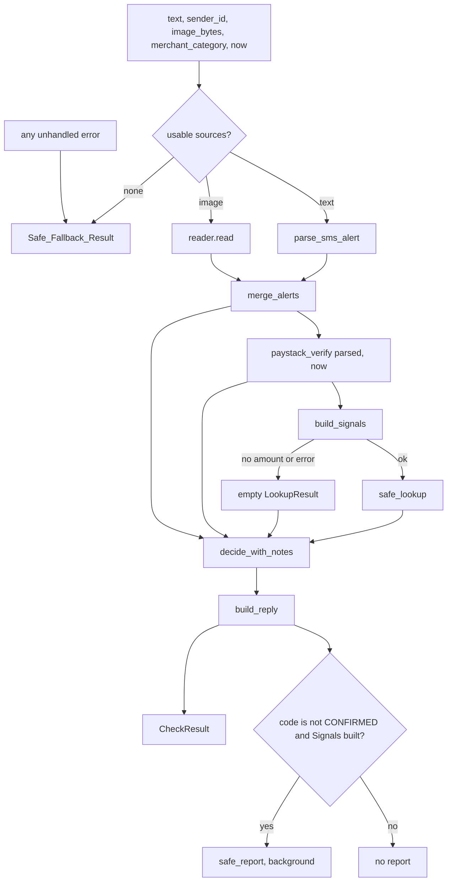
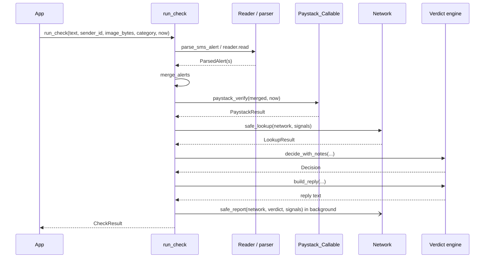

# Design Document

## Overview

The Check_Pipeline is one module, `src/ghost_credit/pipeline.py`. Its main function, `run_check`, takes an alert (SMS text, a screenshot, or both) and returns a `CheckResult`. It wires together parts that other specs own and adds no verdict rules and no AI call.

Steps, in the order the requirements fix (Requirement 1.7):

1. Read the sources and merge them into one `ParsedAlert`.
2. Ask Paystack through an injected callable.
3. Build `Signals` and ask the pattern network (lookup).
4. Call `decide_with_notes` to get the verdict.
5. Call `build_reply` to get the owner's reply.
6. Report to the pattern network in the background.

Design decisions:

| Decision | Reason |
|---|---|
| One module with small private helpers, no classes besides `CheckResult` | The pipeline is glue. A beginner can read it top to bottom. |
| Every dependency is a parameter with a safe default | Tests pass fakes. The defaults (`FakeScreenshotReader`, `make_paystack_verify()`, `NoopPatternNetwork`, `TemplateExplainer`) make no paid or network call unless a key is set (Requirement 1.6). |
| The Paystack secret key is read inside `make_paystack_verify`, never passed through `run_check` | The key cannot reach a `CheckResult`, a log line or an error message (Requirements 3.1 to 3.5). |
| Each step has its own small guard, plus one outer guard around everything | Known failures (reader, Paystack, Signals) have specific recoveries. Any other failure returns the fixed `Safe_Fallback_Result` (Requirement 7.2). |
| The verdict code is read only from the `Decision` | Neither the network, the explainer nor the pipeline can change it (Requirements 4.10, 5.3, 7.8). |
| Merge is its own pure function, `merge_alerts` | It is the one piece of real logic in the pipeline, so it gets its own property tests. |
| The Safe_Fallback_Result is built from constants in `pipeline.py` | It depends on no injected object, so it works when every dependency is broken (Requirement 7.7). |
| Reporting uses `safe_report` from `pattern_network.py` | That function already starts a background thread and swallows errors. The pipeline does not add threads (Requirements 6.4, 6.5). |

Research: no outside sources were needed. The design rests on `requirements.md`, the `src/ghost_credit/*.py` files and the designs of `pattern-network-hook` and `verdict-engine`.

### Reconciliation with the other modules

The names and signatures below were read from the repo on the day this design was written.

| Item | Where it lives | Exact form used here |
|---|---|---|
| `ParsedAlert` | `parser.py`, frozen dataclass | Fields: `amount_kobo`, `currency`, `claimed_bank`, `sender_id`, `account_masked`, `narration`, `alert_time`, `available_balance_kobo`, `claimed_reference`, `red_flags` (list), `screenshot_phash`. Built with `dataclasses.replace`. |
| `parse_sms_alert(text, sender_id)` | `parser.py` | Never raises. Returns a `ParsedAlert`. |
| `RED_FLAG_CODES` | `parser.py` | Six codes today. `TRANSFER_REQUEST_WORDING` is not in the tuple yet (see Open Points). |
| `ScreenshotReader.read(image_bytes)`, `FakeScreenshotReader(recorded_response=None)` | `screenshot.py` | The reader returns a `ParsedAlert` with `sender_id` always None. |
| `PaystackResult`, `verify(parsed, secret_key, now, *, http=None)` | `paystack.py` | Status strings `CONFIRMED`, `NOT_FOUND`, `UNAVAILABLE` are imported from `paystack.py`, not retyped. The unavailable result is built as `PaystackResult(UNAVAILABLE, False, None, None, None, "could not check Paystack")`. |
| `Verdict`, `LookupResult`, `Signals`, `NoopPatternNetwork`, `safe_lookup(network, signals)`, `safe_report(network, verdict, signals)` | `pattern_network.py` (not built yet) | Imported. `LookupResult(network_available=False, matched=False, matches=[])` is the empty lookup. |
| Signals builder | `pattern_network.py` (hook task 5.2) | See "Signals builder contract" below. |
| `decide_with_notes`, `build_reply`, `Decision`, `TemplateExplainer`, `Explainer`, `CHECK_REMINDER` | `verdict.py` | See the note on the module path below. |

**Module path of the verdict engine.** The verdict engine is `src/ghost_credit/verdict.py`, so `pipeline.py` imports from `ghost_credit.verdict`.

### Signals builder contract

The hook design (`.kiro/specs/pattern-network-hook/design.md`) says "One function builds `payer_name_hash`, `payer_account_hash`, `payer_phone_hash` and `merchant_ref` from raw payer values" and its task 5.2 is "Implement the Signals privacy builder". Neither document gives that function a name or arguments. So this design proposes the contract below, and the hook code (task 5.2) must match it.

- **Expected name:** `build_signals`, a public function exported by `src/ghost_credit/pattern_network.py`. The pipeline calls whatever public builder `pattern_network.py` exports. If task 5.2 picks another name, only one import line and one call in `pipeline.py` change.
- **Expected arguments (all keyword-only):**

```python
def build_signals(
    *,
    check_id: str,
    checked_at: str,
    channel: str,                       # "sms" or "screenshot"
    amount_kobo: int,
    currency: str,                      # "NGN"
    claimed_bank: str | None,
    sender_id: str | None,
    claimed_reference: str | None,
    screenshot_phash: str | None,
    red_flags: list[str],
    merchant_category: str,
    payer_name: str | None = None,      # raw, hashed inside, never stored
    payer_account: str | None = None,   # raw, hashed inside, never stored
    payer_phone: str | None = None,     # raw, hashed inside, never stored
) -> Signals: ...
```

- **Behaviour the pipeline relies on:** it fills the three payer hash fields and `merchant_ref` from Hook_Config and the raw payer values, exactly as the hook design table says. The pipeline passes no payer value, so the three payer hash fields are None (Requirement 4.5). It raises `ValueError` if `amount_kobo` is not an integer, and the pipeline's guard covers that (Requirement 4.9).

## Architecture



Sequence for the common success path:



## Components and Interfaces

All names live in `src/ghost_credit/pipeline.py`.

### Constants

| Name | Value |
|---|---|
| `FALLBACK_REASON` | `"The check could not be completed."` |
| `UNAVAILABLE_REASON` | `"could not check Paystack"` |
| `DEFAULT_CATEGORY` | `"other"` |
| `LAGOS` | `timezone(timedelta(hours=1))`, the same fixed +01:00 used in `paystack.py` |
| `CHECK_REMINDER` | Imported from the verdict engine, not retyped. |

### CheckResult

```python
@dataclass(frozen=True)
class CheckResult:
    check_id: str
    parsed: ParsedAlert
    paystack_result: PaystackResult
    verdict: Verdict
    reply: str
    risk_notes: list[str]
```

### run_check

```python
def run_check(
    text, sender_id, image_bytes, merchant_category, now,
    *, reader=None, paystack_verify=None, network=None, explainer=None,
) -> CheckResult
```

Never raises. Steps:

1. `check_id = str(uuid.uuid4())`. Replace any `None` keyword argument with its default (Requirement 1.6).
2. Put everything else inside one `try` block. A `_safe_fallback(check_id, merged)` result is returned from the `except` branch, where `merged` is the Merged_Alert if it was already built, else an empty `ParsedAlert()`.
3. **Sources.** `text_alert = _read_text(text, sender_id)` and `image_alert = _read_image(reader, image_bytes)`. If both are `None`, return `_safe_fallback(check_id, ParsedAlert())` at once, with no Paystack, network or explainer call (Requirement 2.9).
4. **Merge.** `merged = merge_alerts(text_alert, image_alert, sender_id)`.
5. **Paystack.** `paystack_result = _check_paystack(paystack_verify, merged, now)`.
6. **Network lookup.** `signals = _build_signals(...)` (or None). `lookup = safe_lookup(network, signals)` when `signals` is not None, else `_EMPTY_LOOKUP` (Requirements 4.7 to 4.9).
7. **Decide.** `decision = decide_with_notes(merged, paystack_result, lookup, alert_text=text if isinstance(text, str) else None)`.
8. **Reply.** `reply = build_reply(decision.verdict, merged, explainer, decision.risk_notes)`.
9. **Report.** If `signals` is not None and `decision.verdict.code != "CONFIRMED"`, call `_report(network, decision.verdict, signals)`. This helper wraps `safe_report` in try/except and discards any error (Requirements 6.1, 6.5).
10. Return `CheckResult(check_id, merged, paystack_result, decision.verdict, reply, list of str notes)`.

The report is called after the reply is built and before the return. `safe_report` only starts a background thread, so the return is not delayed (Requirement 6.4). The report call is placed inside its own try block so that a failure there never replaces the already-built result with the fallback (Requirement 6.5).

### Source helpers

| Helper | Behaviour | Requirements |
|---|---|---|
| `_text_usable(text)` | True when `text` is a `str` with at least one non-whitespace character. | Alert_Text |
| `_image_usable(image_bytes)` | True when `image_bytes` is `bytes` and not empty. | Alert_Image |
| `_read_text(text, sender_id)` | Returns `parse_sms_alert(text, sender_id if str else None)` when usable, else None. One call. | 2.1 |
| `_read_image(reader, image_bytes)` | Returns the reader's result when usable, else None. If `reader.read` raises, or returns a value that is not a `ParsedAlert`, returns `ParsedAlert()`. Logs only the step name and the exception type. Keeps no reference to the bytes. One call. | 2.2, 2.10, 2.11 |

`image_bytes` is never assigned to anything that outlives the call: no module variable, no field of `CheckResult`, no cache (Requirements 2.11, 8.3).

### merge_alerts

```python
def merge_alerts(text_alert, image_alert, sender_id) -> ParsedAlert
```

Pure and total. Rules (Requirements 2.3 to 2.8, 2.12):

- If both inputs are None, return an empty `ParsedAlert` with `sender_id` set (used only on defensive paths).
- Take the field list from `dataclasses.fields(ParsedAlert)`, so a new field in the parser is merged without an edit. For each field except `red_flags`, `sender_id` and `screenshot_phash`: take the text value when it is not None, else the image value, else None.
- `screenshot_phash`: the image alert's value, or None when there is no image alert.
- `sender_id`: the `sender_id` argument when it is a `str`, else None.
- `red_flags`: `_merge_flags(text_flags, image_flags)`.
- The result is built with a new `ParsedAlert(...)`. Neither input is changed, and the new `red_flags` list is a new list object.

`_merge_flags(a, b)` keeps each code once. Known codes come first, in the order of `FLAG_ORDER`, which is `RED_FLAG_CODES` followed by `TRANSFER_REQUEST_WORDING` when the parser tuple does not already hold it. Any other string code is kept after the known ones in first-seen order, so no flag is dropped. Non-string entries are ignored.

### make_paystack_verify and _check_paystack

```python
def make_paystack_verify(http=None) -> Callable[[ParsedAlert, datetime], PaystackResult]
```

Returns a closure `call(parsed, now)` that reads `os.environ.get("PAYSTACK_SECRET_KEY")` at the moment of the call, converts an empty string to None, and returns `verify(parsed, key, now, http=http)` (Requirements 3.2 to 3.4). `verify` already answers UNAVAILABLE without a network call when the key is missing or is not a test key, so the pipeline adds no key checks. The key is a local variable and is never logged, stored or put in an error text (Requirement 3.5).

`_check_paystack(paystack_verify, parsed, now)`:

1. Call `paystack_verify(parsed, now)` once, with `now` unchanged.
2. If it raises, log the step name and the exception type, and return `_UNAVAILABLE` (Requirement 3.8).
3. If the value is not a `PaystackResult`, return `_UNAVAILABLE` (Requirement 3.9).
4. Otherwise return the same object, unchanged (Requirements 3.6, 3.7).

`_UNAVAILABLE` is a module constant: `PaystackResult(UNAVAILABLE, False, None, None, None, UNAVAILABLE_REASON)`.

### Signals step

`_build_signals(check_id, merged, text, image_bytes, merchant_category, now)` returns a `Signals` or None.

- Returns None when `merged.amount_kobo` is not an integer (a `bool` does not count) (Requirement 4.8).
- `channel` is `"sms"` when the text is usable, else `"screenshot"` (Requirements 4.3, 4.4). The only way to get here without usable text is a usable image.
- `checked_at = _lagos_iso(now)`.
- `merchant_category = _clean_category(merchant_category)`.
- Calls `build_signals(...)` with the fields from the contract above and no payer values.
- Any exception, including a `ValueError` from the builder or a failure in `_lagos_iso`, returns None after a log line with only the step name and the exception type (Requirement 4.9).

`_lagos_iso(now)` treats a naive `datetime` as Lagos time, converts an aware one with `astimezone(LAGOS)`, and returns `isoformat(timespec="seconds")`, for example `2026-11-20T10:02:11+01:00`. A value that is not a `datetime` raises `TypeError`, which `_build_signals` turns into None.

`_clean_category(value)` returns `value.strip()` when `value` is a `str` with a non-empty stripped form, else `"other"` (Requirement 4.6).

### Reply and fallback

`_safe_fallback(check_id, parsed)` returns:

```python
CheckResult(
    check_id=check_id,
    parsed=parsed,
    paystack_result=_UNAVAILABLE,
    verdict=Verdict(code="UNVERIFIED", decided_by="rules", paystack_checked=False,
                    owner_outcome="unknown", reasons=[FALLBACK_REASON]),
    reply=FALLBACK_REASON + " " + CHECK_REMINDER,
    risk_notes=[],
)
```

It reads no injected object (Requirement 7.7). Each call builds a new `Verdict` and a new `reasons` list, so a caller cannot change a shared object.

### Logging

The module logs through `logging.getLogger("ghost_credit.pipeline")`. The only helper is `_log_failure(step, exc)`, which writes `"step %s failed: %s"` with the step name and `type(exc).__name__`. No alert text, sender, image, hash, key or Signals value is ever passed to a logger (Requirements 8.1, 8.2). The module opens no file and writes nothing to disk (Requirement 8.4).

## Data Models

| Type | Source | How it is used |
|---|---|---|
| `CheckResult` | defined here, frozen | Result of `run_check`. Six fields, listed above. |
| `ParsedAlert` | `parser.py` | The merged alert is stored in `CheckResult.parsed`. |
| `PaystackResult` | `paystack.py` | Passed through unchanged. `_UNAVAILABLE` is the only one this module builds. |
| `Signals`, `LookupResult`, `Verdict` | `pattern_network.py` | Built by `build_signals`, returned by `safe_lookup`, produced by the engine. |
| `Decision` | verdict engine | `verdict` and `risk_notes` are copied into `CheckResult`. |

Money is an integer in kobo everywhere. The pipeline does no arithmetic on money (Requirement 8.5).

## Correctness Properties

*A property is a characteristic or behavior that should hold true across all valid executions of a system-essentially, a formal statement about what the system should do. Properties serve as the bridge between human-readable specifications and machine-verifiable correctness guarantees.*

Reflection: criteria 1.3, 1.4, 1.5, 4.10, 5.1, 5.2, 5.3 and 7.8 merge into the model-based Property 4. Criteria 2.3, 2.4, 2.5, 2.7, 2.8 and 2.12 merge into Property 6. Criteria 4.2 to 4.5 merge into Property 9. Criteria 6.1, 6.2, 6.3, 6.6 and 6.7 merge into Property 11. Criteria 5.6 and 5.7 are two concrete network cases, so they stay as example tests. Criteria 1.6 to 1.8, 2.9 to 2.11, 3.1 to 3.5, 3.8, 3.9, 6.4, 6.5, 7.3 to 7.7, 8.1 to 8.5 are example or smoke tests (see the Testing Strategy). Criteria 8.6, 8.7 and Requirement 9 are process rules and are not testable.

### Property 1: Run_Check is total and returns a valid result

For any `text`, `sender_id`, `image_bytes`, `merchant_category` and `now` (including None and values of the wrong type), and for any reader, Paystack_Callable, network and explainer that each either succeed or raise, `run_check` does not raise, returns a `CheckResult` whose `check_id` is a UUID version 4 string, whose `verdict.code` is one of `CONFIRMED`, `NOT_FOUND`, `SUSPICIOUS` or `UNVERIFIED`, and whose `reply` is a string.

**Validates: Requirements 1.2, 1.3, 7.1, 7.2, 9.2**

### Property 2: CONFIRMED matches the engine, and the result passes through

For any alert inputs, any network behaviour, any explainer and any `PaystackResult`, the verdict code is `CONFIRMED` if and only if `decide_with_notes` called directly with the same merged alert, the same `PaystackResult` and the same LookupResult returns `CONFIRMED` (a model-based check). The verdict code is never `CONFIRMED` when the result's `status` is not "CONFIRMED". `CheckResult.paystack_result` is the same object the Paystack_Callable returned.

**Validates: Requirements 3.6, 3.7, 5.5, 9.3**

### Property 3: Dependency failures never produce CONFIRMED or an error

For any input where the Paystack_Callable raises or returns a value that is not a `PaystackResult`, `run_check` continues the check with the Unavailable_Paystack_Result, and the verdict code is not `CONFIRMED`.

**Validates: Requirements 3.8, 3.9, 5.5**

### Property 4: The verdict comes only from the engine (model-based)

For any inputs, with any network answer and any explainer, `CheckResult.verdict` equals the `verdict` of `decide_with_notes(merged, paystack_result, lookup, alert_text=...)` called directly with the same merged alert, Paystack_Result and LookupResult. `CheckResult.risk_notes` equals the `risk_notes` of that Decision, and `CheckResult.reply` equals `build_reply` called directly with the same explainer.

**Validates: Requirements 1.4, 1.5, 4.10, 5.1, 5.2, 5.3, 7.8**

### Property 5: Replies for unconfirmed verdicts end with the reminder

For any inputs whose verdict code is `NOT_FOUND`, `SUSPICIOUS` or `UNVERIFIED`, including the Safe_Fallback_Result, `reply` ends with the Check_Reminder, and `CheckResult.verdict.code` is never changed after `decide_with_notes` returns.

**Validates: Requirements 5.4, 7.4, 9.5**

### Property 6: Merge keeps text values first, fills gaps from the screenshot

For any two `ParsedAlert` values `text_alert` and `image_alert` and any `sender_id`, `merge_alerts` gives, for each field except `red_flags`, `sender_id` and `screenshot_phash`, the text value when it is not None, else the screenshot value. `screenshot_phash` equals the screenshot alert's value (None when there is no screenshot alert). `sender_id` equals the argument when it is a string, else None. With only one source, the merged alert equals that source apart from `sender_id`. Both inputs, including their `red_flags` lists, equal deep copies taken before the call.

**Validates: Requirements 2.3, 2.4, 2.5, 2.7, 2.8, 2.12, 9.4**

### Property 7: Merged red flags are the ordered union

For any two lists of red flag codes, the merged `red_flags` holds every code from either list exactly once, holds known codes in `FLAG_ORDER` order before any other codes, and holds `SCREENSHOT_EDIT_SIGNS` and `TRANSFER_REQUEST_WORDING` whenever either list holds them.

**Validates: Requirements 2.6, 9.4**

### Property 8: Sources are read once when, and only when, usable

For any `text` and `image_bytes` values, `parse_sms_alert` is called exactly once when the text is a string with a non-whitespace character and not at all otherwise, and `reader.read` is called exactly once when `image_bytes` is non-empty `bytes` and not at all otherwise. When neither is usable, the result is the Safe_Fallback_Result and the Paystack_Callable, network and explainer receive no call.

**Validates: Requirements 2.1, 2.2, 2.9**

### Property 9: Signals carry the merged alert and no payer data

For any merged alert with an integer `amount_kobo`, any `now` (naive or aware) and any `merchant_category`, the Signals passed to `safe_lookup` has `check_id` equal to the result's `check_id`; `checked_at` equal to `now` as ISO 8601 text at offset `+01:00` naming the same instant (a naive `now` read as Lagos time); `amount_kobo`, `claimed_bank`, `sender_id`, `claimed_reference`, `screenshot_phash` and `red_flags` equal to the merged alert's values; `currency` "NGN"; `channel` "sms" when the text is usable and "screenshot" otherwise; and all three payer hash fields None.

**Validates: Requirements 4.1, 4.2, 4.3, 4.4, 4.5**

### Property 10: Merchant category is trimmed or defaults to "other"

For any `merchant_category` value, the Signals `merchant_category` equals the value stripped of surrounding whitespace when it is a string that is not empty after stripping, and equals "other" otherwise.

**Validates: Requirements 4.6**

### Property 11: Reports follow the verdict and reuse the lookup Signals

For any inputs, `safe_report` is called exactly once, after the reply is built, when Signals were built and the verdict code is `NOT_FOUND`, `SUSPICIOUS` or `UNVERIFIED`, and is not called when the code is `CONFIRMED`, when no Signals were built, or on the Safe_Fallback_Result path. The Signals passed to `safe_report` is the same object, with the same `check_id`, as the one passed to `safe_lookup`, and the reported verdict has `owner_outcome` "unknown".

**Validates: Requirements 6.1, 6.2, 6.3, 6.6, 6.7**

### Property 12: No amount means no network traffic

For any inputs where the merged alert has no integer `amount_kobo`, `run_check` calls neither `safe_lookup` nor `safe_report`, and the engine receives a LookupResult with `network_available` False, `matched` False and an empty `matches` list. The same holds when the Signals builder raises.

**Validates: Requirements 4.8, 4.9**

## Error Handling

| Situation | Handling |
|---|---|
| Neither text nor image is usable | Safe_Fallback_Result at once. No Paystack, network or explainer call (Requirement 2.9). |
| `reader.read` raises or returns a non-`ParsedAlert` | Treated as an empty `ParsedAlert`. The check continues. One log line with the step name and exception type (Requirement 2.10). |
| Paystack_Callable raises or returns a non-`PaystackResult` | `_UNAVAILABLE` is used. The check continues (Requirements 3.8, 3.9). |
| `PAYSTACK_SECRET_KEY` unset or empty | `make_paystack_verify` passes None, and `verify` returns UNAVAILABLE with no network call (Requirement 3.4). |
| No integer `amount_kobo`, or the Signals builder raises | No Signals, an empty LookupResult, no report (Requirements 4.8, 4.9). |
| `safe_lookup` raises (it should not) | Falls under the unhandled-error rule, so the Safe_Fallback_Result is returned. |
| `safe_report` raises | The error is discarded. The finished result is returned (Requirement 6.5). |
| Explainer raises or returns bad text | Handled inside `build_reply`, which falls back to the reasons and still enforces the Check_Reminder. |
| Any other exception | Safe_Fallback_Result with the Merged_Alert if it exists, else an empty `ParsedAlert` (Requirements 7.2, 7.5). |

The Safe_Fallback_Result never says money arrived (UNVERIFIED, `paystack_checked` False). It has the reply `The check could not be completed. Check your own bank app before releasing goods.`

Secrets and privacy: the key lives only inside the Paystack_Callable. Logs hold only the step name and the exception type. The image bytes are used only for the read and are not kept.

## Testing Strategy

Property-based testing applies because `run_check` and `merge_alerts` are logic over a large input space, and every dependency can be replaced by an in-memory fake. Library: Hypothesis (already used in `tests/`). No property-based testing is built from scratch. Test file: `tests/test_pipeline.py`. All tests use synthetic data only, set `PATTERN_NETWORK=off`, make no network call, no AI call and no live Paystack call, and need no real key.

**Property tests** (Requirements 9.2 to 9.5):

- One Hypothesis test for each of Properties 1 to 12, each with at least 100 examples (`@settings(max_examples=100)` or more).
- Each test carries the tag comment `Feature: check-pipeline, Property N: <property text>`.
- Fakes, defined at the top of the file:
  - `RecordingReader`: counts calls, returns a given `ParsedAlert`, or raises, or returns junk.
  - `FakePaystack`: returns a given object (a `PaystackResult`, junk, or raises) and records its arguments.
  - `RecordingNetwork`: a `PatternNetwork` that records the Signals from `lookup_patterns` and the calls to `report_pattern`, returns a given `LookupResult`, and can raise. Tests that read `safe_report` calls wait for the background thread with a short `threading.Event`, so they stay fast and deterministic.
  - `FakeExplainer` (from the engine) and a few small explainers that return arbitrary text, return a non-string, or raise.
- Generators: `ParsedAlert` built from optional kobo integers, short text, naive `datetime`, and flag subsets (including `TRANSFER_REQUEST_WORDING` and unknown codes); text values that are strings (blank and non-blank), None and other types; bytes values that are empty, non-empty, None and other types; `now` as naive and aware datetimes at several offsets, plus junk; `merchant_category` as text, blank text, None and other types. `PaystackResult` values are built only in the shapes that `paystack.verify` can return (`CONFIRMED` always with `checked` True, `NOT_FOUND` with `checked` True or False, `UNAVAILABLE`).

**Example tests** (Requirements 9.6 to 9.10):

- One run for each verdict path: CONFIRMED with no report call; NOT_FOUND; SUSPICIOUS from red flags; UNVERIFIED; a screenshot and text merge; a network match that turns UNVERIFIED into SUSPICIOUS (5.6) and the same alert without a match giving UNVERIFIED (5.7).
- `safe_report` called once for each non-CONFIRMED code and not for CONFIRMED.
- Defaults: `run_check` with no keyword arguments, `PATTERN_NETWORK=off`, gives a valid result (1.6, 9.8).
- Call order: a shared recorder shows read, Paystack, lookup, then report (1.7). Arguments to the Paystack_Callable are the merged alert and the same `now` object (3.1, 3.10).
- Failure paths: a dependency that raises and reaches the Safe_Fallback_Result with the fixed values and reply (7.3 to 7.7); no usable text or image; an unreadable screenshot; a Paystack_Callable that raises; an UNAVAILABLE `PaystackResult` passed on unchanged (3.7); a slow `report_pattern` that does not delay the return (6.4); a `report_pattern` that raises (6.5).
- Risk notes: a Friday-afternoon `alert_time` and an `alert_text` mentioning a rider both appear in `CheckResult.risk_notes`.
- Flags: `SCREENSHOT_EDIT_SIGNS` and `TRANSFER_REQUEST_WORDING` survive the merge.
- `make_paystack_verify`: with a fake `http` function and an obviously fake test key set through `monkeypatch`, the Authorization header carries the key; with the variable unset or empty, no `http` call is made and the result is UNAVAILABLE (3.2 to 3.4).
- Secret key: with a fake key set, the key text is absent from the `CheckResult` (as text), from captured log output (`caplog`) and from the text of an error raised by a failing dependency (3.5, 9.10).

**Smoke checks:**

- The source of `pipeline.py` holds no AI model name, AI client import, HTTP library or socket import, `open(` call, float arithmetic on money, or secret (1.8, 8.4, 8.5, 8.7).
- `run_check` has the parameter order in Requirement 1.1.
- No module-level name in `pipeline.py` holds image bytes (8.3).

Because the pattern-network-hook and verdict-engine modules are not built yet, the pipeline tests can run only after those specs' tasks are done (see the implementation order).

## Suggested Implementation Order

Do this only after `pattern_network.py` (with `build_signals`) and the verdict engine exist.

1. **Skeleton and fixed pieces.** Create `src/ghost_credit/pipeline.py` with imports, constants, `CheckResult`, `_UNAVAILABLE`, `_log_failure`, `_safe_fallback`, `make_paystack_verify`, `_lagos_iso` and `_clean_category`.
   - Tests: fallback shape example; `make_paystack_verify` examples; Property 10. Requirements 3.2 to 3.5, 4.6, 7.3 to 7.7.
2. **Read and merge.** Add `_text_usable`, `_image_usable`, `_read_text`, `_read_image`, `merge_alerts` and `_merge_flags`.
   - Tests: Properties 6 and 7; unreadable-screenshot example. Requirements 2.1 to 2.8, 2.10 to 2.12.
3. **Paystack and network steps.** Add `_check_paystack`, `_build_signals`, the empty-lookup constant and `_report`.
   - Tests: Paystack failure examples; Properties 9 and 12; Signals builder failure example. Requirements 3.1, 3.6 to 3.10, 4.1 to 4.9.
4. **Wire `run_check`.** Add defaults, the source step, the outer guard, `decide_with_notes`, `build_reply`, the report call and the result.
   - Tests: Properties 1 to 5, 8 and 11; the verdict-path, call-order, default and report examples. Requirements 1, 2.9, 5, 6, 7.
5. **Smoke checks and secrets.** Add the source scan, the parameter-order check and the secret-key and log-capture example.
   - Requirements 1.8, 3.5, 8, 9.10.
6. **Checkpoint.** Run the whole suite with `PATTERN_NETWORK=off` and fix any failure. Requirement 9.8.

## Open Points

- **Signals builder name and arguments.** The hook design and tasks name no function. This design expects `build_signals` with the keyword-only arguments listed above. The hook code (task 5.2) must match, or the hook design must be updated and the one call in `pipeline.py` changed.
- **`TRANSFER_REQUEST_WORDING` is not in `RED_FLAG_CODES` yet.** `parser.py` lists six codes. The pipeline keeps the code during the merge through its own `FLAG_ORDER`, so nothing is lost. The parser spec or code should add it.
- **Outdated docstring in `paystack.py`.** It says the verdict engine has its own `PaystackResult`. It does not, so the docstring needs a fix in a later code change.
- **Network hook is not built.** `src/ghost_credit/pattern_network.py` and the verdict engine do not exist yet, so no pipeline code or test can run until they do.
