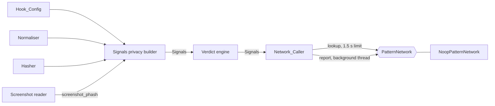
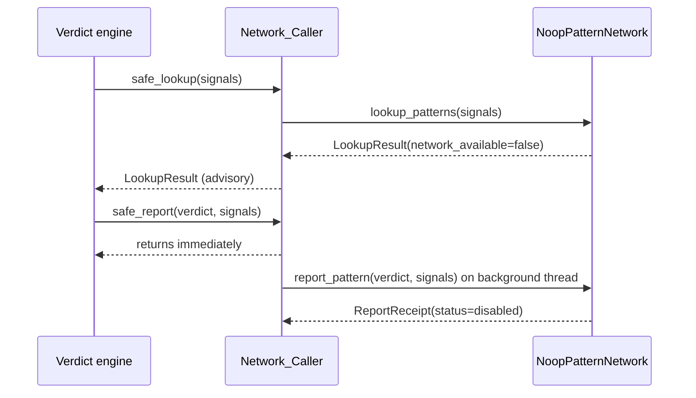

# Design Document

## Overview

This feature adds one module, `src/ghost_credit/pattern_network.py`, that holds the `PatternNetwork` plug socket defined by `docs/pattern-network-contract.md` v1.0. The repo ships only the off version: an abstract interface, the contract dataclasses, normalisation and hashing helpers, configuration reading, safe calling rules (1.5 second lookup timeout, fire-and-forget report) and `NoopPatternNetwork`.

The module contains no network code and no Fake Alert Shield code. It imports only the Python standard library (`abc`, `dataclasses`, `os`, `re`, `hmac`, `hashlib`, `logging`, `concurrent.futures`/`threading`, `typing`).

Design decisions:

| Decision | Rationale |
|---|---|
| One module, no package split | Requirements name a single module. Other specs import `Verdict` and `LookupResult` from it. |
| Standard-library `dataclasses` with validation in `__post_init__` | Matches the existing parser style, adds no dependency, and gives the ValueError rules in Requirement 2. |
| Explicit `to_dict` / `from_dict` functions per dataclass | `from_dict` picks known keys only, so unknown fields are ignored (contract rule 7). |
| Configuration read at call time, not import time | Tests can change the environment between calls. Hook_Off hides the key and merchant_ref by construction. |
| Lookup runs in a worker thread with a 1.5 s wait | Gives a hard upper bound on waiting using only the standard library. |
| Report runs on a daemon thread | The caller returns at once. Errors are caught and logged without payload data. |
| Invalid input returns None, never a guess | Conservative rule from the requirements. |
| No function maps a LookupResult to CONFIRMED | Contract safety rule 1. The network can only be advisory. |

Research summary: the contract is the single source of truth, so no external research was needed. The HMAC and E.164 rules use the Python standard library and the E.164 form defined in the contract (`+234` plus 10 digits).

## Architecture

Flow with the hook off (the only shipped state):

Layers inside the module, bottom to top: dataclasses and validation, Normaliser, Hasher, Hook_Config, Signals privacy builder, PatternNetwork and Noop_Network, Network_Caller.

## Components and Interfaces

### PatternNetwork (abstract)

| Member | Input | Output | Requirements |
|---|---|---|---|
| `lookup_patterns` | Signals | LookupResult | 1.1 |
| `report_pattern` | Verdict, Signals | ReportReceipt | 1.2 |

### NoopPatternNetwork

Implements both methods with constant answers. It does no I/O, keeps no state and writes nothing (4.4). Its answers equal the contract hook-off example (4.3).

### Hook_Config

| Function | Behaviour | Requirements |
|---|---|---|
| `is_hook_on()` | Reads `PATTERN_NETWORK`. True only when the trimmed, lowercased value is "on". | 3.1 to 3.4 |
| `get_hmac_key()` | Returns `PATTERN_NETWORK_HMAC_KEY` when Hook_On, else None. | 3.5, 3.7 |
| `get_merchant_ref()` | Returns `PATTERN_NETWORK_MERCHANT_REF` when Hook_On, else None. | 3.6, 3.7 |
| `get_network()` | Always returns a Noop_Network, whatever the setting. | 3.9 |

An empty key string is treated as no key. No key value appears in source, defaults, logs, errors or any dataclass string form (3.8).

### Normaliser

| Function | Rule | Requirements |
|---|---|---|
| `normalise_name(raw)` | Uppercase, drop characters that are not letters, digits or whitespace, collapse whitespace runs to one space, trim. None or empty result gives None. | 5.1, 5.2, 5.8 |
| `normalise_phone(raw)` | Accepts `+234` + 10 digits, `234` + 10 digits or `0` + 10 digits, with optional spaces, hyphens or round brackets. Returns `+234` + 10 digits. Anything else gives None. | 5.3 to 5.5, 5.9, 5.11 |
| `normalise_account(raw)` | Exactly 10 digits, optional spaces or hyphens between digits. Masked, lettered or wrong-length input gives None. | 5.6, 5.7, 5.10 |

### Hasher

`hash_value(normalised, key)` returns "hmac:" plus the 64 lowercase hex characters of HMAC-SHA256 over the UTF-8 value with the key (69 characters in total). None value or None/empty key returns None (6.1 to 6.4).

### Signals privacy builder

One function builds `payer_name_hash`, `payer_account_hash`, `payer_phone_hash` and `merchant_ref` from raw payer values (6.5):

| State | payer hashes | merchant_ref |
|---|---|---|
| Hook_Off | None | None (6.6) |
| Hook_On, no key | None (6.8) | configured value |
| Hook_On, key set | Hash_String of normalised value, or None if normalisation gives None (6.7) | configured value |

Raw payer name, phone and account never enter a Signals field (6.9). The screenshot reader supplies `screenshot_phash` as an input.

### Network_Caller

| Function | Behaviour | Requirements |
|---|---|---|
| `safe_lookup(network, signals)` | Runs `lookup_patterns` in a worker and waits at most 1.5 s. On timeout, exception, or a result that is not a LookupResult, returns a LookupResult with network_available false, matched false, matches empty. Logs the event type only. Returns the result unchanged otherwise. Never touches a Verdict. | 7.1 to 7.6 |
| `safe_report(network, verdict, signals)` | If `verdict.code` is CONFIRMED, does nothing. Otherwise starts a daemon thread that calls `report_pattern` and returns at once. The thread catches every exception and logs the event type only. The verdict (including `owner_outcome`) and `signals.check_id` are passed through unchanged, so a later call with the same check_id and a new owner_outcome is an update. | 8.1 to 8.7 |

No function in the module converts a LookupResult into CONFIRMED (7.7).

## Data Models

All dataclasses use the contract field names and types. Money is an integer in kobo.

| Dataclass | Fields | Validation |
|---|---|---|
| Signals | schema_version ("1.0" default), check_id, checked_at, channel, amount_kobo (int), currency, claimed_bank, sender_id, claimed_reference, payer_name_hash, payer_account_hash, payer_phone_hash, screenshot_phash, red_flags (list of str), merchant_ref, merchant_category | amount_kobo must be an integer, else ValueError naming `amount_kobo` (2.7). Booleans are not accepted as integers. |
| Verdict | code, decided_by ("rules" default), paystack_checked, owner_outcome, reasons (list of str) | code in CONFIRMED, NOT_FOUND, SUSPICIOUS, UNVERIFIED, else ValueError naming `code` (2.8). owner_outcome in "unknown", "fake", "real", else ValueError naming `owner_outcome` (2.9). |
| Match | pattern_id, matched_on (list of str), first_seen, times_seen, shops_seen, last_verdict, confidence (0 to 1), summary (optional) | None beyond contract types |
| LookupResult | schema_version ("1.0" default), network_available, matched, matches (list of Match), trace_url (optional) | None |
| ReportReceipt | schema_version ("1.0" default), accepted, status, pattern_id, trace_url (optional) | status in "disabled", "queued", "rejected", else ValueError naming `status` (2.10). |

Conversion: `to_dict` produces plain dictionaries (LookupResult nests Match dictionaries). `from_dict` reads only contract fields and ignores others (2.12, 2.13). Dataclass string forms hold only the fields above, and no key is ever a field.

Hash_String: "hmac:" followed by 64 lowercase hexadecimal characters.

Hook-off JSON: `to_dict` of the Noop results equals the contract section "Example: what this repo returns (hook off)" (4.3).

## Correctness Properties

*A property is a characteristic or behavior that should hold true across all valid executions of a system-essentially, a formal statement about what the system should do. Properties serve as the bridge between human-readable specifications and machine-verifiable correctness guarantees.*

Redundancy review: criterion 2.12 is covered by the first property below. Criterion 6.5 is covered by the Hook_On Signals property. Criteria 5.3, 5.9 and 5.11 merge into the phone property. Criteria 6.3, 6.4 and 6.8 merge into the missing-inputs property. Criteria 7.2, 7.3 and 7.4 merge into the lookup fallback property. Criteria 3.7 and 6.6 merge into the Hook_Off property. Criteria 8.5, 8.6 and 8.7 merge into the pass-through property.

### Property 1: Dataclass round trip

For any valid Signals, Verdict, Match, LookupResult or ReportReceipt, converting it to a dictionary and back to a dataclass produces an equal value.

**Validates: Requirements 2.12, 2.14**

### Property 2: Unknown fields are ignored

For any valid dataclass dictionary and any extra keys not defined in the contract, building the dataclass from the extended dictionary produces the same value as building it from the original dictionary.

**Validates: Requirements 2.13**

### Property 3: Invalid values are rejected by name

For any non-integer amount_kobo value, any Verdict code outside the four allowed codes, any owner_outcome outside "unknown", "fake" and "real", and any ReportReceipt status outside "disabled", "queued" and "rejected", construction raises a ValueError whose message names the offending field.

**Validates: Requirements 2.7, 2.8, 2.9, 2.10**

### Property 4: Hook flag parsing

For any string value of PATTERN_NETWORK, Hook_Config reports Hook_On if and only if the value, trimmed and lowercased, equals "on". An unset variable reports Hook_Off.

**Validates: Requirements 3.2, 3.3, 3.4**

### Property 5: Hook_Off hides secrets and hashes

For any PATTERN_NETWORK value that is not the on value, any HMAC key and any merchant_ref in the environment, and any raw payer values, Hook_Config returns no key and no merchant_ref, and the built Signals has None for payer_name_hash, payer_account_hash, payer_phone_hash and merchant_ref.

**Validates: Requirements 3.7, 6.6**

### Property 6: Noop answers are constant

For any Signals and any Verdict, Noop_Network returns the same LookupResult (schema_version "1.0", network_available false, matched false, matches empty, trace_url None) and the same ReportReceipt (accepted false, status "disabled", pattern_id None, trace_url None).

**Validates: Requirements 4.1, 4.2, 4.5**

### Property 7: Name normalisation

For any string, normalising a name twice gives the same result as normalising once, and any non-None result is uppercase, has only letters, digits and single spaces, and has no leading or trailing whitespace. For any None or string that holds no letters or digits, the result is None.

**Validates: Requirements 5.1, 5.2, 5.8**

### Property 8: Phone normalisation across accepted forms

For any 10 subscriber digits and any of the three accepted forms (`+234`, `234`, `0`) with optional spaces, hyphens or round brackets, the Normaliser returns "+234" followed by those 10 digits. The result is identical across the three forms, and normalising the result again returns the same value.

**Validates: Requirements 5.3, 5.9, 5.11**

### Property 9: Invalid phones give None

For any string that does not match an accepted phone form (including 9 subscriber digits, 11 subscriber digits, letters, and None), the Normaliser returns None.

**Validates: Requirements 5.5**

### Property 10: Account normalisation

For any 10-digit string with optional spaces or hyphens between digits, the Normaliser returns exactly those 10 digits, and normalising the result again returns the same value. For any string that is masked, contains letters, or does not hold exactly 10 digits, or None, the result is None.

**Validates: Requirements 5.6, 5.7, 5.10**

### Property 11: Hash format and value

For any non-None value and non-empty key, the Hasher returns a string of exactly 69 characters made of "hmac:" and 64 lowercase hexadecimal characters, equal to the HMAC-SHA256 digest of the UTF-8 value computed with the key.

**Validates: Requirements 6.1, 6.2**

### Property 12: Hash equality follows value equality

For any two raw values that normalise to the same value and any key, the Hash_Strings are equal. For any two different normalised values and the same key, the Hash_Strings are different.

**Validates: Requirements 6.10, 6.11**

### Property 13: Missing inputs give None

For any key, a None value gives None. For any value, a None or empty key gives None. While Hook_On with no key configured, all three payer hash fields of the built Signals are None.

**Validates: Requirements 6.3, 6.4, 6.8**

### Property 14: Hook_On Signals carry hashes only

For any raw payer name, phone and account, while Hook_On with a key configured, each payer hash field equals the Hash_String of the normalised raw value, or None when normalisation returns None, and no Signals field equals or contains the raw name, phone or account.

**Validates: Requirements 6.5, 6.7, 6.9**

### Property 15: Lookup falls back safely

For any stub network that raises any exception, returns a non-LookupResult value, or takes longer than 1.5 seconds, safe_lookup returns a LookupResult with network_available false, matched false and matches empty, and returns within the limit plus a small margin.

**Validates: Requirements 7.1, 7.2, 7.3, 7.4**

### Property 16: Lookup is advisory and logs no payload data

For any Signals, Verdict and stub LookupResult, safe_lookup returns the stub result unchanged and leaves the Verdict unchanged. For any failing lookup, the log output contains no Signals value, no hash and no HMAC key.

**Validates: Requirements 3.8, 7.5, 7.6**

### Property 17: Reports follow the verdict code

For any Verdict and Signals, safe_report submits exactly one report to the network when the code is NOT_FOUND, SUSPICIOUS or UNVERIFIED, and submits none when the code is CONFIRMED.

**Validates: Requirements 8.1, 8.2**

### Property 18: Report failures stay hidden and do not block

For any stub network whose report raises any exception or runs slowly, safe_report returns to the caller without raising and without waiting for the stub, and the log output contains no Signals value, hash or key.

**Validates: Requirements 8.3, 8.4**

### Property 19: Reports pass identity and outcome through

For any Signals and any two Verdicts with different owner_outcome values, two safe_report calls with the same check_id deliver both reports with that check_id and each owner_outcome unchanged. A Verdict built without an answer carries "unknown".

**Validates: Requirements 8.5, 8.6, 8.7**

## Error Handling

| Situation | Handling |
|---|---|
| Invalid amount_kobo, code, owner_outcome or status | ValueError naming the field (Requirement 2). |
| Unrecognised fields in an incoming dictionary | Ignored. |
| Unparseable name, phone or account | Normaliser returns None. |
| Missing or empty HMAC key | Hasher and builder return None for hashes. |
| PATTERN_NETWORK unset, empty or any value other than "on" | Hook_Off. |
| Lookup timeout, exception or wrong return type | Fallback LookupResult, event logged by type only. |
| Report exception | Discarded and logged by type only. The owner's reply is unchanged. |

Log messages never include Signals values, hashes or keys.

## Testing Strategy

Property-based testing applies because the module is mostly pure logic (normalisation, hashing, serialisation, validation, call rules). Hypothesis is already used in `tests/` and is the chosen library. No property-based testing is built from scratch.

Property tests:
- One Hypothesis test per property above, each run with at least 100 examples.
- Each test carries a comment tag in the form **Feature: pattern-network-hook, Property N: property text**.
- Timeout and slow-report properties use stub networks with short sleeps and few examples, to keep the run fast. Time limits are asserted with a small margin.
- Environment changes use pytest's monkeypatch, so PATTERN_NETWORK is unset by default.

Unit and example tests (kept few):
- The hook-off JSON from a lookup and a report through the Network_Caller with PATTERN_NETWORK "off" equals the contract example (4.3, 4.6, 9.2).
- Phone "0803 123 4567" returns "+2348031234567"; a name with punctuation; a masked account "012****789"; a 9-digit account; a 9-subscriber-digit phone (9.4).
- A lookup stub that sleeps over 1.5 s returns network_available false (9.5).
- Hook_Off hides key and merchant_ref even when both variables are set (9.6).
- Dataclass field names match the contract tables (2.1 to 2.4), schema_version defaults (2.5), decided_by default (2.11).

Smoke checks:
- The module imports no HTTP client, socket or other network library, and contains no Shield code (1.4, 1.5).
- Exports exist (1.3). Noop_Network is the only PatternNetwork subclass (3.9). No function converts a LookupResult to CONFIRMED (7.7).

Test hygiene: no real network connection, only fixed test HMAC keys, and the suite passes with PATTERN_NETWORK unset (9.1, 9.7, 9.8).

## Suggested Implementation Order

1. Create the module with the dataclasses, validation, `to_dict` and `from_dict` (Requirement 2), plus the round-trip, unknown-field and invalid-value tests.
2. Add the abstract PatternNetwork and Noop_Network, and the hook-off JSON example test (Requirements 1, 4).
3. Add the Normaliser for name, phone and account, with idempotence and metamorphic property tests and the example tests (Requirement 5).
4. Add the Hasher and its property tests (Requirement 6.1 to 6.4, 6.10, 6.11).
5. Add Hook_Config and the Signals privacy builder, with the Hook_Off and no-key tests (Requirements 3, 6.5 to 6.9).
6. Add `safe_lookup` with the 1.5 s timeout and fallback tests (Requirement 7).
7. Add `safe_report` with fire-and-forget, update and error tests (Requirement 8).
8. Add the smoke checks (no network imports, exports, single implementation, no CONFIRMED mapping) and run the full suite with PATTERN_NETWORK unset (Requirements 1, 9).
