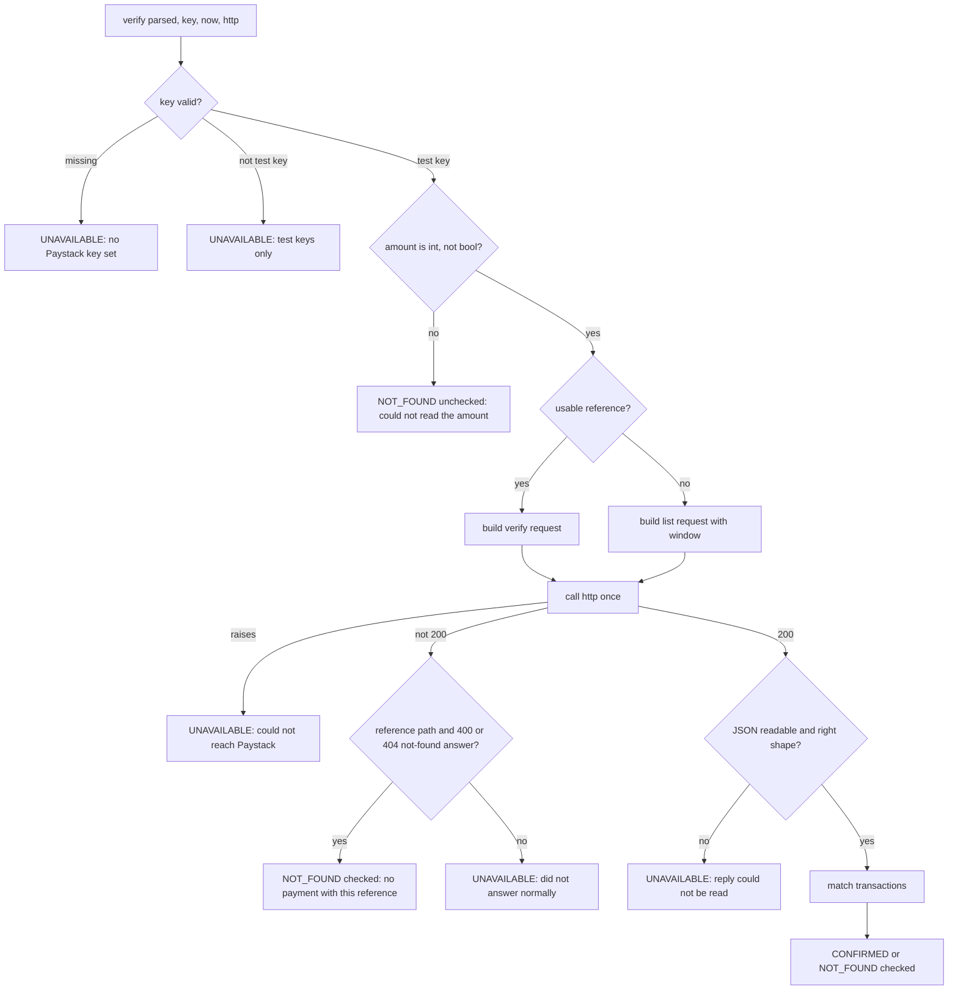

# Design Document

## Overview

The Paystack_Verifier is one module, `src/ghost_credit/paystack.py`. Its public function `verify(parsed, secret_key, now, *, http=None)` decides whether the payment named in a `ParsedAlert` exists in the shop's own Paystack test account. It makes at most one read-only GET call, compares the answer with the alert, and returns a frozen `PaystackResult`. It is the only place in Ghost Credit that can say `CONFIRMED`.

Design choices:
- **Pure core, thin I/O edge.** All decisions (key check, amount check, request building, response matching) are small pure functions. The only I/O is one call to an injected `Http_Function`, so tests pass a fake and never touch the network.
- **Standard library only.** `urllib.request`, `urllib.parse`, `json` and `datetime`. No new dependency.
- **Fail closed.** Anything unexpected (bad key, bad shape, exception, non-200) gives `UNAVAILABLE` or `NOT_FOUND`. The one non-200 case that gives `NOT_FOUND` is a clear "transaction not found" answer on the reference path. `CONFIRMED` needs every condition in Requirement 7.5 to hold.
- **Fixed reasons.** Every `reason` is a constant string. No text from Paystack and no part of the key ever enters a reason.
- **Reads `ParsedAlert` narrowly.** The module imports `ParsedAlert` from `src/ghost_credit/parser.py` (a frozen dataclass) and reads only three fields: `amount_kobo` (`int | None`), `claimed_reference` (`str | None`, taken from labels such as `Ref`, `Reference` or `Session ID`) and `alert_time` (`datetime | None`, naive, so it is read as Lagos time). Other fields (`red_flags`, `sender_id`, `screenshot_phash` and so on) are ignored. `parsed` is read with `getattr(..., None)`, so a non-`ParsedAlert` object cannot raise.

Research notes: the Paystack verify endpoint (`GET /transaction/verify/:reference`) and list endpoint (`GET /transaction`, with `status`, `from`, `to`, `perPage`) return a JSON object with a `data` field and amounts in kobo. This matches the `payments-nigeria` rules and the requirements. No further research was needed, and the design makes no live call.

Out of scope for this module: `scripts/paystack_smoke.py`. That is a separate, manual script. It reads `PAYSTACK_SECRET_KEY` from the environment or a `.env` file using the standard library, calls `verify` for the made-up reference `GC-SMOKE-0001`, prints only the status and reason, and never prints the key. Tests do not run it, and `paystack.py` never reads a key itself (Requirement 9.5).

## Architecture



The whole body of `verify` sits inside one `try/except Exception`, with a last-resort `UNAVAILABLE` (`"could not check Paystack"`), so the function is total (Requirement 6.6). The key checks run first and do not touch `parsed` (Requirement 2.3).

## Components and Interfaces

All functions live in `src/ghost_credit/paystack.py`. Each has type hints and a short plain-English docstring.

### Public

```python
@dataclass(frozen=True)
class PaystackResult:
    status: str                      # "CONFIRMED" | "NOT_FOUND" | "UNAVAILABLE"
    checked: bool                    # True when Paystack answered 200 with readable JSON, or 400/404 not-found on the reference path
    matched_reference: str | None
    amount_kobo: int | None
    paid_at: datetime | None         # Lagos offset
    reason: str                      # fixed string, 1..120 characters

HttpFunction = Callable[[str, dict[str, str], float], tuple[int, bytes]]

def verify(parsed: ParsedAlert, secret_key: str | None, now: datetime,
           *, http: HttpFunction | None = None) -> PaystackResult: ...
```

`PaystackResult` here is not the verdict-engine's type of the same name. The later mapping task must import one under an alias.

### Internal helpers (all pure except `default_http`)

| Function | Job |
|---|---|
| `default_http(url, headers, timeout_seconds)` | One `urllib.request` GET. Returns `(status, body)`. An `HTTPError` returns its code and body. Other errors propagate. Adds no header of its own. |
| `_key_problem(secret_key)` | Returns a fixed `UNAVAILABLE` result, or None for a Test_Key. Test_Key means a `str` starting with `"sk_" + "test_"` (built from two pieces). |
| `_is_int_amount(value)` | True for an `int` that is not a `bool`. |
| `_usable_reference(value)` | Returns the reference when it is a `str` with a non-whitespace character, else None. |
| `_to_lagos(dt)` | Naive means Lagos. Aware is converted with `astimezone` to `+01:00`. |
| `_search_window(alert_time, now)` | Returns `(from, to)` as Lagos datetimes: alert time minus 30 and plus 5 minutes, or `now` minus 60 minutes and `now`. |
| `_iso(dt)` | `isoformat(timespec="seconds")` of a Lagos datetime. |
| `_verify_request(reference, key)` | Returns `(url, headers)` using `urllib.parse.quote(reference, safe="")`. |
| `_list_request(window, key)` | Returns `(url, headers)` using `urllib.parse.urlencode` with `status=success`, `from`, `to`, `perPage=100`. |
| `_parse_body(body)` | Decodes and `json.loads` the bytes. Returns a `dict` or None. |
| `_is_reference_not_found(status_code, body)` | True only for HTTP 400 or 404 with a JSON object whose `status` is exactly the boolean false and whose `code` equals `"transaction_not_found"` or whose `message` is a string containing "not found" (case-insensitive). Used on the reference path only. |
| `_is_match(item, amount)` | Matching_Transaction test: dict, `status == "success"`, `currency == "NGN"`, int (not bool) `amount == amount`. |
| `_parse_paid_at(value)` | Parses ISO 8601 text to a Lagos datetime, or None. |
| `_decide_by_reference(data, parsed_reference, amount)` | Builds the result for a verify response. |
| `_decide_by_search(data, amount)` | Builds the result for a list response (zero, one, many, full page). |
| `_result(...)` constructors | `_unavailable(reason)`, `_not_found(reason, checked)`, `_confirmed(...)`. They keep the detail fields None for non-confirmed results. |

### Request headers

Every request, on both the verify and the list path, carries exactly three headers. One shared helper, `_auth_headers(secret_key)`, builds them, and both request builders use it:

| Header | Value |
|---|---|
| `Authorization` | `Bearer <Secret_Key>` (unchanged) |
| `User-Agent` | `ghost-credit/0.1` (constant `USER_AGENT`) |
| `Accept` | `application/json` (constant `ACCEPT`) |

Reason: Paystack sits behind Cloudflare, which blocks the default Python-urllib User-Agent with a 403 and the body "error code: 1010". Without a custom `User-Agent`, every real call would fail. `default_http` adds no header of its own. It sends the headers it is given and nothing else. The key still appears only in the `Authorization` value, never in the URL, `User-Agent`, `Accept` or any reason.

### Fixed reasons

| Case | Status | checked | Reason |
|---|---|---|---|
| No key | UNAVAILABLE | False | `no Paystack key set` |
| Non-test key | UNAVAILABLE | False | `test keys only during the hackathon` |
| Unreadable amount | NOT_FOUND | False | `could not read the amount` |
| Raised | UNAVAILABLE | False | `could not reach Paystack` |
| Non-200 (any other than the next row) | UNAVAILABLE | False | `Paystack did not answer normally` |
| Reference not found (400 or 404, reference path) | NOT_FOUND | True | `Paystack has no payment with this reference` |
| Bad JSON or shape | UNAVAILABLE | False | `Paystack reply could not be read` |
| No match | NOT_FOUND | True | `Paystack has no matching payment` |
| Many or full page | NOT_FOUND | True | `more than one payment of this amount, check manually` |
| Match | CONFIRMED | True | `Paystack has a matching payment` |
| Internal failure | UNAVAILABLE | False | `could not check Paystack` |

All are under 120 characters.

## Data Models

`PaystackResult` (above) is the only new model. Invariants:
- `status` is one of three strings.
- `status == "CONFIRMED"` implies `checked` is True.
- `status != "CONFIRMED"` implies `matched_reference`, `amount_kobo` and `paid_at` are None.
- `reason` is a constant, 1 to 120 characters, with no key text.

Paystack response shapes read (every other field is ignored, Requirement 7.1):
- Verify: `{"data": {"status": str, "currency": str, "amount": int, "reference": str, "paid_at": str}}`. `data` must be an object.
- List: `{"data": [ {transaction}, ... ]}`. `data` must be a list. Items that are not objects are skipped.

Times: the request uses ISO 8601 with `+01:00`, for example `2026-11-20T10:02:11+01:00`. Money stays an `int` in kobo with no float arithmetic.

Decisions:
- A full page (100 items) holding at least one match is `NOT_FOUND` with the "check manually" reason (5.10).
- A 400 or 404 from the verify endpoint gives `NOT_FOUND` with `checked` True only when `_is_reference_not_found` is true. A 400 or 404 with unreadable JSON, a non-object body, a `status` that is not exactly false, or a different message stays `UNAVAILABLE`. On the search path every non-200 gives `UNAVAILABLE`.
- `bool` is rejected as an amount everywhere, because `True == 1` in Python.

## Correctness Properties

*A property is a characteristic or behavior that should hold true across all valid executions of a system-essentially, a formal statement about what the system should do. Properties serve as the bridge between human-readable specifications and machine-verifiable correctness guarantees.*

Reflection: the key-handling criteria 2.1 and 2.2 merge into one property. The reference criteria 4.3 to 4.6 merge into a confirmation property and a no-false-confirm property. The window criteria 5.2 to 5.5 merge into one window property. Criteria 7.5 is the umbrella for properties 6 and 7, but those two stay separate because requirements 8.6 and 8.7 ask for them by name. Hypothesis is the library (`max_examples` at least 100).

### Property 1: Never raises, always a valid result

*For any* ParsedAlert-like input (including None fields and non-ParsedAlert objects), any Secret_Key (including None and non-strings), any `now` (including non-datetimes) and any fake Http_Function behaviour (returning arbitrary bytes or status codes, returning the wrong shape, or raising), `verify` raises no exception and returns a PaystackResult whose `status` is `CONFIRMED`, `NOT_FOUND` or `UNAVAILABLE`, whose `reason` is 1 to 120 characters, and whose detail fields are None unless the status is `CONFIRMED`.

**Validates: Requirements 1.4, 1.5, 1.6, 6.6, 8.5**

### Property 2: A mismatched amount is never confirmed

*For any* fake successful Paystack response (verify or list form) whose transaction amounts all differ from `parsed.amount_kobo` (including float, string and bool amounts), `verify` returns a status other than `CONFIRMED`.

**Validates: Requirements 4.6, 5.11, 7.5, 8.6**

### Property 3: A non-success status is never confirmed

*For any* fake response (verify or list form) whose transaction `status` is not the string `"success"`, `verify` returns a status other than `CONFIRMED`.

**Validates: Requirements 5.11, 7.5, 8.7**

### Property 4: Only test keys reach Paystack

*For any* Secret_Key that is None, empty, not a string, or a string that lacks the test prefix, `verify` returns `UNAVAILABLE` with `checked` False and the matching fixed reason, and the fake Http_Function is never called, even when `parsed` is invalid.

**Validates: Requirements 2.1, 2.2, 2.3**

### Property 5: The key never leaks

*For any* Fake_Key and any fake response, the key text appears in no returned PaystackResult (its `repr`) and in no captured log output, and in the recorded request it appears only inside the `Authorization: Bearer <key>` header value, not in the URL and not in the `User-Agent` or `Accept` headers (the request carries these three headers, so `Authorization` is not the only header sent).

**Validates: Requirements 2.4, 2.5, 4.2, 8.9**

### Property 6: Unreadable amounts make no call

*For any* Test_Key and any `parsed.amount_kobo` that is None, a non-int, or a bool, `verify` returns `NOT_FOUND` with `checked` False and the reason `could not read the amount`, and the fake Http_Function is never called.

**Validates: Requirements 3.1, 3.2**

### Property 7: Request building

*For any* Test_Key, int amount and reference string, `verify` makes exactly one Http_Function call with a 5-second timeout and exactly three headers: `Authorization` equal to `Bearer <key>`, `User-Agent` equal to `ghost-credit/0.1` and `Accept` equal to `application/json`. When the reference has a non-whitespace character, the URL is the Verify_Endpoint with the reference encoded by `quote(reference, safe="")`. Otherwise the URL is the List_Endpoint with `status=success`, `perPage=100`, and `from` and `to` as given by property 8.

**Validates: Requirements 4.1, 4.2, 4.7, 5.1, 6.5**

### Property 8: Search window

*For any* naive or timezone-aware `alert_time` and `now`, the window is computed in Lagos time. With an alert time, `from` is 30 minutes before and `to` is 5 minutes after. Without one, `from` is 60 minutes before `now` and `to` is `now`. Both are written as ISO 8601 text ending in `+01:00`, and a naive datetime gives the same text as the same wall-clock time given with the `+01:00` offset.

**Validates: Requirements 5.2, 5.3, 5.4, 5.5, 9.2**

### Property 9: A matching reference payment is confirmed

*For any* Test_Key, amount and reference, when the fake Verify_Endpoint answers 200 with `data.status == "success"`, `data.currency == "NGN"` and `data.amount` equal to the amount, `verify` returns `CONFIRMED` with `checked` True, `matched_reference` equal to the claimed reference and `amount_kobo` equal to the amount.

**Validates: Requirements 4.3, 4.4**

### Property 10: Search outcome depends on the match count

*For any* list of transactions (including non-object items, other currencies, other amounts and other statuses), `verify` returns `CONFIRMED` only when the list holds exactly one Matching_Transaction and fewer than 100 items. It returns `NOT_FOUND` with `checked` True and the "no matching payment" reason when there are zero matches. It returns `NOT_FOUND` with `checked` True and the "check manually" reason when there are two or more matches, or when the list has 100 items and at least one match. On `CONFIRMED`, `matched_reference` is the transaction's `reference` when it is a string, otherwise None.

**Validates: Requirements 5.6, 5.7, 5.8, 5.9, 5.10, 5.11, 4.5**

### Property 11: Failures give UNAVAILABLE and are not confirmed

*For any* Test_Key and int amount, when the fake Http_Function raises, or returns a status other than 200 that is not a Reference_Not_Found_Answer on the reference path (this includes every non-200 on the search path, and a 400 or 404 on the reference path with unreadable JSON, a non-object body, a `status` that is not exactly false, or a different message), or returns a 200 body that is not a JSON object or lacks a `data` field of the right type, `verify` returns `UNAVAILABLE` with `checked` False and the matching fixed reason.

**Validates: Requirements 6.1, 6.2, 6.3**

### Property 12: paid_at handling

*For any* confirmed transaction, a valid ISO 8601 `paid_at` string gives a `paid_at` datetime with the Lagos offset that represents the same instant, and a missing or unparseable `paid_at` gives `paid_at` None with the status still `CONFIRMED`.

**Validates: Requirements 7.3, 7.4**

### Property 13: CONFIRMED needs every condition

*For any* input and fake response, a `CONFIRMED` result implies `checked` is True, a Test_Key was used, the matched transaction had `status == "success"` and `currency == "NGN"`, and its `amount` was an int equal to `parsed.amount_kobo`.

**Validates: Requirements 7.5**

### Property 14: Reasons are fixed strings

*For any* input and fake response containing arbitrary text in any field, the `reason` of the result is one of the fixed strings in the reasons table.

**Validates: Requirements 7.6, 1.5, 6.7**

### Property 15: Reference not found

*For any* Test_Key, int amount and usable reference, when the fake Http_Function returns HTTP 400 or 404 with a JSON object whose `status` is the boolean false and whose `code` equals `"transaction_not_found"` or whose `message` is a string containing "not found" in any letter case, `verify` returns `NOT_FOUND` with `checked` True, `matched_reference`, `amount_kobo` and `paid_at` None, and the reason `Paystack has no payment with this reference`. When the same answer arrives on the search path (no usable reference), `verify` returns `UNAVAILABLE` with `checked` False.

**Validates: Requirements 6.2, 6.7**

## Error Handling

| Situation | Result |
|---|---|
| Key None, empty or non-string | `UNAVAILABLE`, unchecked, no call |
| Key not a test key | `UNAVAILABLE`, unchecked, no call |
| Amount not a plain int | `NOT_FOUND`, unchecked, no call |
| Http_Function raises (timeout, network, anything) | `UNAVAILABLE`, unchecked |
| Reference path: HTTP 400 or 404 with a JSON object body, `status` exactly false, and `code` `"transaction_not_found"` or `message` containing "not found" (any case) | `NOT_FOUND`, checked, reason `Paystack has no payment with this reference` |
| Status other than 200 (including 401, 500, and a 400 or 404 that is not the not-found answer above, such as unreadable JSON, a non-object body, `status` not exactly false or a different message) | `UNAVAILABLE`, unchecked |
| Search path: any status other than 200 | `UNAVAILABLE`, unchecked |
| Body not UTF-8 JSON, not an object, or `data` of wrong type | `UNAVAILABLE`, unchecked |
| Http_Function returns the wrong shape (not a `(int, bytes)` pair) | `UNAVAILABLE`, `could not reach Paystack`, unchecked |
| `parsed` or `now` of the wrong type | Caught by the outer guard. `UNAVAILABLE`, unchecked |
| Any unexpected exception | `UNAVAILABLE`, `could not check Paystack` |

No exception text is ever put in a reason, since exception messages could hold the URL or key. The module logs nothing. No retry is made.

## Testing Strategy

Property-based testing applies: `verify` is a pure decision function around an injected Http_Function, so a fake makes every property cheap and offline. Hypothesis is used (no custom property framework). Each property is one Hypothesis test with at least 100 examples, tagged with a comment in the form **Feature: paystack-verifier, Property N: title**.

Rules for all tests:
- Every Http_Function is passed through `http=`. No real network call, no AI call.
- Every Fake_Key is built from pieces, such as `"sk_" + "test_" + "abc"`, so no key-like literal appears in `src`, `tests` or `docs`. This keeps `tests/test_example_screenshot_secrets.py` passing.
- Data is synthetic. Tests pass with `PATTERN_NETWORK=off`.
- A small recording fake captures `(url, headers, timeout)` for request checks.

Three Hypothesis properties are named in the requirements: Property 1 (never raises, 8.5), Property 2 (amount mismatch, 8.6) and Property 3 (non-success status, 8.7).

Example tests (Requirement 8.8), one each: confirmed reference check, confirmed search with one match, search with zero matches, search with two matches, non-NGN currency, missing key, non-test key, unreadable amount, timeout, non-200, malformed JSON, naive and aware `alert_time`, and an exact URL plus `Authorization` header check. Edge cases: a full page of 100 with one match, a `bool` amount, a non-object item in `data`.

Smoke checks: `http=None` selects `default_http`, `default_http` is stdlib-only, and `paystack.py` imports `ParsedAlert` from `parser.py`. `default_http` itself is not called in tests.

`scripts/paystack_smoke.py` is not part of this module and is not run by tests.

### Suggested implementation order

1. Add `PaystackResult`, the fixed reason constants, the result constructors and the `verify` skeleton with the outer guard. Add the key check and amount check (Properties 4, 6, 1).
2. Add the time helpers `_to_lagos`, `_search_window` and `_iso` (Property 8).
3. Add request builders for the verify and list endpoints and the single `http` call with the 5-second timeout, plus `default_http` (Properties 7, 5).
4. Add body parsing and the failure paths for raise, non-200 and bad JSON, including the reference not-found answer (Properties 11, 15).
5. Add `_is_match`, `_parse_paid_at` and the reference decision (Properties 9, 12).
6. Add the search decision with zero, one, many and full-page cases (Property 10).
7. Add the cross-cutting properties 2, 3, 13 and 14, and the full never-raises test over all fakes.
8. Add the remaining example tests, the secrets check and the PATTERN_NETWORK=off run.
