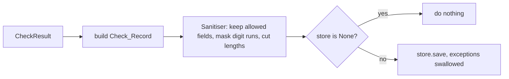

# Design Document

## Overview

The Lab adds an owner/judge dashboard to the Lambda that already serves the WhatsApp webhook, on the same Function URL. A new `src/ghost_credit/lab_router.py` inspects the request path inside `lambda_handler` and either forwards to the existing `handle_webhook` unchanged, or serves one of three Lab endpoints: `GET /lab` (the HTML page), `GET /lab/data` (JSON feed of newest and sample records) and `POST /lab/check` (the "try an alert" form). `src/ghost_credit/lab.py` holds the storage interface, the record builder and sanitiser, the rate limiter and the HTML page template. `src/ghost_credit/lab_sample.json` holds six synthetic sample records.

Design decisions:

| Decision | Reason |
|---|---|
| Routing happens in `lambda_handler.py`, by reading the same Function URL event fields it already reads | Keeps `handle_webhook`'s contract and all its existing tests untouched; adding a path branch cannot change WhatsApp behaviour (Requirement 1). |
| `lab_router.route(method, path, query, headers, raw_body, *, now, store, limiter)` returns a `WebhookResponse`-shaped tuple `(status, headers, body)` | Mirrors the existing `WebhookResponse` shape from `whatsapp.py` so `lambda_handler` builds the Lambda dict the same way for both paths. |
| `Check_Store` is a `typing.Protocol` with `InMemoryCheckStore` and `DynamoCheckStore`, following the `UsedReferences`/`PatternNetwork` pattern already in the repo | Matches existing conventions (`pipeline.py`'s `UsedReferences`, `pattern_network.py`'s `PatternNetwork`): a small Protocol, a trivial in-memory fake, and a real implementation that imports its SDK lazily. |
| `record_check(store, check_result, channel, now)` lives in `lab.py`, not in `pipeline.py` or `whatsapp.py` | `pipeline.py` has no knowledge of storage or channels; keeping it there would mix concerns. `whatsapp.py` only gets one new call site after sending the reply. |
| Sanitisation happens inside `record_check`, before `store.save` is ever called | A badly written store can never see or persist a raw field; the privacy guarantee does not depend on the store's own code. |
| `DynamoCheckStore.newest` uses Scan, not Query, and sorts in Python | The table's only key is `check_id`; there is no secondary index for `checked_at` in this spec. A Scan of a demo-sized table (expected: dozens to low hundreds of items before TTL expiry) is cheap and avoids adding a GSI. This trades a small amount of read cost for simplicity; revisit if the table grows large. |
| `get_store()` returns `None` when `CHECKS_TABLE` is unset, and callers treat `None` as "do not log" | Matches the existing optional-dependency pattern (`get_explainer()` falling back, `get_network()` always returning a no-op). Keeps `lab.py` usable in tests and in the webhook without any AWS dependency unless explicitly configured. |
| The page is one inline HTML/CSS/JS string returned by a function, with no template engine dependency | FastAPI/Jinja are not pulled in just for one page; the brief requires a fully self-contained page with no external resources, which a plain Python string builds directly. |
| The client fetches `/lab/data` instead of the server embedding records in the HTML | Requirement 4.3 and the injection-safety goal (Requirement 8.2) are easier to satisfy when the server never interpolates record data into HTML text; the client always goes through `textContent`. |
| `Rate_Limiter` is an in-memory sliding window keyed by nothing (one window per container, not per caller) | The brief specifies "20 checks per minute per container" — a single shared window is the literal, simplest implementation and needs no caller identity (which would require trusting a spoofable header). |
| The CSP, `X-Content-Type-Options` and `Cache-Control` headers are added by one small wrapper function `_lab_headers()` used by every Lab response path | Keeping header-adding in one place guarantees Requirement 8.3 holds for every current and future Lab response without relying on each handler to remember. |
| `TemplateExplainer` is passed explicitly to `run_check` in the Try_Form handler, never `get_explainer()` | Requirement 7.1 and the product rule "the AI only explains, never decides" are enforced in code, not by relying on `ai-explainer` being absent; The Lab never triggers a paid AI call. |

Existing code read before writing this design: `pipeline.py` (`run_check`, `CheckResult`, `FLAG_ORDER`, `make_paystack_verify`), `verdict.py` (`Verdict`, `OWNER_LABELS`, `TemplateExplainer`, `FLAG_REASONS`, `REASON_ALREADY_USED`), `whatsapp.py` (`handle_webhook`, dependency-injection style), `lambda_handler.py` (Function URL event shape), `scripts/deploy_lambda.py` (zip building, IAM policy, deploy steps), `docs/deploy.md`, `PRIVACY.md`, the four steering files, and the `whatsapp-webhook` design and requirements.

## Architecture

```mermaid
flowchart TD
    URL[Lambda Function URL] --> LA[lambda_handler.lambda_handler]
    LA --> RT{path starts with "/lab"?}
    RT -->|no| WH[whatsapp.handle_webhook, unchanged]
    RT -->|yes| LR[lab_router.route]
    LR --> P1{path}
    P1 -->|"/lab"| PAGE[serve HTML page]
    P1 -->|"/lab/data"| DATA[newest 50 + sample 6, JSON]
    P1 -->|"/lab/check"| CHECK{rate limit ok?}
    CHECK -->|no| R429[429]
    CHECK -->|yes| RC[run_check with TemplateExplainer]
    RC --> REC1[record_check channel=lab]
    REC1 --> RESP[JSON result]
    WH --> REC2[record_check channel=whatsapp, after reply sent]
    DATA --> STORE[(Check_Store.newest)]
    REC1 --> STORE2[(Check_Store.save)]
    REC2 --> STORE2
```



## Components and Interfaces

### `src/ghost_credit/lab.py`

```python
from __future__ import annotations

from typing import Protocol

ALLOWED_FIELDS = (
    "check_id", "checked_at", "channel", "verdict", "owner_label",
    "amount_kobo", "claimed_bank", "red_flags", "reasons", "risk_notes",
    "expires_at",
)
TTL_SECONDS = 30 * 24 * 60 * 60
MAX_LIST_ITEMS = 10
MAX_TEXT_FIELD_CHARS = 120
MAX_BANK_CHARS = 60
MAX_TRY_TEXT_CHARS = 2000
RATE_LIMIT_PER_MINUTE = 20

class CheckStore(Protocol):
    def save(self, record: dict) -> None: ...
    def newest(self, limit: int) -> list[dict]: ...

class InMemoryCheckStore:
    def __init__(self) -> None: ...
    def save(self, record: dict) -> None: ...
    def newest(self, limit: int) -> list[dict]: ...

class DynamoCheckStore:
    def __init__(self, table_name: str | None = None) -> None: ...
    def save(self, record: dict) -> None: ...     # one PutItem
    def newest(self, limit: int) -> list[dict]: ... # Scan, sort by checked_at desc

def get_store() -> CheckStore | None:
    """DynamoCheckStore when CHECKS_TABLE is set in the environment, else None."""

def sanitise_record(record: dict) -> dict:
    """Keep only ALLOWED_FIELDS; mask 7+ digit runs; cut list/string lengths."""

def record_check(store: CheckStore | None, check_result: "CheckResult", channel: str, now: datetime) -> None:
    """Build, sanitise and save one Check_Record. Never raises, never blocks the reply."""

class SlidingWindowLimiter:
    def __init__(self, limit: int = RATE_LIMIT_PER_MINUTE, window_seconds: float = 60.0) -> None: ...
    def allow(self, now: float) -> bool:
        """Record one attempt at time now and return whether it is within the limit."""

def render_page() -> str:
    """Return the complete, self-contained /lab HTML document (no external refs)."""

def plain_english_flags(codes: list[str]) -> list[str]:
    """Map red flag codes to the sentences in verdict.FLAG_REASONS, unknown codes dropped."""

def format_naira(amount_kobo: int | None) -> str:
    """Integer-only formatting of kobo as a naira string, e.g. 450000 -> 'NGN 4,500.00'."""
```

`_digit_run_re = re.compile(r"\d[\d \-.,]{5,}\d")` (conceptually: a run that, once separators are stripped, holds 7 or more digits) is the masking pattern described in Requirement 3.7; the implementation strips separators from each match and only replaces matches whose digit count is at least 7, to avoid over-masking short numbers written with stray punctuation (e.g. a 6-digit reference should not be masked).

### `src/ghost_credit/lab_router.py`

```python
LabResponse = tuple[int, dict[str, str], str]  # status, headers, body

def route(
    method: str, path: str, query: object, headers: object, raw_body: bytes,
    *, now: datetime, store: "CheckStore | None", limiter: "SlidingWindowLimiter",
    run_check_fn: Callable = run_check,
) -> LabResponse:
    """Dispatch /lab, /lab/data, /lab/check. Total: never raises, always one of
    200, 404, 405, 413, 429 with the Lab security headers attached."""
```

Private helpers: `_lab_headers(content_type: str) -> dict[str, str]` (adds CSP, `X-Content-Type-Options`, `Cache-Control` to every Lab response); `_handle_check(raw_body, now, store, limiter, run_check_fn) -> LabResponse`; `_handle_data(store) -> LabResponse`; `_escape(value) -> str` (thin wrapper over `html.escape`, used for every value placed in server-rendered HTML — only the static `/lab` shell is server-rendered, since data loads client-side, so this is mainly exercised by the Property 5 scan and by any future server-rendered fragment).

### `src/ghost_credit/lambda_handler.py` changes

Add a `_path(event)` helper mirroring `_method(event)` (reads `rawPath` from the Function URL v2.0 event, defaulting to `"/"`). `lambda_handler` becomes:

```python
def lambda_handler(event, context):
    try:
        if not isinstance(event, dict):
            return _forbidden()
        path = _path(event)
        if path.startswith("/lab"):
            status, headers, body = lab_router.route(
                _method(event) or "", path, event.get("queryStringParameters"),
                _lower_headers(event.get("headers")), _raw_body(event),
                now=datetime.now(LAGOS), store=get_store(), limiter=_LIMITER,
            )
            return {"statusCode": status, "headers": headers, "body": body}
        raw = _raw_body(event)
        response = handle_webhook(..., seen=_SEEN)   # unchanged call
        return {"statusCode": ..., "headers": ..., "body": ...}
    except Exception:
        return _forbidden()
```

`_LIMITER` is one module-level `SlidingWindowLimiter`, matching the existing one-`_SEEN`-per-container pattern. `get_store()` is called once per request (cheap: it only reads an environment variable and constructs a thin client wrapper; the `boto3` client itself is created lazily inside `DynamoCheckStore`).

### `src/ghost_credit/whatsapp.py` change

After `_send_reply` returns inside `_process_message` (text branch only, since that is the only branch that calls `run_check`), add one call: `record_check(deps["store"] if "store" in deps else get_store(), result, "whatsapp", clock())`. `handle_webhook` gains one new optional keyword argument, `store: CheckStore | None = None`, defaulting to `get_store()` when not supplied by the caller (mirroring how `explainer` and `network` already default). A store failure is already swallowed inside `record_check`, so `_process_message`'s existing try/except needs no change.

### `scripts/deploy_lambda.py` changes

New constants: `CHECKS_TABLE_NAME = "ghost-credit-checks"`, `RESERVED_CONCURRENCY = 5`. New pure helpers (unit tested, no AWS):

```python
def checks_table_permissions_statement(account_id: str, region: str) -> dict:
    """The dynamodb:PutItem + dynamodb:Scan statement, scoped to the table ARN."""

def lab_url(function_url: str) -> str:
    """function_url with 'lab' appended after the trailing slash."""
```

`permissions_policy(account_id)` gains the new DynamoDB statement alongside the existing Bedrock and logs statements (now three statements total). `build_zip` already copies every file under `src/ghost_credit`, so `lab_sample.json` is included automatically; a test asserts this explicitly rather than changing `build_zip`. New AWS-calling steps (never run by tests, `boto3` imported inside): `_ensure_checks_table(dynamodb_client)` (create with `PAY_PER_REQUEST`, `AttributeDefinitions=[{"AttributeName": "check_id", "AttributeType": "S"}]`, then `update_time_to_live` enabling TTL on `expires_at`; an existing table is left as is), `_set_reserved_concurrency(lambda_client)` (calls `put_function_concurrency`; catches `InvalidParameterValueException` and `LimitExceededException`, prints a warning naming the exception, and returns normally so the deploy continues). `select_lambda_variables` adds `CHECKS_TABLE` to `LAMBDA_VARIABLE_NAMES`, defaulting it to `CHECKS_TABLE_NAME` when unset. `main` prints the Lab URL (via `lab_url`) alongside the existing Function URL line.

### `PRIVACY.md` change

One new bullet under "What we keep": check results (verdict, amount, red flags, reasons) are kept 30 days for The Lab; message text and phone numbers are never stored (already true today, now stated explicitly for The Lab too).

## Data Models

| Name | Fields | Notes |
|---|---|---|
| `Check_Record` (dict, post-sanitisation) | `check_id: str`, `checked_at: str` (ISO 8601, +01:00), `channel: str`, `verdict: str`, `owner_label: str`, `amount_kobo: int \| None`, `claimed_bank: str \| None`, `red_flags: list[str]`, `reasons: list[str]`, `risk_notes: list[str]`, `expires_at: int` | Exactly `ALLOWED_FIELDS`; no other key ever appears. |
| DynamoDB item (`DynamoCheckStore`) | Same fields as `Check_Record`, DynamoDB-typed (`S`, `N`, `L` of `S`) | Partition key `check_id` (S); TTL attribute `expires_at` (N, epoch seconds). |
| `/lab/data` response | `{"records": [Check_Record, ...], "sample": [Check_Record, ...]}` | `records` from `store.newest(50)`; `sample` from `lab_sample.json`, each with an added `"sample": true` marker consumed only by the client to show the "Sample" label (not part of `ALLOWED_FIELDS`-constrained storage, since it never reaches the store). |
| `/lab/check` request | `{"text": str}` | Up to 2000 characters; longer is rejected 413 (see Requirement 7.2 resolution below). |
| `/lab/check` response | `{"verdict": str, "owner_label": str, "amount_kobo": int \| None, "red_flags": list[str], "reasons": list[str], "risk_notes": list[str], "reply": str}` | Built from the same `CheckResult` used to call `record_check`. |
| `lab_sample.json` | `list[Check_Record]`, length 6 | Synthetic only; validated by Requirement 6.4/6.5 tests. |

**Resolution of Requirement 7.2's either/or:** this design rejects with **413** rather than silently truncating, for consistency with `whatsapp.py`'s existing `MAX_BODY_BYTES` → 413 behaviour and so the caller is not misled about what was checked.

Money stays an integer in kobo throughout; `format_naira` divides and formats using only `//` and `%` on integers, never `float`.

## Correctness Properties

*A property is a characteristic or behavior that should hold true across all valid executions of a system-essentially, a formal statement about what the system should do. Properties serve as the bridge between human-readable specifications and machine-verifiable correctness guarantees.*

Reflection on the prework: the two halves of the routing rule (1.1, 1.2, 1.4) are one passthrough property. The three Sanitiser length limits (3.8, 3.9) merge with the field-set invariant (3.6) into one "sanitiser invariants" property, but the digit-masking rule (3.7) stays separate since it is the privacy-critical guarantee and deserves its own focused generator (phone numbers, accounts, references). The "store is None" and "store.save raises" cases (3.10, 3.11, 3.12) merge into one "record_check never raises and never leaks a failure into the reply" property. The `/lab/data` shape and content rules (5.1, 5.2, 5.4) merge into one property, since 5.4 is the same allowed-fields invariant applied at the response boundary. The rate-limiter invariant and its router-level consequence (7.5, 7.6) merge into one property with a dedicated example test for the literal 21st-call case. The escaping/no-reflection rules (7.4, 8.1, 8.4) merge into one "no executable, unescaped or reflected content" property, since all three are the same anti-XSS guarantee viewed from the record side (8.4), the user-input side (7.4) and the general escaping rule (8.1). The response-header rule (8.3) stays its own property since it applies to every response regardless of content, not just ones holding record or user data.

### Property 1: The router is a total, correct passthrough for non-Lab paths

For any HTTP method, any path that is `/`, is `/webhook`, or does not start with `/lab`, and any query, headers and body (including malformed or arbitrary values), routing through the combined handler calls `handle_webhook` exactly once with the same arguments `lambda_handler` would pass directly, and returns the identical status, headers and body that calling `handle_webhook` directly produces, without ever raising.

**Validates: Requirements 1.1, 1.2, 1.4**

### Property 2: InMemoryCheckStore round-trips saved records

For any sequence of valid Check_Records saved in order to a fresh `InMemoryCheckStore`, `newest(limit)` returns at most `limit` records, each one of the saved records, ordered most-recently-saved first.

**Validates: Requirements 2.2**

### Property 3: DynamoCheckStore.save sends exactly one well-shaped PutItem

For any valid Check_Record, calling `DynamoCheckStore.save` on a fake DynamoDB table double performs exactly one `PutItem` call whose `Item` encodes every field of the record with the correct DynamoDB type (`S` for strings, `N` for `amount_kobo` and `expires_at`, `L` of `S` for the three list fields) and no other call.

**Validates: Requirements 2.5**

### Property 4: DynamoCheckStore.newest sorts and limits a Scan

For any set of Check_Records returned by a fake table's `Scan` in any order, `DynamoCheckStore.newest(limit)` returns them sorted by `checked_at` descending and returns at most `min(limit, 50)` of them.

**Validates: Requirements 2.6**

### Property 5: Record_Check builds a complete, correctly derived Check_Record

For any `CheckResult` (any verdict code, amount, flags, reasons and risk notes) and any channel string and any `now`, the record that reaches `store.save` contains exactly the Allowed_Fields, with `channel` equal to the given channel, `verdict` equal to the verdict's code, `owner_label` equal to `OWNER_LABELS[verdict.code]`, `amount_kobo` equal to the parsed alert's amount, and `expires_at` equal to `checked_at`'s epoch-seconds value plus exactly 2,592,000 (30 days).

**Validates: Requirements 3.3, 3.4**

### Property 6: The Sanitiser enforces its field and length invariants

For any dict with arbitrary extra keys, arbitrarily long `reasons`, `risk_notes` and `claimed_bank` values, and lists of arbitrary length, `sanitise_record` returns a dict whose keys are exactly the Allowed_Fields present in the input, whose `reasons` and `risk_notes` each have at most 10 entries each at most 120 characters, and whose `claimed_bank` is at most 60 characters.

**Validates: Requirements 3.6, 3.8, 3.9**

### Property 7: The Sanitiser removes every long digit run except in check_id

For any Check_Record whose string fields (other than `check_id`) are built to contain phone numbers, masked or unmasked account digits, or references of 7 or more digits (optionally separated by spaces, hyphens, dots or commas), `sanitise_record`'s output contains no run of 7 or more digits in any field except `check_id`, and `check_id` is left unchanged.

**Validates: Requirements 3.7**

### Property 8: Record_Check never raises and never changes the reply

For any `CheckResult`, any channel, any `now`, and any store that is `None` or that raises an arbitrary exception from `save`, `record_check` returns normally without raising, and the `CheckResult.reply` value passed in is unchanged by the call (identity-equal before and after).

**Validates: Requirements 3.10, 3.11, 3.12**

### Property 9: GET /lab/data always returns both arrays, records from the store, within the allowed fields

For any sequence of Check_Records a store holds (including zero, and including one from each Owner_Label), the response's `records` array equals `store.newest(50)` (or `[]` when no store is configured), the `sample` array always has length 6, and every record in `records` has only the Allowed_Fields.

**Validates: Requirements 5.1, 5.2, 5.4**

### Property 10: Try_Form's response fields come from the CheckResult it ran

For any text up to 2000 characters and any `CheckResult` a fake `run_check` returns for it, `POST /lab/check`'s JSON response has `verdict` equal to the result's verdict code, `owner_label` equal to `OWNER_LABELS[verdict.code]`, `amount_kobo`, `red_flags`, `reasons` and `risk_notes` equal to the corresponding fields of the result, and `reply` equal to `result.reply`.

**Validates: Requirements 7.1**

### Property 11: Over-length Try_Form text is always rejected before running a check

For any text longer than 2000 characters, `POST /lab/check` returns status 413 and calls the injected `run_check` zero times.

**Validates: Requirements 7.2**

### Property 12: The rate limiter enforces a 20-per-60-second window end to end

For any sequence of call timestamps within one container's lifetime, the number of calls the limiter allows in any rolling 60-second window never exceeds 20, and for any call the limiter denies, `POST /lab/check` returns status 429 and calls the injected `run_check` zero times for that call.

**Validates: Requirements 7.5, 7.6**

### Property 13: No executable, unescaped or reflected content ever appears in Lab HTML

For any Check_Record field or any submitted Try_Form text containing `<script>alert(1)</script>` or other HTML-significant characters, every server-rendered HTML response from The_Lab contains that content, if at all, only as escaped text (no raw `<script`, `<img`, `onerror=` or similar unescaped construct), and no HTML response contains the exact submitted Try_Form text verbatim.

**Validates: Requirements 7.4, 8.1, 8.4**

### Property 14: Every Lab response carries the required security headers

For any method, path under `/lab`, query, headers and body (including malformed or arbitrary values), every response the router returns includes `Content-Security-Policy: default-src 'self'; script-src 'self' 'unsafe-inline'; style-src 'unsafe-inline'`, `X-Content-Type-Options: nosniff`, and `Cache-Control: no-store`.

**Validates: Requirements 8.3**

### Property 15: The permissions policy grants exactly the right DynamoDB actions on the right resource

For any 12-digit account id, the permissions policy's DynamoDB statement grants exactly `dynamodb:PutItem` and `dynamodb:Scan`, scoped to the Checks_Table's ARN built from that account id and the configured region, alongside the unchanged Bedrock and logs statements.

**Validates: Requirements 9.2**

### Property 16: lab_url always appends "lab" as a path segment

For any Function URL string with or without a trailing slash, `lab_url(url)` returns a string equal to the URL with exactly one `/` followed by `lab` appended, with no double slash and no missing separator.

**Validates: Requirements 9.5**

### Property 17: A reserved-concurrency failure is reported and never stops the deploy

For any exception raised by a fake Lambda client's `put_function_concurrency` (including `InvalidParameterValueException`, `LimitExceededException`, and other exception types), setting reserved concurrency prints a warning naming the exception's type, and returns normally without raising.

**Validates: Requirements 9.7**

## Error Handling

| Situation | Result |
|---|---|
| Path does not start with `/lab` | Routed to `handle_webhook` unchanged; every existing WhatsApp error-handling rule from the whatsapp-webhook design still applies untouched |
| Unknown path under `/lab` (not `/lab`, `/lab/data` or `/lab/check`) | 404, with the Lab security headers still attached |
| Wrong method for a Lab path (e.g. `POST /lab`) | 405, with the Lab security headers still attached |
| `POST /lab/check` body is not valid JSON, or `text` is missing or not a string | 400, `run_check` is not called |
| `POST /lab/check` text over 2000 characters | 413, `run_check` is not called (Requirement 7.2 resolved as reject, not truncate) |
| `POST /lab/check` exceeds the rate limit | 429, `run_check` is not called |
| `store` is `None` (no `CHECKS_TABLE` configured) | `record_check` returns immediately; `/lab/data`'s `records` array is `[]` |
| `store.save` raises any exception | Caught inside `record_check`; only the exception's type name is logged; the caller's reply is unaffected |
| `DynamoCheckStore.newest` raises (table missing, throttled, etc.) | Caught inside `lab_router`'s `/lab/data` handler; `records` falls back to `[]` rather than failing the whole page |
| Any unexpected exception anywhere inside `lab_router.route` | Caught at the top level; returns a fixed 500-free fallback (mirrors `whatsapp.py`'s "never raise" rule) — specifically, falls back to the same safe response shape used for 404, with the Lab security headers attached, so a bug in The Lab can never surface a raw traceback |
| Deploy: Checks_Table already exists | Treated as success; TTL is still ensured via `update_time_to_live` (idempotent) |
| Deploy: `put_function_concurrency` fails with `InvalidParameterValueException` or `LimitExceededException` | Warning printed naming the exception; remaining deploy steps continue (Requirement 9.7) |
| Deploy: any other AWS error during the new steps | Follows the existing deploy script convention: print the exception type name and AWS error code, exit code 1 |

Conservative decision: an unexpected failure inside `lab_router` never returns a 500 with a traceback, matching the "never leak internals" posture already used in `whatsapp.py` and `lambda_handler.py`. Because `/lab` carries no authentication, treating every unexpected failure as a safe, header-complete 404-shaped response avoids giving a probing visitor information about internal errors.

## Testing Strategy

**Approach.** Both example tests and property tests are used. Property-based testing applies well here: the router, the sanitiser, `record_check`, the rate limiter and the small deploy-script helpers are pure or near-pure functions with large input spaces (arbitrary paths, arbitrary records, arbitrary digit-run text, arbitrary call-timing sequences). It does not apply to the real AWS calls added to `scripts/deploy_lambda.py` (table creation, concurrency setting), to the static structure of the HTML/CSS/JS page, or to visual/accessibility qualities (contrast, ghost styling) — those get smoke checks, source scans, and fixed examples, consistent with the whatsapp-webhook design's precedent.

**Library and settings.** Hypothesis with pytest. Each property is one test with at least 100 examples (`@settings(max_examples=100)` or more). Each test carries a comment tag in the form `Feature: the-lab, Property N: <property text>`.

**Offline rules.** No test imports `boto3` eagerly or makes a live AWS, Paystack or AI call. `DynamoCheckStore` tests use a fake table double recording its calls. Try_Form tests inject a fake `run_check`. Rate-limiter tests use an injected clock, not real `time.sleep`. All synthetic data only; `PATTERN_NETWORK=off` for the whole suite (The Lab never touches it directly, but the suite-wide rule still applies).

**Shared helpers** (new `tests/lab_fakes.py`): a `FakeTable` double for DynamoDB (`put_item`, `scan`) recording calls; a `FakeRunCheck` (records calls, returns a given `CheckResult`, can raise); Hypothesis strategies for digit-run-bearing text (phone numbers, masked and unmasked account numbers, references, mixed separators), for arbitrary Lab paths and non-Lab paths, and for sequences of call timestamps.

**Example tests** (one file each, named in `tasks.md`):
- `GET /lab` page structure: no `http://`/`https://` in any `src`/`href`, no `<script src=`, inline `<style>` and `<script>` only, viewport meta tag present, fetches `/lab/data`
- `GET /lab/data` sample array equals the six `lab_sample.json` records, each verdict-mix requirement (one ALIVE, one GHOST/no-payment, one GHOST/already-used, one SUSPICIOUS, one UNVERIFIED, one with `TRANSFER_REQUEST_WORDING`), and a scan confirming no field in the sample file contains a 7+ digit run
- Lab page JS source scan: no `innerHTML`, `outerHTML`, `insertAdjacentHTML` or `document.write` call
- `POST /lab/check` happy path with a fake `CheckResult`, and the 2,001-character boundary case returning 413
- Wiring: a WhatsApp text check with an injected fake store calls `record_check` once with channel `"whatsapp"`; a Try_Form check with an injected fake store calls it once with channel `"lab"`
- `get_store()` returns `None` with `CHECKS_TABLE` unset and a `DynamoCheckStore` with it set
- Deploy script: `lab_sample.json` present in the real package zip; the updated permissions policy example matching the exact three-statement shape; `CHECKS_TABLE` added to the selected variable names with its default; a fake-client example test for `_ensure_checks_table` (create-table call shape, TTL call) and for `_set_reserved_concurrency` (successful call shape)
- `PRIVACY.md` contains the 30-day Lab retention statement and the never-stores-text-or-numbers statement

**Manual verification by the user** (not automated, listed in `docs/deploy.md`): open the deployed `/lab` URL on a phone, confirm the sample toggle, submit a real test alert through the Try_Form, and confirm WhatsApp checks still work end to end.
