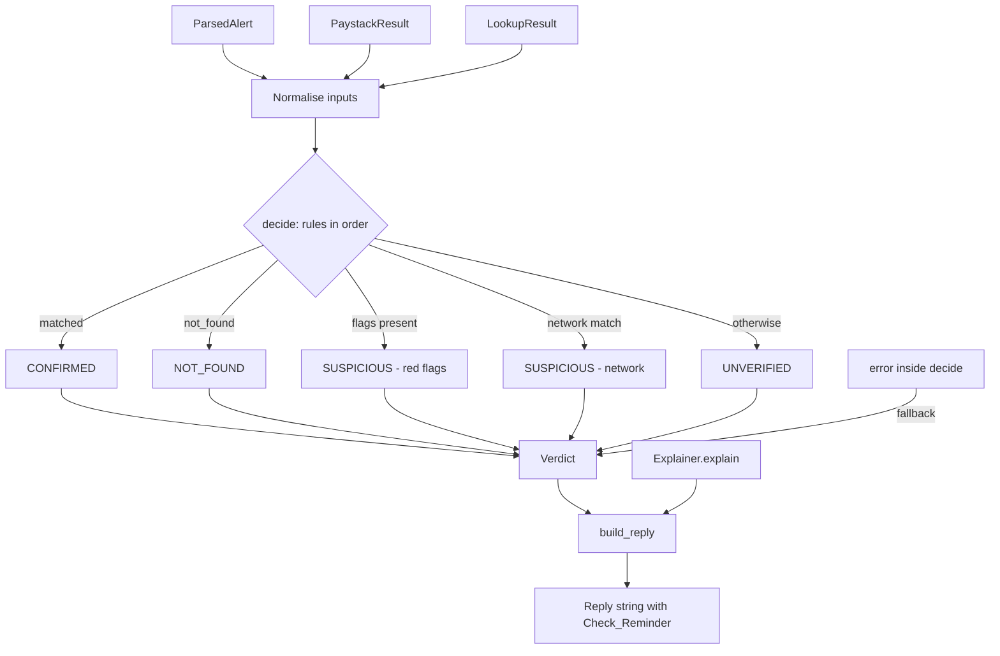

# Design Document

## Overview

The Verdict_Engine is one module, `src/ghost_credit/verdict_engine.py`. It has two jobs:

1. `decide(parsed, paystack_result, lookup_result)` chooses a verdict with four fixed rules from `.kiro/steering/payments-nigeria.md`. It is pure and total: it never raises and never calls anything outside itself.
2. `build_reply(verdict, parsed, explainer)` asks an `Explainer` for the wording, then enforces the Check_Reminder. The Explainer can change the words, never the verdict.

Design decisions and reasons:

- **Rules in a short if-chain, not a table of strategies.** There are four rules plus one network upgrade. A plain ordered chain is the easiest thing for a beginner to read and for a reviewer to check against the steering file.
- **Defensive normalisation first, decision second.** Three small helpers turn any argument (including None or junk) into a safe value. The decision code then only sees clean values, so there is one place where "bad input" is handled (Requirements 4.3 to 4.6).
- **One outer try/except returns UNVERIFIED** (Requirement 4.8). UNVERIFIED is the safe fallback because it never says money arrived and the reply still carries the Check_Reminder.
- **Reminder enforced in Reply_Builder, not in any Explainer** (Requirement 7.1). A future AI Explainer therefore cannot drop it.
- **No AI model, client or call exists in this module** (Requirement 6.3). The Explainer is an interface only. Any real implementation needs Ayobami's approval and a quoted cost first (`tech.md`, cost rules).
- **Reuse, do not redefine.** `Verdict` and `LookupResult` come from `src/ghost_credit/pattern_network.py` and `ParsedAlert` from `src/ghost_credit/parser.py` (Requirement 9.4).

Research: no outside sources were needed. The design rests on the repo documents: `docs/pattern-network-contract.md` v1.0, the pattern-network-hook requirements, `src/ghost_credit/parser.py` and the steering files.

### Reconciliation with the pattern-network-hook spec and the contract

| Item | Contract and hook spec | This design |
|---|---|---|
| Module path | `src/ghost_credit/pattern_network.py` | Same path, imported by name |
| `Verdict` fields | `code`, `decided_by`, `paystack_checked`, `owner_outcome`, `reasons` (hook Req 2.2) | Built with exactly these five keyword arguments |
| `Verdict` validation | Raises `ValueError` for a bad `code` or `owner_outcome` (hook Req 2.8, 2.9) | `decide` only passes valid values; the outer try/except covers any surprise |
| `LookupResult` fields | `schema_version`, `network_available`, `matched`, `matches`, `trace_url` | Reads only `network_available` and `matched` |
| `Match` | Eight fields, only inside `LookupResult.matches` | Not read. Match details never affect the verdict |
| `decided_by` | Always `"rules"` in v1 | Always `"rules"` |
| Network power | Can only turn UNVERIFIED into SUSPICIOUS (safety rule 1) | Same, in rule 4 only |
| Money | Integer kobo | No amounts appear in reasons or replies |

## Architecture



Rule order inside `decide` (stop at the first that applies):

1. state `matched` gives CONFIRMED.
2. state `not_found` gives NOT_FOUND.
3. state `not_applicable` and one or more red flags gives SUSPICIOUS (reason: flags).
4. state `not_applicable`, no flags, and a Network_Match gives SUSPICIOUS (reason: network).
5. Otherwise UNVERIFIED.

Rule 4 is the "network can only be stricter" step. It sits after the red-flag rule so a verdict is never both. It is unreachable for `matched` and `not_found`, so the network cannot touch a Paystack result (Requirement 2.2, 2.3).

## Components and Interfaces

All names live in `src/ghost_credit/verdict_engine.py`.

### PaystackResult

A frozen dataclass with one field, `state`. The accepted values are the three strings `not_applicable`, `matched` and `not_found`, held as module constants. Building one with another value raises `ValueError` naming `state` (Requirement 5.2). It holds no key, token or personal data (Requirement 5.3). Calling Paystack is a separate spec (Requirement 5.4).

### decide

```
decide(parsed, paystack_result, lookup_result) -> Verdict
```

Steps:

1. Inside one try block, call three private helpers:
   - `_state_of(paystack_result)` returns one of the three state strings. None, a wrong type or an unknown state returns `not_applicable` (Requirement 4.4).
   - `_flags_of(parsed)` returns a list of strings. None, a missing attribute or a non-list returns `[]` (Requirement 4.5). The result is a new list, so the argument is never changed (Requirement 4.7).
   - `_is_network_match(lookup_result)` returns True only when `network_available is True` and `matched is True` (strict `is True`, so truthy junk does not count; Requirement 4.6, 2.5).
2. Apply the rule chain above and build the `Verdict` with `decided_by="rules"`, `owner_outcome="unknown"` and `paystack_checked` True only for `matched` and `not_found` (Requirement 3.1 to 3.3).
3. On any exception, return the fallback Verdict: code `UNVERIFIED`, `decided_by="rules"`, `owner_outcome="unknown"`, `paystack_checked=False`, one reason "The check could not be completed." (Requirement 4.8).

The function reads no clock, file, network or random source (Requirement 4.1).

### Reasons

Each Verdict gets a short list of plain-English reasons, each 1 to 120 characters (Requirement 3.4).

| Case | Reason text (fixed) |
|---|---|
| CONFIRMED | "Paystack found a matching payment." |
| NOT_FOUND | "Paystack found no matching payment." |
| SUSPICIOUS, flags | "Red flags: " plus the codes joined, see below |
| SUSPICIOUS, network | "The pattern network has seen a similar alert." |
| UNVERIFIED | "No Paystack check was possible and no red flags were found." |
| fallback | "The check could not be completed." |

Flag reason length: the parser's six codes (`SENDER_ID_MISMATCH`, `BALANCE_LINE_MISSING`, `AMOUNT_FORMAT_ODD`, `DATE_ODD`, `SCREENSHOT_EDIT_SIGNS`, `PRESSURE_LANGUAGE`) total 101 characters. Joined with a comma and no space plus the prefix "Flags: " they take 101 + 5 + 7 = 113 characters, under 120. The prefix "Red flags: " with ", " separators would take 122 and break Requirement 3.4, so the design uses `"Flags: "` and `","`. The parser returns unique codes from a fixed tuple, so six is the maximum. For hand-made lists with unknown or very long codes, the reason is deduplicated and cut at 120 characters; Requirement 3.5 is only guaranteed for the parser's codes (see Open Points).

### Explainer and FakeExplainer

`Explainer` is an abstract base class (`abc.ABC`) with one method, `explain(verdict, parsed) -> str`. It receives the Verdict and the ParsedAlert and returns text. `Verdict` is passed as-is; because the engine ignores the returned value for the code, the Explainer has no way to change the verdict (Requirement 6.5).

`FakeExplainer` returns a fixed string built only from `verdict.code` and `verdict.reasons`, for example the code followed by the reasons joined by a space. It makes no external call and returns the same string for equal arguments (Requirement 6.2). It adds no reminder; that is Reply_Builder's job (Requirement 7.1).

### build_reply

```
build_reply(verdict, parsed, explainer) -> str
```

1. Call `explainer.explain(verdict, parsed)` inside try/except.
2. If it raised, or the value is not a `str`, or is empty after stripping whitespace, use the fallback text: `verdict.reasons` joined with a single space (Requirement 6.6).
3. If `verdict.code` is `CONFIRMED`, return the text unchanged (Requirement 7.4).
4. Otherwise strip trailing whitespace. If the result already ends with the Check_Reminder, return it. If not, append a single space (or nothing for empty text) and the reminder, and return that. The reply then ends exactly with the reminder and nothing follows it (Requirement 7.2, 7.3).

The Check_Reminder is a module constant, `Check your own bank app before releasing goods.` (Glossary).

Because step 4 strips trailing whitespace and then checks `endswith`, feeding a built reply back in as Explainer text returns the same reply (Requirement 7.5).

## Data Models

| Type | Source | Fields used here |
|---|---|---|
| `ParsedAlert` | `parser.py` (existing, frozen) | `red_flags: list[str]` only |
| `PaystackResult` | defined here | `state: str` |
| `LookupResult` | `pattern_network.py` | `network_available: bool`, `matched: bool` |
| `Verdict` | `pattern_network.py` | all five fields, written by `decide` |
| `Explainer` | defined here | `explain(verdict, parsed) -> str` |

Constants: `PAYSTACK_NOT_APPLICABLE`, `PAYSTACK_MATCHED`, `PAYSTACK_NOT_FOUND`, `CHECK_REMINDER`, and the four code strings used as `Verdict.code` values.

## Correctness Properties

*A property is a characteristic or behavior that should hold true across all valid executions of a system-essentially, a formal statement about what the system should do. Properties serve as the bridge between human-readable specifications and machine-verifiable correctness guarantees.*

Reflection: criteria 1.1 to 1.5, 2.1 to 2.3 are one rule table, so they are merged into Property 1. Property 2 (CONFIRMED only from Paystack) is kept separate because it is the main safety rule and Requirement 8.1 asks for it by name. Criteria 3.1 to 3.4 merge into Property 4. Criteria 4.1, 6.1, 6.3, 5.3, 5.4, 8.x and 9.x are design or process checks, not input-dependent behaviour, and are handled by example, smoke and review checks in the Testing Strategy.

### Property 1: Verdict code follows the rule table

*For any* ParsedAlert flag list, any PaystackResult state and any LookupResult, the code returned by `decide` equals the code from an independent oracle: `matched` gives CONFIRMED; `not_found` gives NOT_FOUND; `not_applicable` with one or more flags gives SUSPICIOUS; `not_applicable` with no flags and a Network_Match gives SUSPICIOUS; otherwise UNVERIFIED.

**Validates: Requirements 1.1, 1.2, 1.3, 1.4, 1.5, 2.1, 2.2, 2.3**

### Property 2: Only Paystack can confirm

*For any* inputs, including None and malformed values, if the returned code is CONFIRMED then the PaystackResult state was `matched`; and *for any* PaystackResult not in state `matched`, the returned code is not CONFIRMED.

**Validates: Requirements 2.4, 8.1, 8.2**

### Property 3: An unavailable network equals no network

*For any* ParsedAlert, PaystackResult and LookupResult with `network_available` False (any `matched` value), `decide` returns the same Verdict as it returns when the LookupResult is None.

**Validates: Requirements 2.5**

### Property 4: Verdict fields and reasons are well formed

*For any* inputs, the returned Verdict has `decided_by` equal to `"rules"`, `owner_outcome` equal to `"unknown"`, `paystack_checked` True exactly when the state is `matched` or `not_found`, and `reasons` a non-empty list of strings each 1 to 120 characters long (flag codes drawn from the parser's `RED_FLAG_CODES`).

**Validates: Requirements 3.1, 3.2, 3.3, 3.4**

### Property 5: Reasons explain the verdict

*For any* inputs, the reasons match the code: a flag-based SUSPICIOUS verdict has one reason containing every code in `red_flags`; a network-based SUSPICIOUS verdict has a reason saying the pattern network has seen a similar alert; CONFIRMED, NOT_FOUND and UNVERIFIED each have the matching fixed reason from the reasons table.

**Validates: Requirements 3.5, 3.6, 3.7, 3.8, 3.9**

### Property 6: Decide is deterministic and leaves arguments unchanged

*For any* arguments, calling `decide` twice returns equal Verdict values, and a deep copy taken before the call equals the arguments after the call.

**Validates: Requirements 4.2, 4.7**

### Property 7: Decide is total and treats junk as defaults

*For any* arguments drawn from valid values, None and arbitrary junk (wrong types, non-list flags, unknown states, non-boolean `matched` or `network_available`), `decide` does not raise, returns a code in the four Verdict_Code values, and returns the same Verdict as for the defaults: unknown state as `not_applicable`, non-list flags as empty, a bad LookupResult as not a Network_Match.

**Validates: Requirements 4.3, 4.4, 4.5, 4.6, 8.3**

### Property 8: Reply building never changes the verdict and survives bad Explainers

*For any* Verdict and any Explainer (FakeExplainer, one returning arbitrary text, one returning a non-string or empty string, one that raises), `build_reply` leaves the Verdict equal to its value before the call and returns a non-empty string; when the Explainer fails or returns an empty or non-string value, the reply is built from the reasons joined by a single space (plus the reminder when the code is not CONFIRMED).

**Validates: Requirements 6.2, 6.4, 6.5, 6.6**

### Property 9: Unconfirmed replies end with the reminder exactly once at the end

*For any* Explainer text and any Verdict whose code is NOT_FOUND, SUSPICIOUS or UNVERIFIED, the reply ends with the Check_Reminder with no characters after it, and the text before that final reminder does not end with another copy of it; *for any* Explainer text that already ends with the reminder, the reminder appears once at the end. *For any* text and a CONFIRMED Verdict, the reply equals the Explainer text.

**Validates: Requirements 7.1, 7.2, 7.3, 7.4, 8.5**

### Property 10: Reply building is idempotent

*For any* Explainer text and any of the four Verdict codes, if `build_reply` returns reply R, then `build_reply` with an Explainer that returns R produces R again.

**Validates: Requirements 7.5**

## Error Handling

| Situation | Behaviour |
|---|---|
| Any argument of `decide` is None or malformed | Defaults in the normalising helpers (Requirements 4.4 to 4.6); no exception |
| Unexpected exception inside `decide` (for example a `Verdict` build error) | Fallback Verdict: UNVERIFIED, reason "The check could not be completed." (Requirement 4.8) |
| `PaystackResult` built with an unknown state | `ValueError` naming `state`. `decide` itself still accepts junk and treats it as `not_applicable` |
| Explainer raises, returns a non-string or whitespace-only text | Reply built from `verdict.reasons` joined by a space (Requirement 6.6); no exception reaches the caller |
| Verdict has empty `reasons` in `build_reply` | The fallback text is empty; for non-CONFIRMED the reply is then only the reminder, for CONFIRMED an empty string. Verdicts from `decide` always have reasons, so this only happens for hand-built verdicts |
| `build_reply` called with a Verdict whose code is unknown | Treated as not CONFIRMED, so the reminder is added (the safe side) |

Logging, if added later, must never include secrets or personal data (Requirement 9.2). This design adds none.

## Testing Strategy

Tests use pytest and Hypothesis, matching the existing `tests/` files. They use synthetic data only, no secrets and no real personal data (Requirement 8.6), and make no AI or network call (`tech.md`). They run with `PATTERN_NETWORK` unset.

Property-based testing applies here because `decide` and `build_reply` are pure functions over a large input space. Library: Hypothesis (already used in the repo). Not implemented from scratch.

Property tests:

- One Hypothesis test per Property 1 to 10, each with `@settings(max_examples=100)` or more.
- Each test carries a comment tag: `Feature: verdict-engine, Property N: <property text>`.
- Generators: flag lists drawn from the parser's `RED_FLAG_CODES` (subsets in order) for Properties 4 and 5, plus arbitrary text lists for Properties 6 and 7; PaystackResult states from the three values plus junk; LookupResult built from two booleans, plus None and junk objects; Explainer texts from `st.text()` including whitespace-only and reminder-suffixed strings.
- Explainers for tests: `FakeExplainer`, a function-backed Explainer returning arbitrary text, one returning non-strings, one that raises.

Unit and example tests (Requirement 8.4):

- One example per rule 1 to 4 and one example where a Network_Match turns UNVERIFIED into SUSPICIOUS.
- The fallback Verdict for an internal error, forced by passing a `red_flags` object that raises when iterated.
- `PaystackResult` accepts the three states, rejects another, and is frozen.
- All six parser codes together produce a reason of 120 characters or fewer.
- Smoke checks: the module imports `Verdict` and `LookupResult` from `pattern_network`, and `ParsedAlert` from `parser`, and defines none of them (Requirement 9.4); source text holds no AI model name, client import, HTTP library or secret (Requirements 6.3, 9.1, 9.2).

## Suggested Implementation Order

1. Create `verdict_engine.py` with the constants, `PaystackResult` and the imports (Requirements 5, 9.4).
2. Add the three normalising helpers and the reason builders (Requirements 3.4 to 3.9, 4.4 to 4.6).
3. Add `decide` with the rule chain and fallback (Requirements 1, 2, 3, 4).
4. Add `Explainer`, `FakeExplainer` (Requirement 6.1, 6.2).
5. Add `build_reply` with fallback and reminder enforcement (Requirements 6, 7).
6. Write property tests for `decide` (Properties 1 to 7).
7. Write property tests for `build_reply` (Properties 8 to 10).
8. Write example and smoke tests, then run the full suite with `PATTERN_NETWORK` unset (Requirement 8).

## Open Points

- Requirement 3.5 asks for one reason that names every code. For lists with unknown or very long codes this cannot fit in 120 characters, so the design guarantees it only for the parser's six codes.
- Requirement 6.6 says "non-empty string"; the design also treats whitespace-only text as empty.
