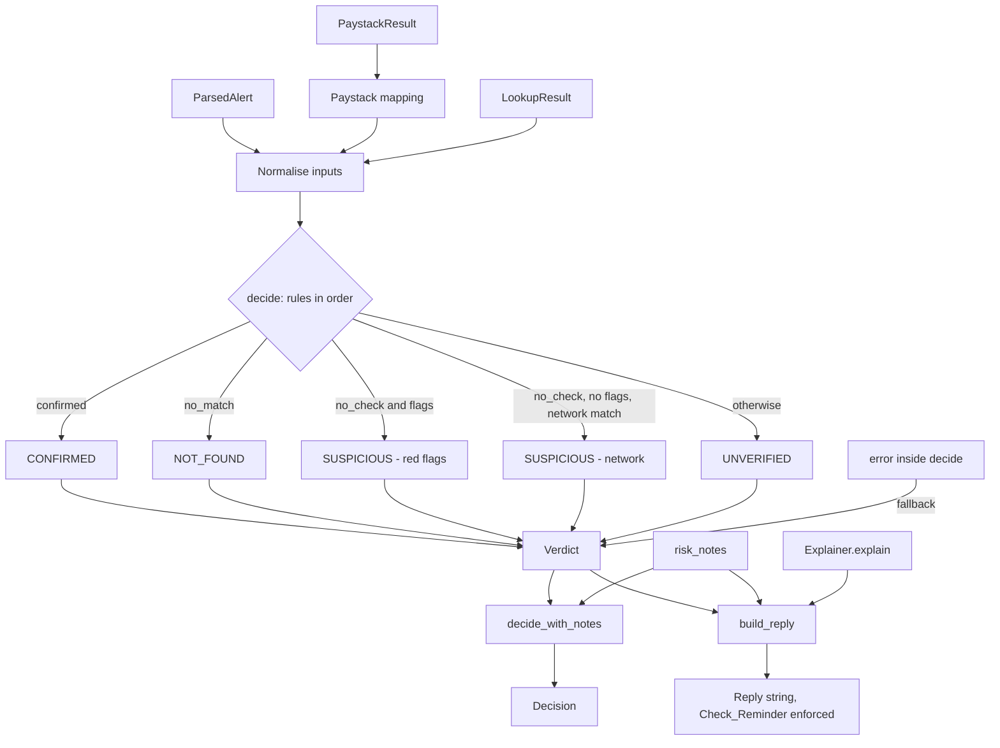

# Design Document

## Overview

The Verdict_Engine is one module, `src/ghost_credit/verdict.py`. The Explainer interface, TemplateExplainer, FakeExplainer and Reply_Builder live in the same module. A second file `explainer.py` is not created, because the whole engine is about 300 lines and one file is easier for a beginner to follow.

The module has four jobs:

1. `decide(parsed, paystack_result, lookup_result)` chooses a verdict with the four fixed rules from `.kiro/steering/payments-nigeria.md`, plus one stricter step for a network match. It is pure and total: it never raises and calls nothing outside itself.
2. `risk_notes(parsed, *, alert_text=None, large_amount_kobo=50000000)` returns plain-English cautions. `decide_with_notes(...)` returns a frozen `Decision` that holds the Verdict and those notes. Notes never change the verdict code or the red flags.
3. `Explainer`, `TemplateExplainer` and `FakeExplainer` write the wording. The Explainer can change the words, never the verdict.
4. `build_reply(verdict, parsed, explainer, risk_notes=None)` asks an Explainer for text, falls back to the reasons if the Explainer fails, and enforces the Check_Reminder.

Design decisions and reasons:

| Decision | Reason |
|---|---|
| Module path `src/ghost_credit/verdict.py`, with the Explainer code in the same module | One file, one import. The earlier requirements text names `verdict_engine.py`; this design uses `verdict.py` as instructed. Requirements 1 to 9 then need the path updated (see Open Points). |
| Rules in a short if-chain, not a table of strategies | Four rules plus one network step. An ordered chain is the easiest to read and to check against the steering file. |
| Defensive helpers first, decision second | Three small helpers turn any argument, including None or junk, into a safe value. Bad input is handled in one place (Requirements 4.3 to 4.6). |
| One outer try/except returns UNVERIFIED | UNVERIFIED never says money arrived, and its reply still carries the Check_Reminder (Requirement 4.8). |
| Import `PaystackResult`, do not define it | The real dataclass already exists in `ghost_credit.paystack`. A second type with the same name would invite mistakes (Requirement 9.4). |
| Risk notes live only on `Decision` | `decide` keeps its signature and returns the plain `Verdict` from the contract. `Verdict` is not extended (Requirement 5.1). |
| Reminder enforced in Reply_Builder | A future AI Explainer cannot drop it (Requirement 7.1). TemplateExplainer also writes it, and Reply_Builder never doubles it (Requirement 7.3). |
| Money as integer kobo, no floats | `tech.md` data rules. The threshold and amount comparison use ints only (Requirement 5.8). |
| No AI model, client or call | Cost rule in `tech.md` and `boundaries.md`. The Explainer is an interface with fixed-template and fake implementations (Requirement 6.8). |

Research: no outside sources were needed. The design rests on the repo files: `requirements.md`, `src/ghost_credit/paystack.py`, `src/ghost_credit/parser.py`, `.kiro/specs/pattern-network-hook/design.md`, `docs/pattern-network-contract.md` and the steering files.

### Reconciliation with other modules

| Item | Source | How this design uses it |
|---|---|---|
| `ParsedAlert` | `parser.py`, frozen dataclass | Reads `red_flags` (list of str), `amount_kobo` (int or None) and `alert_time` (naive `datetime` or None). Never reads other fields. |
| `RED_FLAG_CODES` | `parser.py` | Six codes today. Requirement text adds `TRANSFER_REQUEST_WORDING`, which the parser does not list yet. The reason table below covers it already, and any code not in the table gets a generic sentence. |
| `PaystackResult` | `paystack.py`, frozen dataclass: `status`, `checked`, `matched_reference`, `amount_kobo`, `paid_at`, `reason` | Imported. Only `status` and `checked` are read. |
| `Verdict` | `pattern_network.py` (planned in pattern-network-hook) | Built with `code`, `decided_by`, `paystack_checked`, `owner_outcome`, `reasons`. Its constructor raises `ValueError` for a bad `code` or `owner_outcome`, which the outer try/except covers. |
| `LookupResult` | `pattern_network.py` | Reads only `network_available` and `matched`. `Match` details never affect the verdict. |
| Network power | contract safety rule 1 | Can only turn UNVERIFIED into SUSPICIOUS. |

## Architecture



Rule order inside `decide` (stop at the first that applies):

1. Paystack mapping gives `confirmed`: CONFIRMED.
2. Paystack mapping gives `no_match`: NOT_FOUND.
3. Paystack mapping gives `no_check` and one or more red flags: SUSPICIOUS (reasons: flags).
4. Paystack mapping gives `no_check`, no red flags and a Network_Match: SUSPICIOUS (reason: network).
5. Otherwise: UNVERIFIED.

Step 4 is the "network can only be stricter" step. It is reachable only after the Paystack mapping gave `no_check`, so the network cannot change a Paystack result (Requirements 2.2, 2.3, 2.4).

## Components and Interfaces

All names live in `src/ghost_credit/verdict.py`. Imports: `Verdict` and `LookupResult` from `ghost_credit.pattern_network`, `ParsedAlert` from `ghost_credit.parser`, and `PaystackResult` from `ghost_credit.paystack` (Requirement 9.4). The module defines none of these. Because `paystack.py` has its own docstring saying the verdict engine has a separate `PaystackResult`, that sentence is outdated and is flagged under Open Points.

Module constants: `CONFIRMED`, `NOT_FOUND`, `SUSPICIOUS`, `UNVERIFIED` (the four code strings), `CHECK_REMINDER` (`Check your own bank app before releasing goods.`), `MAX_REASON_LENGTH` (120), `DEFAULT_LARGE_AMOUNT_KOBO` (50000000), and the owner labels table.

### Paystack mapping

Private helper `_paystack_state(paystack_result) -> str` returns exactly one of `confirmed`, `no_match` or `no_check`. It uses `isinstance(x, PaystackResult)`, then reads `status` and `checked`, all inside try/except.

| Paystack input | Mapped state | Verdict path | `paystack_checked` |
|---|---|---|---|
| `PaystackResult` with `status == "CONFIRMED"` | `confirmed` | CONFIRMED | True |
| `PaystackResult` with `status == "NOT_FOUND"` and `checked is True` | `no_match` | NOT_FOUND | True |
| `PaystackResult` with `status == "NOT_FOUND"` and `checked` False (for example "could not read the amount") | `no_check` | red flags, network, or UNVERIFIED | False |
| `PaystackResult` with `status == "UNAVAILABLE"` (no key, test key rule, timeout, bad reply) | `no_check` | red flags, network, or UNVERIFIED | False |
| `PaystackResult` with any other `status`, or a `status` that is not a string, or a `checked` that is not exactly True or False | `no_check` | red flags, network, or UNVERIFIED | False |
| None, or any value that is not a `PaystackResult` | `no_check` | red flags, network, or UNVERIFIED | False |

Notes on the table:

- `checked` is compared with `is True`, so a truthy junk value never counts as a Paystack check.
- `paystack.py` builds every real CONFIRMED result with `checked` True. The mapping reads only `status` for CONFIRMED, as Requirement Glossary says, so a hand-built CONFIRMED with `checked` False would still map to CONFIRMED. This matches the requirement and is covered by an example test.
- `paystack.py` returns NOT_FOUND with `checked` True when it finds more than one payment of the same amount ("more than one payment of this amount, check manually"). The mapping gives NOT_FOUND (GHOST) for that case, as the requirements say. It is listed under Open Points because the owner reply may deserve a softer line later.

### Already-used payment reason (addition, Requirement 3.12)

`paystack.py` returns `NOT_FOUND` with `checked` True and the reason `REASON_ALREADY_USED` when a matching payment was already used for an earlier check. The mapping does not change: this is still `no_match`, so the code is `NOT_FOUND` (GHOST) and `paystack_checked` is True. Only the reason changes. A small private helper `_no_match_reason(paystack_result)` returns `REASON_ALREADY_USED` when `paystack_result.reason == REASON_ALREADY_USED`, and `REASON_NOT_FOUND` otherwise. `decide` uses it for the `no_match` branch. The constant is imported from `ghost_credit.paystack`, not retyped. It is 50 characters, so `_cut` leaves it whole. The engine reads no other Paystack text, because every other reason in `paystack.py` is a fixed string the owner never sees.

### Helpers

| Helper | Returns | Rule |
|---|---|---|
| `_flags_of(parsed)` | New `list` of the `red_flags` | None, missing attribute or a non-list gives `[]`. Always a copy, so the argument is never changed (Requirements 4.5, 4.7). A code outside the known set still counts as a flag (Requirement 1.6). |
| `_is_network_match(lookup_result)` | bool | True only when `network_available is True` and `matched is True`, read with `getattr`. None or a missing or non-boolean field gives False (Requirements 2.5, 4.6). |
| `_cut(text)` | str | Cuts a reason to its first 120 characters (Requirement 3.5). |

### decide

```
decide(parsed, paystack_result, lookup_result) -> Verdict
```

1. Inside one try block, compute `state`, `flags` and `network` with the helpers.
2. Apply the rule chain. Build the Verdict with `decided_by="rules"`, `owner_outcome="unknown"` and `paystack_checked` True only for `confirmed` and `no_match` (Requirements 3.1 to 3.3). Every reason goes through `_cut` and `reasons` is never empty (Requirement 3.4).
3. On any exception, return the fallback Verdict: code `UNVERIFIED`, `decided_by="rules"`, `owner_outcome="unknown"`, `paystack_checked=False`, one reason "The check could not be completed." (Requirement 4.8).

`decide` reads no clock, file, network or random source and holds no state (Requirements 4.1, 4.2). It puts no Risk_Note in `reasons` (Requirement 3.11).

### Reasons

| Case | Reasons written |
|---|---|
| CONFIRMED | "Paystack found a matching payment." |
| NOT_FOUND | "Paystack found no matching payment." |
| NOT_FOUND, payment already used (Requirement 3.12) | "This payment was already used for an earlier check" (the constant `REASON_ALREADY_USED`, imported from `ghost_credit.paystack`) |
| SUSPICIOUS, red flags | One reason per entry of `red_flags`, in list order, from the flag sentence table below |
| SUSPICIOUS, network | "The pattern network has seen a similar alert." |
| UNVERIFIED | "No Paystack check was possible and no red flags were found." |
| Fallback after an internal error | "The check could not be completed." |

Flag sentence table (everyday words, no code names, each well under 120 characters, each talks about the alert and never about the customer):

| Red_Flag_Code | Reason sentence |
|---|---|
| SENDER_ID_MISMATCH | "The message came from a phone number, not from a bank." |
| BALANCE_LINE_MISSING | "The alert has no available balance line, which banks normally include." |
| AMOUNT_FORMAT_ODD | "The amount is written in a strange way." |
| DATE_ODD | "The date or time on the alert looks wrong." |
| PRESSURE_LANGUAGE | "The message pushes you to release goods before you can check." |
| SCREENSHOT_EDIT_SIGNS | "The screenshot shows signs it may have been edited." |
| TRANSFER_REQUEST_WORDING | "The message says a transfer was requested, not received." |
| any other entry, including a non-string | "Something else about this alert looks wrong." |

Because every sentence is fixed and short, an arbitrarily long or unknown code in `red_flags` can never push a reason past 120 characters. The earlier approach of printing the codes in one line is dropped, and the old caveat about 101-character code lists no longer applies. A list with several entries produces several reasons, and the 120 limit applies to each (Requirements 3.5, 3.6). Duplicate entries each get a reason, because the requirement says one reason for each entry.

### risk_notes

```
risk_notes(parsed, *, alert_text=None, large_amount_kobo=50000000) -> list[str]
```

Pure, keyword-only extras, never raises (Requirement 5.12), never changes `parsed` (Requirement 5.13). It collects up to three notes in this fixed order and returns each at most once (Requirement 5.11).

| Order | Note text (exact) | Applies when |
|---|---|---|
| 1 | `Sent late on a Friday or at the weekend, a common time for fake alerts.` | `alert_time` is a `datetime` and, as Lagos time, it is a Friday at 14:00 or later, or a Saturday, or a Sunday |
| 2 | `Large amount. Take extra care before releasing goods.` | `amount_kobo` is an `int` (not a bool) and `amount_kobo >= threshold` |
| 3 | `Someone is coming to collect at once. Do not release goods until the money shows in your bank app.` | The normalised `alert_text` contains a collection word or phrase |

Lagos time handling (note 1):

- Lagos is a fixed +01:00 all year, with no daylight saving, so one module constant `_LAGOS = timezone(timedelta(hours=1))` is enough, the same as in `paystack.py`.
- A naive `alert_time` is already Lagos time (the parser returns naive values). `tzinfo` is attached with `replace(tzinfo=_LAGOS)`.
- An aware `alert_time` is converted with `astimezone(_LAGOS)` before the weekday and hour are read. An aware value whose `utcoffset()` is None is treated as naive.
- After conversion: `weekday() == 4 and hour >= 14` (Friday), or `weekday() in (5, 6)` (Saturday, Sunday). Friday 13:59 gives no note, Friday 14:00 gives the note.
- A value that is not a `datetime`, or None, adds no note (Requirement 5.10). Conversion errors are caught by the outer try/except and return `[]`.

Threshold in kobo (note 2):

- The default is `DEFAULT_LARGE_AMOUNT_KOBO = 50000000` (NGN 500,000).
- `_threshold(value)` returns `value` only when `isinstance(value, int)` and not `isinstance(value, bool)`. Anything else, including floats and strings, gives the default (Requirement 5.9).
- The comparison is integer `>=`. One kobo below the threshold gives no note and exactly the threshold gives the note. No floats are used (Requirement 5.8).
- `amount_kobo` of None, a bool or any non-int adds no note (Requirement 5.10).
- The note text contains no figure, so no amount appears in the reply (Requirement 9.3).

Word list and text normalisation (note 3):

- Collection words: `rider`, `dispatch`, `driver`. Collection phrases: `pick up now`, `pickup now`. These are the module constant `COLLECTION_TERMS` and are lower case.
- `_normalise_text(text)` does three steps in this order: replace curly quotes (U+2018, U+2019, U+201C, U+201D) with straight quotes using `str.translate`, lower-case the text, and replace each run of whitespace with one space (Requirement 5.6).
- Matching uses one compiled regex per term of the form `(?<!\w)` + `re.escape(term)` + `(?!\w)`, so `drivers` and `riderless` do not match but `Rider!` does.
- `alert_text` that is None or not a string adds no note (Requirement 5.7). The text is used only for matching and is never copied into a note, a reason or a log.

### decide_with_notes and Decision

```
@dataclass(frozen=True)
class Decision:
    verdict: Verdict
    risk_notes: list[str]

decide_with_notes(parsed, paystack_result, lookup_result, *, alert_text=None,
                  large_amount_kobo=50000000) -> Decision
```

`decide_with_notes` calls `decide(...)` once for the verdict and `risk_notes(...)` once for the notes, then returns `Decision(verdict, notes)`. The two calls do not share state, so the notes cannot change the code, the reasons or the `red_flags` (Requirements 5.1, 5.2). `risk_notes` is a `list` as the requirement says, so a Decision compares equal by value but is not hashable.

### Explainer and FakeExplainer

`Explainer` is an abstract base class (`abc.ABC`) with one method: `explain(verdict, parsed, risk_notes) -> str` (Requirement 6.1). `build_reply` passes it a deep copy of the Verdict and a copy of the notes list, so even a careless Explainer cannot change the real verdict (Requirement 6.10).

`FakeExplainer` returns the same fixed string for equal arguments, built only from `verdict.code`, `verdict.reasons` and the notes. It makes no external call (Requirement 6.7).

### TemplateExplainer

`TemplateExplainer.explain` builds the reply from fixed text. It makes no AI call and no network call (Requirements 6.2, 6.8). Layout, in WhatsApp-friendly lines:

```
<headline: label, instruction, one or two short sentences>

Why:
- <reason 1>
- <reason 2>
- <reason 3>
- <risk note 1>
- <risk note 2>

Check your own bank app before releasing goods.      (not for CONFIRMED)
```

Headline templates, one per code. Each starts with the Owner_Label and an instruction, and has at most three sentences (Requirements 6.3, 6.4):

| Verdict code | Owner_Label | Headline template (fixed text) |
|---|---|---|
| CONFIRMED | ALIVE | `ALIVE. You can release the goods. Paystack has a matching payment for this alert.` |
| NOT_FOUND | GHOST | `GHOST. Hold the goods. Paystack has no matching payment for this alert.` |
| NOT_FOUND, and `reasons` include `REASON_ALREADY_USED` (Requirement 6.12) | GHOST | `GHOST. Hold the goods. This payment was already used.` |
| SUSPICIOUS | SUSPICIOUS | `SUSPICIOUS. Hold the goods. This alert has warning signs.` |
| UNVERIFIED | UNVERIFIED | `UNVERIFIED. Check first before you release anything. Nothing here proves this alert either way.` |
| any other code | UNVERIFIED | Same as UNVERIFIED (safe side) |

The already-used headline is chosen only when the code is NOT_FOUND and the `reasons` list holds `REASON_ALREADY_USED` (imported from `ghost_credit.paystack`). It is the first line of the reply. Every other case keeps the headline in the table above, the reasons list still follows, and `build_reply` still adds the Check_Reminder (Requirement 6.12).

List rules:

- "Why:" lists at most the first 3 `reasons` (Requirement 6.5). If there are no reasons and no notes, the "Why:" block is left out.
- Each Risk_Note follows the reasons as its own `- ` line, with no cap on how many (there are at most three).
- The Check_Reminder is the last line for every code except CONFIRMED (Requirement 6.5). Reply_Builder still checks for it, so TemplateExplainer and Reply_Builder never produce it twice.
- No code name appears: reasons are already plain English, and the template never prints `Verdict.code` or any Red_Flag_Code (Requirement 6.6).
- The text talks about "this alert" and never names or accuses a customer (`product.md`).

### build_reply

```
build_reply(verdict, parsed, explainer, risk_notes=None) -> str
```

Never raises. Steps:

1. Read the code once from the original verdict, `getattr(verdict, "code", None)`. Keep only `str` items of `risk_notes` (None means an empty list). These are the `code` and `notes` used for the rest of the function.
2. Call `explainer.explain(deepcopy(verdict), parsed, list(notes))` inside try/except.
3. If it raised, or the value is not a `str`, or is empty after stripping whitespace, use the fallback text (Requirement 6.11): the `verdict.reasons` joined with a single space, then each Risk_Note, with the parts joined by a newline. Non-string reasons are skipped. If the Verdict has no readable reasons, the fallback text may be empty.
4. If `code == CONFIRMED`, return the text unchanged (Requirement 7.4).
5. Otherwise (NOT_FOUND, SUSPICIOUS, UNVERIFIED or any unknown code), strip trailing whitespace from the text. If the result ends with `CHECK_REMINDER`, return it. If not, return the result, a newline (nothing for empty text) and `CHECK_REMINDER` (Requirements 7.1 to 7.3).

Effects:

- The reply for a non-CONFIRMED code always ends with the reminder and no character follows it.
- Risk notes sit after the reasons and before the reminder, because the template and the fallback both put them there and the reminder is appended last (Requirement 7.5).
- Feeding a finished reply back in through an Explainer that returns it unchanged yields the same reply, because step 5 strips trailing whitespace and then finds the reminder already in place (Requirement 7.6).
- Because `code` was read from the original Verdict before the Explainer ran, the Explainer has no way to change it (Requirement 6.10).

## Data Models

| Type | Source | Fields used here |
|---|---|---|
| `ParsedAlert` | `parser.py` | `red_flags`, `amount_kobo`, `alert_time` |
| `PaystackResult` | `paystack.py` | `status`, `checked` |
| `LookupResult` | `pattern_network.py` | `network_available`, `matched` |
| `Verdict` | `pattern_network.py` | All five fields, written by `decide` |
| `Decision` | defined here | `verdict: Verdict`, `risk_notes: list[str]` (frozen) |
| `Explainer`, `TemplateExplainer`, `FakeExplainer` | defined here | `explain(verdict, parsed, risk_notes) -> str` |

Owner labels table (constant): CONFIRMED to ALIVE, NOT_FOUND to GHOST, SUSPICIOUS to SUSPICIOUS, UNVERIFIED to UNVERIFIED.

Paystack status strings used in the mapping come from `ghost_credit.paystack` (`CONFIRMED`, `NOT_FOUND`, `UNAVAILABLE`) and are imported, not retyped, so a rename there is caught at import time.

## Correctness Properties

*A property is a characteristic or behavior that should hold true across all valid executions of a system-essentially, a formal statement about what the system should do. Properties serve as the bridge between human-readable specifications and machine-verifiable correctness guarantees.*

Reflection: criteria 1.1 to 1.6 and 2.1 merge into the rule-table property. Criteria 3.1 to 3.3 merge into one field property. Criteria 3.6 to 3.11 merge into one reasons-content property. Criteria 4.3 to 4.6 and 4.8 merge into one totality property. Criteria 5.11 to 5.13 merge into one note-list property. Criteria 6.9 to 6.11 merge into one build_reply property, and 7.1 to 7.5 into one reminder property. Properties 2, 3 and 4 overlap with Property 1 in logic but are kept separate because Requirements 8.1 to 8.3 ask for each by name and each guards a distinct safety rule. Criteria 4.1, 6.1, 6.2, 6.8, 8.x and 9.x are design or process checks and are covered by smoke checks in the Testing Strategy.

### Property 1: Verdict code follows the rule table

For any ParsedAlert `red_flags` list (including codes outside the known set), any Paystack input and any LookupResult, the code returned by `decide` equals the code of an independent oracle: Paystack_Confirmed gives CONFIRMED; Paystack_No_Match gives NOT_FOUND; otherwise one or more red flags give SUSPICIOUS; otherwise a Network_Match gives SUSPICIOUS; otherwise UNVERIFIED.

**Validates: Requirements 1.1, 1.2, 1.3, 1.4, 1.5, 1.6, 2.1**

### Property 2: A Paystack result beats the network

For any ParsedAlert and any LookupResult, a Paystack_Confirmed input gives code CONFIRMED, and a Paystack_No_Match input gives code NOT_FOUND.

**Validates: Requirements 2.2, 2.3, 8.2**

### Property 3: Only Paystack can confirm

For any ParsedAlert, any LookupResult (including any Network_Match) and any Paystack input that is not Paystack_Confirmed (including `NOT_FOUND` with `checked` False, `UNAVAILABLE`, None and junk), the code returned by `decide` is not CONFIRMED.

**Validates: Requirements 2.4, 8.1**

### Property 4: A screenshot never confirms by itself

For any ParsedAlert that carries a `screenshot_phash` and an empty `red_flags` list, any LookupResult and any Paystack input that is not Paystack_Confirmed, the code returned by `decide` is not CONFIRMED.

**Validates: Requirements 2.4, 8.3**

### Property 5: An unavailable network equals no network

For any ParsedAlert and Paystack input, and any LookupResult with `network_available` False (with either `matched` value), `decide` returns a Verdict equal to the one it returns for a LookupResult of None.

**Validates: Requirements 2.5**

### Property 6: Verdict fields are fixed by the rules

For any inputs, the returned Verdict has `decided_by` equal to `"rules"`, `owner_outcome` equal to `"unknown"`, and `paystack_checked` True exactly when the Paystack input is Paystack_Confirmed or Paystack_No_Match.

**Validates: Requirements 3.1, 3.2, 3.3**

### Property 7: Every reason is 1 to 120 characters

For any `red_flags` list, including unknown codes, non-string entries and very long strings, every string in the returned `reasons` has 1 to 120 characters, and `reasons` is not empty.

**Validates: Requirements 3.4, 3.5, 8.6**

### Property 8: Reasons explain the verdict and hold no notes

For any inputs, the reasons match the verdict. A flag-based SUSPICIOUS verdict has one reason per entry of `red_flags`, in order, each taken from the flag sentence table and containing no Red_Flag_Code. A network-based SUSPICIOUS verdict has the reason that the pattern network has seen a similar alert. CONFIRMED, NOT_FOUND and UNVERIFIED each have their fixed reason, except that a NOT_FOUND from a Paystack result whose reason is `REASON_ALREADY_USED` has that sentence as its reason. No Risk_Note text appears in `reasons`, whatever `alert_text`, `alert_time` and amount are.

**Validates: Requirements 3.6, 3.7, 3.8, 3.9, 3.10, 3.11, 3.12**

### Property 9: Decide is deterministic and leaves arguments unchanged

For any arguments, two calls to `decide` return equal Verdict values, and a deep copy of the arguments taken before the calls equals the arguments after the calls.

**Validates: Requirements 4.2, 4.7**

### Property 10: Decide is total and treats junk as defaults

For any arguments drawn from valid values, None and arbitrary junk (wrong types, non-list `red_flags`, unknown Paystack status, non-boolean `matched` or `network_available`, objects that raise on access), `decide` does not raise, returns a code from the four Verdict_Code values and `decided_by` equal to `"rules"`. A junk Paystack input gives the same Verdict as None, a non-list `red_flags` gives the same Verdict as an empty list, and a bad LookupResult gives the same Verdict as not a Network_Match. When an internal error is forced, the Verdict is UNVERIFIED with one reason.

**Validates: Requirements 4.3, 4.4, 4.5, 4.6, 4.8, 8.5**

### Property 11: Notes never change the verdict or the red flags

For any ParsedAlert, Paystack input, LookupResult, `alert_text` and `large_amount_kobo`, the Verdict inside the Decision from `decide_with_notes` equals the Verdict from `decide` for the same three inputs, and the `red_flags` of the ParsedAlert are equal before and after.

**Validates: Requirements 5.1, 5.2, 8.4**

### Property 12: Friday and weekend note follows Lagos time

For any `alert_time`, naive or aware at any offset, the note `Sent late on a Friday or at the weekend, a common time for fake alerts.` is present exactly when the Lagos-time value (naive read as Lagos, aware converted to +01:00) is a Friday at 14:00 or later, a Saturday or a Sunday. For a None or non-datetime `alert_time`, the note is absent.

**Validates: Requirements 5.3, 5.10**

### Property 13: Large amount note follows an integer threshold

For any `amount_kobo` and any `large_amount_kobo`, the note `Large amount. Take extra care before releasing goods.` is present exactly when `amount_kobo` is an integer (not a bool) and is at or above the effective threshold. The effective threshold is `large_amount_kobo` when it is an integer and not a bool, and 50000000 otherwise. For a None or non-integer `amount_kobo`, the note is absent.

**Validates: Requirements 5.4, 5.8, 5.9, 5.10**

### Property 14: Collection note follows whole-word matching

For any `alert_text` built from filler text with a collection word or phrase inserted, in any letter case, with any whitespace run between the words of a phrase and with curly or straight quotes elsewhere in the text, the note `Someone is coming to collect at once. Do not release goods until the money shows in your bank app.` is present exactly when a whole-word `rider`, `dispatch`, `driver`, `pick up now` or `pickup now` is in the normalised text. A term inside a longer word does not match. For None or a non-string `alert_text`, the note is absent.

**Validates: Requirements 5.5, 5.6, 5.7**

### Property 15: The note list is ordered, unique and safe

For any inputs, `risk_notes` returns a list that is a subsequence of the three fixed notes in the order Friday-or-weekend, large amount, collection, with no repeats. It returns an empty list when no note applies and when an internal error is forced, and it leaves the ParsedAlert unchanged.

**Validates: Requirements 5.11, 5.12, 5.13**

### Property 16: TemplateExplainer text is short, plain and ordered

For any Verdict returned by `decide` and any list of Risk_Note strings, the TemplateExplainer text starts with the Owner_Label for the code, has at most three sentences before the "Why:" list, lists at most the first 3 reasons, places every Risk_Note after the reasons, contains no Red_Flag_Code, and ends with the Check_Reminder when the code is not CONFIRMED. When the code is NOT_FOUND and the reasons include `REASON_ALREADY_USED`, the first line is exactly `GHOST. Hold the goods. This payment was already used.`, and for every other Verdict the first line is the headline of its code.

**Validates: Requirements 6.3, 6.4, 6.5, 6.6, 6.12**

### Property 17: FakeExplainer is deterministic

For any Verdict, ParsedAlert and note list, two calls to FakeExplainer with equal arguments return equal strings, and the arguments are unchanged.

**Validates: Requirements 6.7**

### Property 18: build_reply keeps the verdict and survives bad Explainers

For any Verdict and any Explainer (TemplateExplainer, FakeExplainer, one returning arbitrary text, one returning a non-string or whitespace-only value, one that raises, one that tries to change the Verdict it receives), `build_reply` does not raise, leaves the Verdict code and reasons equal to their values before the call, and returns a string. When the Explainer fails or returns a non-string or empty text, the reply is built from the reasons joined with a single space followed by each Risk_Note, plus the Check_Reminder when the code is not CONFIRMED.

**Validates: Requirements 6.9, 6.10, 6.11**

### Property 19: Replies for unconfirmed verdicts end with the reminder

For any Explainer text, any note list and any Verdict with code NOT_FOUND, SUSPICIOUS or UNVERIFIED, the reply from `build_reply` ends with the Check_Reminder with no character after it, the Check_Reminder is not repeated at the end, and the Risk_Notes passed in appear before it. For any Explainer text that already ends with the Check_Reminder, the reply has it once at the end. For any non-blank Explainer text and a CONFIRMED Verdict, the reply equals the Explainer text. This holds for TemplateExplainer, FakeExplainer and an Explainer that returns arbitrary text.

**Validates: Requirements 7.1, 7.2, 7.3, 7.4, 7.5, 8.10**

### Property 20: Reply building is idempotent

For any Explainer text, any note list and any of the four Verdict codes, if `build_reply` returns the reply R, then `build_reply` with an Explainer that returns R returns R again.

**Validates: Requirements 7.6**

## Error Handling

| Situation | Behaviour |
|---|---|
| Any argument of `decide` is None or malformed | Helpers use the defaults (Requirements 4.4 to 4.6). No exception. |
| Unexpected exception inside `decide`, for example a `Verdict` constructor error or a `red_flags` object that raises when copied | Fallback Verdict: UNVERIFIED, reason "The check could not be completed." (Requirement 4.8). |
| `PaystackResult` with an unknown `status` or a non-boolean `checked` | Mapped to `no_check`. |
| `NOT_FOUND` with `checked` False | Mapped to `no_check`, so it is never reported as GHOST. |
| `risk_notes` meets bad `alert_time`, `amount_kobo`, `alert_text` or `large_amount_kobo` | The affected note is skipped or the default threshold is used. An unexpected error returns `[]` (Requirement 5.12). |
| `decide_with_notes` | Calls the two total functions, so it never raises. |
| Explainer raises, returns a non-string, or returns blank text | Reply built from the reasons and notes (Requirement 6.11). No exception reaches the caller. |
| Explainer tries to change the Verdict | It only receives a deep copy. The original is untouched (Requirement 6.10). |
| Verdict with empty `reasons` in `build_reply` | Fallback text is empty. For a non-CONFIRMED code the reply is only the Check_Reminder, for CONFIRMED it is an empty string. Verdicts from `decide` always have reasons. |
| Verdict with an unknown or unreadable code in `build_reply` | Treated as not CONFIRMED, so the reminder is added (the safe side). |

Nothing in the module logs, so no alert text, reference or key can leak (Requirement 9.2).

## Testing Strategy

Property-based testing applies because `decide`, `risk_notes`, `build_reply` and the templates are pure functions over a large input space. Library: Hypothesis (already used in `tests/`), not built from scratch. Tests use pytest, synthetic data only, no secrets, no AI call and no network call, and pass with `PATTERN_NETWORK=off` (Requirements 8.12, 9.2).

Property tests:

- One Hypothesis test per Property 1 to 20, each run with at least 100 examples (`@settings(max_examples=100)` or more).
- Each test carries the comment tag `Feature: verdict-engine, Property N: <property text>`.
- Test file: `tests/test_verdict.py`. Shared strategies at the top of that file.
- Generators:
  - `red_flags`: subsets of the parser's `RED_FLAG_CODES`, plus `TRANSFER_REQUEST_WORDING`, plus arbitrary text lists (long strings, empty strings) and non-strings.
  - Paystack input: real `PaystackResult` values built for `CONFIRMED`, `NOT_FOUND` with `checked` True and False, `UNAVAILABLE`, an unknown status, plus None and junk objects.
  - LookupResult: built from two booleans, plus None and junk objects.
  - `alert_time`: naive and aware datetimes across several offsets, plus None.
  - `amount_kobo` and `large_amount_kobo`: integers around the threshold, plus floats, bools, strings and None.
  - `alert_text`: filler text with inserted terms, case changes, whitespace runs and curly quotes.
  - Explainer texts: `st.text()` including blank strings and strings ending with the Check_Reminder.
- Test Explainers: `TemplateExplainer`, `FakeExplainer`, one returning given text, one returning a non-string, one that raises, one that tries to change the Verdict it receives.

Example tests (Requirements 8.7 to 8.9, 8.11):

- One example for each of rules 1 to 4, and one for a Network_Match turning UNVERIFIED into SUSPICIOUS.
- Paystack mapping examples: `NOT_FOUND` with `checked` False, `UNAVAILABLE`, None and an unreadable value each act as No_Paystack_Check; `NOT_FOUND` with `checked` True and a hand-built `CONFIRMED` with `checked` False.
- Risk note examples: Friday 13:59 (no note), Friday 14:00 (note), Saturday, Sunday, an aware `alert_time` in another offset that falls on a different weekday in Lagos, an amount one kobo below and exactly at the threshold, and an `alert_text` with curly quotes and mixed letter case.
- Fallback Verdict forced by a `red_flags` object that raises on copy.
- TemplateExplainer example for each of the four codes: Owner_Label first, at most 3 reasons, notes after reasons and before the reminder, no network or AI call.
- A reply for each code ends as expected (reminder for three, none for CONFIRMED).
- Already-used headline example (Requirement 6.12), in `tests/test_ai_explainer_instruction_examples.py`: a NOT_FOUND Verdict with the reason `REASON_ALREADY_USED` gives the first line `GHOST. Hold the goods. This payment was already used.`. This is an example test and not a property test, because it has one fixed input.

Smoke checks:

- The module imports `Verdict` and `LookupResult` from `pattern_network`, `ParsedAlert` from `parser` and `PaystackResult` from `paystack`, and defines none of them (Requirement 9.4).
- The module source holds no AI model name, AI client import, HTTP library, socket, `open(` call, clock or random import, and no secret (Requirements 4.1, 6.8, 9.1, 9.2).
- `Explainer` is abstract and exposes `explain(verdict, parsed, risk_notes)` (Requirement 6.1).

## Suggested Implementation Order

1. **Module skeleton and Paystack mapping.** Create `src/ghost_credit/verdict.py` with the imports, constants, owner labels, `_paystack_state`, `_flags_of`, `_is_network_match` and `_cut`.
   - Test sub-tasks: Paystack mapping example tests; smoke check on imports and forbidden names. Requirements 4.4 to 4.6, 9.4.
2. **decide and reasons.** Add the flag sentence table, the reason builders, `decide` and the fallback Verdict.
   - Test sub-tasks: rule examples 1 to 4 and the network example; Properties 1 to 10. Requirements 1 to 4.
3. **Risk notes.** Add `COLLECTION_TERMS`, `_normalise_text`, the Lagos time helper, `_threshold` and `risk_notes`.
   - Test sub-tasks: Risk note examples; Properties 12 to 15. Requirement 5.
4. **Decision and decide_with_notes.**
   - Test sub-tasks: Property 11 and a frozen-dataclass example. Requirement 5.1, 5.2.
5. **Explainer, FakeExplainer, TemplateExplainer.**
   - Test sub-tasks: template examples for the four codes; Properties 16 and 17. Requirement 6.1 to 6.8.
6. **build_reply.**
   - Test sub-tasks: Properties 18 to 20 and the reply-ending examples. Requirements 6.9 to 6.11, 7.
7. **Checkpoint.** Run the full test suite with `PATTERN_NETWORK=off` and fix any failure.
   - Test sub-tasks: none beyond running the suite. Requirement 8.12.

## Open Points

- **Module path.** `requirements.md` still names `src/ghost_credit/verdict_engine.py` in the Introduction and the Glossary. This design uses `src/ghost_credit/verdict.py`. One of the two must be changed so they match.
- **`TRANSFER_REQUEST_WORDING`.** The requirements list it as the last entry of `RED_FLAG_CODES`, but `src/ghost_credit/parser.py` has six codes and not this one. The design handles it already, and any other unknown code gets a generic sentence.
- **`pattern_network.py` does not exist yet.** `src/ghost_credit/` holds only `parser.py`, `paystack.py` and `screenshot.py`. The import of `Verdict` and `LookupResult` works only after the pattern-network-hook tasks are done.
- **Outdated docstring in `paystack.py`.** It says the verdict-engine has its own `PaystackResult`. The requirements now import the real one. The docstring needs a fix in a later code change. This task is docs only.
- **Ambiguous Paystack matches.** `paystack.py` returns NOT_FOUND with `checked` True when several payments of the same amount exist. The mapping then gives NOT_FOUND (GHOST), as the requirements state. The reason "Paystack found no matching payment." is slightly off for that case.
- **Reminder from two places.** Requirement 6.5 has TemplateExplainer write the Check_Reminder and Requirement 7.1 says no Explainer carries the duty. The design satisfies both: the template writes it and Reply_Builder never doubles it.
- **Duplicate flags.** Requirement 3.6 says one reason for each entry, so a duplicate entry in `red_flags` gives a duplicate reason. The parser never produces duplicates.
- **GHOST headline for an already-used payment.** Closed. Requirement 6.12 and the headline table now give the first line `GHOST. Hold the goods. This payment was already used.` for this case.
- **Old `tasks.md`.** `.kiro/specs/verdict-engine/tasks.md` was not touched and may still describe the old design.
