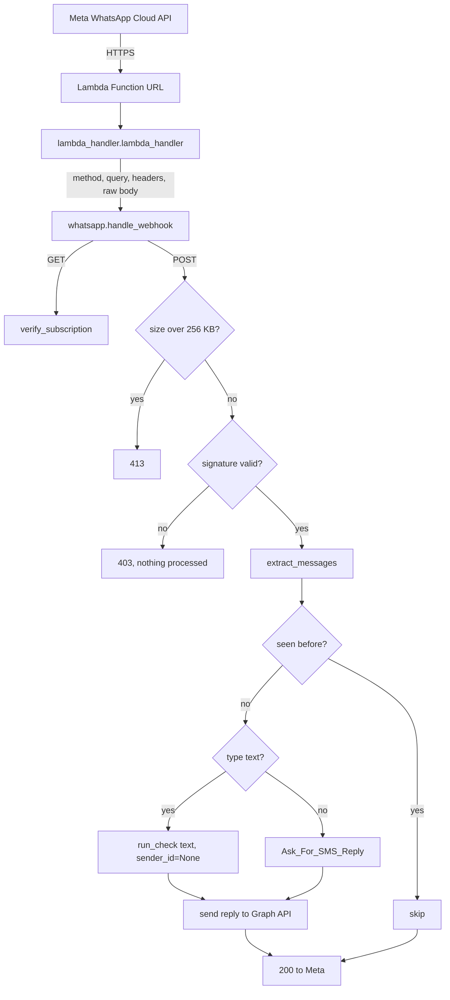
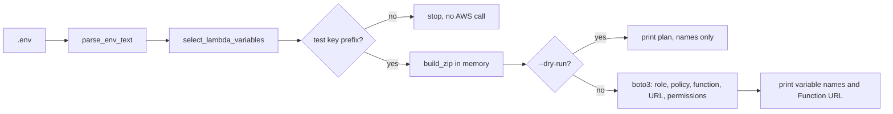

# Design Document

## Overview

The feature has two parts.

**Part A** adds `src/ghost_credit/whatsapp.py`, a standard-library-only module with one entry point, `handle_webhook`. It answers Meta's GET verification, checks the HMAC signature of every POST, reads text messages from the Cloud API payload, runs the existing `run_check` pipeline, and sends the reply back with one outbound HTTPS call. Images and other non-text messages get a fixed "please paste the SMS text" reply.

**Part B** adds `src/ghost_credit/lambda_handler.py` (an adapter for an AWS Lambda Function URL), makes the Pillow and imagehash imports in `screenshot.py` lazy, and adds `scripts/deploy_lambda.py` and `docs/deploy.md`. The tests never call AWS and never import `boto3`.

Design decisions:

| Decision | Reason |
|---|---|
| `handle_webhook(method, query, headers, body, **deps)` takes plain values and returns a `WebhookResponse` | The same function serves tests, Lambda and any other host. It knows nothing about Lambda. |
| Order for POST: size check, signature check, JSON parse, per-message work | Cheap and safe checks run first. Nothing is parsed or processed before the signature passes (Requirements 2.1 to 2.7). |
| One `authenticated` flag decides what an unexpected error returns | Before the signature passes, a failure gives 403 (fail closed). After it passes, a failure gives 200 so Meta does not retry (Requirements 2.6, 9.2). A fixed 500 is never used. |
| Environment variables are read at request time | Tests change them with `monkeypatch`, and a Lambda container picks up its own variables without import-time side effects (Requirements 1.5, 2.8). |
| Every dependency is an optional keyword argument | Tests inject fakes. Defaults are the real parts with `PATTERN_NETWORK=off` (Requirements 4.4 to 4.8). |
| The Send_Function takes `(url, headers, body_bytes, timeout)` and returns `(status, body_bytes)` | It mirrors the injectable `http` function in `paystack.py`, with a body added for POST. |
| `get_explainer` is imported lazily inside a helper | `ghost_credit.ai_explainer` belongs to another spec and may not exist. A missing module or a raising call falls back to `TemplateExplainer` (Requirement 4.8). |
| `sender_id=None` is passed to `run_check` | A WhatsApp number is not an SMS sender id. Passing it would raise SENDER_ID_MISMATCH on every check. |
| The Seen_Set is an `OrderedDict` capped at 1000 | Small, bounded, oldest-first removal. It is best effort and lasts one container (Requirements 7.3 to 7.7). |
| `screenshot.py` uses a module-level `__getattr__` for `Image` and `imagehash` | The existing test `test_prop_screenshot_bad_input.py` patches `screenshot.Image.open`. Lazy loading on first attribute access keeps that test passing unchanged (Requirement 10.4). |
| The deploy script keeps `boto3` imports inside functions that call AWS | Pure helpers import and test with no `boto3` (Requirement 12.9). |

Research: Meta's webhook rules were checked against the public WhatsApp Cloud API documentation on webhooks (verification uses `hub.mode`, `hub.verify_token` and `hub.challenge`; signed calls carry `X-Hub-Signature-256`, an HMAC-SHA256 of the raw payload keyed with the app secret). AWS rules were checked against the Lambda Function URL documentation. A public Function URL with auth type `NONE` needs a resource-based permission for `lambda:InvokeFunctionUrl` with `FunctionUrlAuthType` `NONE`. Since October 2025 it also needs `lambda:InvokeFunction` with the `InvokedViaFunctionUrl` condition, which the requirements already list. Function URL payload version 2.0 puts the method in `requestContext.http.method`, lowercases header names, and base64-encodes the body when `isBase64Encoded` is true. Content was rephrased for compliance with licensing restrictions.

Existing code read before writing this design: `pipeline.py` (`run_check`, `CheckResult`, `make_paystack_verify`), `verdict.py` (`TemplateExplainer`, `CHECK_REMINDER`), `screenshot.py`, `pattern_network.py` (`get_network`), `paystack.py` (the injectable `http` pattern) and the four steering files.

## Architecture



Deploy flow (run by the user, never by tests):



## Components and Interfaces

### `src/ghost_credit/whatsapp.py` (standard library only)

```python
GRAPH_API_VERSION = "v21.0"
GRAPH_URL_TEMPLATE = "https://graph.facebook.com/{version}/{phone_number_id}/messages"
MAX_BODY_BYTES = 262_144
MAX_TEXT_CHARS = 2000
MAX_REPLY_CHARS = 4096
SEND_TIMEOUT_SECONDS = 5.0
SEEN_CAPACITY = 1000
USER_AGENT = "ghost-credit/0.1"
ASK_FOR_SMS_REPLY = ("I can only check the SMS text for now. "
                     "Please copy the alert SMS from your bank and paste it here.")

SendFunction = Callable[[str, dict[str, str], bytes, float], tuple[int, bytes]]

@dataclass(frozen=True)
class WebhookResponse:
    status: int
    body: str
    content_type: str = "text/plain"

@dataclass(frozen=True)
class IncomingMessage:
    message_id: str | None
    sender: str            # 1 to 20 digits, validated
    kind: str              # "text" or "other"
    text: str | None       # only for kind "text"

class SeenSet:
    def __init__(self, capacity: int = SEEN_CAPACITY) -> None: ...
    def add_if_new(self, message_id: str) -> bool:
        """Return True and remember the id when it is new; False when seen."""

def verify_subscription(query: object, verify_token: object) -> str | None:
    """Return the challenge when mode, token and challenge are right, else None."""

def verify_signature(raw_body: bytes, header: object, app_secret: object) -> bool:
    """True only for a non-empty secret and a matching sha256= header (constant time)."""

def extract_messages(payload: object) -> list[IncomingMessage]:
    """Read entry[].changes[].value.messages[] defensively; skip malformed items."""

def build_reply_request(phone_number_id: str, access_token: str,
                        sender: str, reply: str) -> tuple[str, dict[str, str], bytes]:
    """Build the URL, headers and JSON body for one outbound message."""

def default_send(url, headers, body, timeout) -> tuple[int, bytes]:
    """POST with urllib.request; an HTTP error status is returned, not raised."""

def handle_webhook(method: object, query: object, headers: object, body: object, *,
                   send: SendFunction | None = None,
                   clock: Callable[[], datetime] | None = None,
                   check: Callable | None = None,          # defaults to run_check
                   reader: object = None,                  # FakeScreenshotReader()
                   paystack_verify: Callable | None = None,  # make_paystack_verify()
                   network: object = None,                 # get_network()
                   explainer: object = None,               # get_explainer() or TemplateExplainer()
                   seen: SeenSet | None = None) -> WebhookResponse: ...
```

Private helpers, each small and total:
- `_env(name)` returns the trimmed variable or `""`.
- `_normalise_headers(headers)` returns a dict with lowercased string names and string values; anything else gives `{}`.
- `_as_bytes(body)` returns `bytes`, encoding a `str` as UTF-8 and giving `b""` for other types.
- `_handle_get(query)` and `_handle_post(headers, raw, deps)`.
- `_process_message(message, deps)` runs inside its own try block, so one failure never stops the next message.
- `_resolve_explainer(explainer)` tries `from ghost_credit.ai_explainer import get_explainer` and falls back to `TemplateExplainer()`. It assumes `get_explainer()` takes no arguments (see Open Points).
- `_send_reply(sender, reply, send)` checks the environment (`send_skipped` when the token or phone number id is missing or the id is not 1 to 32 digits), builds the request, calls `send` once, and logs only an event name plus a type name or status code.
- `_lagos_now()` returns `datetime.now(LAGOS)` using `LAGOS` from `pipeline.py`.

Fixed response bodies: `ok` for accepted POSTs, `forbidden` for 403, `payload too large` for 413, `method not allowed` for 405. Log event names (the only log text): `webhook_forbidden`, `webhook_too_large`, `webhook_bad_json`, `webhook_message_failed`, `webhook_duplicate`, `webhook_send_failed`, `send_skipped`, `webhook_unexpected_error`. Each line may add one exception type name or one status code and nothing else.

Flow inside `handle_webhook`:

1. `authenticated = False`. Everything runs inside one try block.
2. Method `GET`: `_handle_get`. Method `POST`: size check (413), signature check, set `authenticated = True`, parse JSON, loop over messages. Any other method: 405.
3. The `except Exception` branch returns 200 `ok` when `authenticated` is true and 403 `forbidden` otherwise, after logging `webhook_unexpected_error` and the exception type name.

Message handling for one message, after dedupe:
- `kind == "text"`: cut `text` to 2000 characters, call `check(text, None, None, category, clock(), reader=..., paystack_verify=..., network=..., explainer=...)`, take `result.reply`, cut to 4096 characters, send.
- `kind == "other"`: send `ASK_FOR_SMS_REPLY`. No check, no media request.

### `src/ghost_credit/lambda_handler.py`

```python
def lambda_handler(event: object, context: object) -> dict:
    """Adapt a Function URL v2.0 event to handle_webhook and back."""
```

It reads `requestContext.http.method`, `queryStringParameters`, `headers` and `body`, decodes the body to the raw bytes (base64 when `isBase64Encoded` is true), calls `handle_webhook` with all defaults (a module-level `SeenSet` shared by the container) and returns `{"statusCode": status, "headers": {"content-type": content_type}, "body": body}`. A non-dict event or an undecodable body returns 403 `forbidden`. A final `except Exception` returns the same 403 body, because the signature has not been checked at that point.

### `src/ghost_credit/screenshot.py` change

- Remove the top-level `import imagehash` and `from PIL import Image`.
- Inside `_compute_phash`, import both inside the existing `try`, after the type and size guards, so a missing library returns `None`.
- Add a module `__getattr__(name)` that returns `PIL.Image` for `"Image"` and the `imagehash` module for `"imagehash"` and raises `AttributeError` otherwise. `monkeypatch.setattr(screenshot.Image, "open", ...)` then patches `PIL.Image.open`, which the lazy import inside `_compute_phash` also sees.
- Nothing else in the file changes.

### `scripts/deploy_lambda.py` (standard library plus `boto3` at call time)

Pure helpers (all unit tested):

```python
FUNCTION_NAME = "ghost-credit"
ROLE_NAME = "ghost-credit-lambda"
REGION = "us-east-1"
BEDROCK_MODEL_ARN = "arn:aws:bedrock:us-east-1::foundation-model/amazon.nova-micro-v1:0"
HANDLER = "ghost_credit.lambda_handler.lambda_handler"
RUNTIME, TIMEOUT_SECONDS, MEMORY_MB = "python3.12", 30, 256
WHATSAPP_NAMES = ("WHATSAPP_VERIFY_TOKEN", "WHATSAPP_APP_SECRET",
                  "WHATSAPP_TOKEN", "WHATSAPP_PHONE_NUMBER_ID")
LAMBDA_VARIABLE_NAMES = WHATSAPP_NAMES + ("PAYSTACK_SECRET_KEY", "EXPLAINER", "MERCHANT_CATEGORY")

def parse_env_text(text: str) -> dict[str, str]
def select_lambda_variables(values: dict[str, str]) -> dict[str, str]
def missing_whatsapp_names(selected: dict[str, str]) -> list[str]
def is_test_key(value: object) -> bool          # prefix built from "sk_" + "test_"
def build_zip(src_package_dir: Path) -> bytes   # paths start with ghost_credit/
def trust_policy() -> dict
def permissions_policy(account_id: str) -> dict
def format_plan(selected_names: list[str], zip_files: int, zip_bytes: int) -> str
def main(argv: list[str] | None = None) -> int
```

AWS steps live in functions that import `boto3` when called (`_deploy(zip_bytes, variables)`), in this order: find the account id with STS, create or update the role and trust policy, put the inline policy, wait a short time for the role to propagate, create or update the function code and configuration (waiting for each update to finish), create or update the Function URL (`AuthType` `NONE`), add both permissions (a `ResourceConflictException` counts as success), and print the variable names and the URL. `--dry-run` builds the zip and prints `format_plan` without importing `boto3`.

Permissions policy (the only one attached):

```json
{
  "Version": "2012-10-17",
  "Statement": [
    {"Effect": "Allow", "Action": "bedrock:InvokeModel",
     "Resource": "arn:aws:bedrock:us-east-1::foundation-model/amazon.nova-micro-v1:0"},
    {"Effect": "Allow",
     "Action": ["logs:CreateLogGroup", "logs:CreateLogStream", "logs:PutLogEvents"],
     "Resource": "arn:aws:logs:us-east-1:<account>:log-group:/aws/lambda/ghost-credit:*"}
  ]
}
```

### `docs/deploy.md` and `.env.example`

`docs/deploy.md` holds the numbered steps with PowerShell commands (`python -m pip install boto3`, `aws sts get-caller-identity`, `python scripts\deploy_lambda.py --dry-run`, `python scripts\deploy_lambda.py`, and the delete commands). `.env.example` lists the new variable names with empty values.

## Data Models

| Name | Fields | Notes |
|---|---|---|
| `WebhookResponse` | `status: int`, `body: str`, `content_type: str` | Status is one of 200, 403, 405, 413. |
| `IncomingMessage` | `message_id: str or None`, `sender: str`, `kind: "text" or "other"`, `text: str or None` | Built only from validated payload parts. |
| `SeenSet` | `OrderedDict[str, None]`, capacity 1000 | Per process. |
| Lambda event (input) | `requestContext.http.method`, `queryStringParameters`, `headers`, `body`, `isBase64Encoded` | Function URL payload version 2.0. |
| Lambda result (output) | `statusCode: int`, `headers: dict`, `body: str` | Built from `WebhookResponse`. |
| Outbound message | `{"messaging_product": "whatsapp", "to": <sender>, "type": "text", "text": {"body": <reply>}}` | JSON encoded as UTF-8 bytes. |

Money stays an integer in kobo inside the pipeline. This feature does no money arithmetic. Times passed to `run_check` are timezone-aware at +01:00.

## Correctness Properties

*A property is a characteristic or behavior that should hold true across all valid executions of a system-essentially, a formal statement about what the system should do. Properties serve as the bridge between human-readable specifications and machine-verifiable correctness guarantees.*

Reflection on the prework: signature acceptance (2.2, 2.3) is covered by the signed-text property and rejection by the unproven-requests property. Totality (9.1, 9.3, 3.1) merges into one property. Reply request shape (6.1 to 6.3) merges into the signed-text property. Dedupe (7.3, 7.4) is one property and the capacity bound (7.5) is separate because it varies different input. The three privacy criteria (8.1 to 8.3) merge into one property. Environment-variable timing (1.5, 2.8), timeout and attempt count (6.4), and default wiring (4.4 to 4.7) are examples, not properties. The criteria that are timing, source-text or AWS-call checks are covered by smoke checks and examples in the Testing Strategy.

### Property 1: The handler is total

For any method, query, headers and body of any type (including `None`, wrong types, non-UTF-8 bytes and huge values), and any environment state, `handle_webhook` returns a `WebhookResponse` with status in {200, 403, 405, 413} and never raises.

**Validates: Requirements 3.1, 9.1, 9.3**

### Property 2: Unproven requests are never processed

For any POST body (up to the size limit) with a missing, malformed or wrong Signature_Header, or with the App_Secret unset or empty, `handle_webhook` returns status 403, calls the check function zero times and calls the Send_Function zero times.

**Validates: Requirements 2.2, 2.3, 2.4, 2.5, 2.7**

### Property 3: A signed text message gets one check and one reply to the same number

For any valid sender number, any non-empty message body and any reply text returned by the fake check, a correctly signed payload holding one text message with a new Message_Id returns status 200, calls the check exactly once with `sender_id=None`, `image_bytes=None`, and the clock's time, and calls the Send_Function exactly once with the Graph API URL for the configured phone number id, the four required headers (Authorization as `Bearer` plus the Access_Token, Content-Type, Accept, and User-Agent set to `ghost-credit/0.1`), a 5 second timeout, and a JSON body whose `to` equals the sender and whose `text.body` equals the reply cut to 4096 characters.

**Validates: Requirements 4.1, 4.3, 4.9, 4.10, 6.1, 6.2, 6.3, 6.4, 7.1**

### Property 4: Long text is cut to 2000 characters

For any message text of any length, the text passed to the check equals the first `min(len(text), 2000)` characters of the original text.

**Validates: Requirements 4.2**

### Property 5: A signed non-text message gets the fixed ask and no check

For any message `type` other than `text` (including missing media fields) and any valid sender, a correctly signed payload returns status 200, calls the check zero times, makes no request other than one reply, and sends exactly `ASK_FOR_SMS_REPLY` to the same sender.

**Validates: Requirements 5.1, 5.2, 5.3**

### Property 6: GET verification matches the token

For any Verify_Token setting (unset, empty or non-empty), any supplied `hub.mode`, `hub.verify_token` and `hub.challenge`, the handler returns 200 with the challenge as the body exactly when the mode is `subscribe`, the Verify_Token is non-empty, the supplied token equals it and a challenge is present, and returns 403 in every other case.

**Validates: Requirements 1.1, 1.3, 1.4**

### Property 7: A repeated message is processed once

For any signed payload with Message_Ids, delivering the same payload twice calls the check and the Send_Function the same number of times as delivering it once.

**Validates: Requirements 7.3, 7.4**

### Property 8: The Seen_Set stays bounded and forgets the oldest

For any sequence of Message_Ids, the Seen_Set never holds more than its capacity, and once the capacity is exceeded the oldest id is the first to be forgotten.

**Validates: Requirements 7.5**

### Property 9: One failing message does not stop the rest

For any list of text messages in one signed payload where the fake check raises for some of them, the response is 200, and every message whose check does not raise gets its reply, in the order received.

**Validates: Requirements 3.5, 7.1, 7.2, 9.2**

### Property 10: Logs, responses and replies hold no secret or customer data

For any secrets, message text and sender number (drawn as distinctive strings), and any request outcome including failures of the check and of the Send_Function, no captured log line contains any Secret, the signature value, the message text or the sender number, no Webhook_Response body contains any Secret, and no outbound request body or header other than the Authorization header contains the Access_Token or any other Secret.

**Validates: Requirements 8.1, 8.2, 8.3**

### Property 11: Lambda body decoding keeps the raw bytes

For any bytes, passing them to `lambda_handler` as a base64 string with `isBase64Encoded` true, or as text with `isBase64Encoded` false when the bytes are valid UTF-8, gives `handle_webhook` the identical Raw_Body bytes.

**Validates: Requirements 11.2, 11.3**

### Property 12: The Lambda adapter is total and well shaped

For any event (dicts with missing, wrongly typed or extra fields, and non-dict values), `lambda_handler` returns a dict with an integer `statusCode`, a dict `headers` and a string `body`, and never raises.

**Validates: Requirements 11.4, 11.5, 11.6**

### Property 13: Env file parsing round trips

For any mapping of valid variable names to values without newlines, writing each pair as `NAME=value` lines (with optional blank lines and comment lines) and parsing the text returns the same mapping.

**Validates: Requirements 12.3**

### Property 14: Variable selection keeps only the allowed names

For any mapping of names to values, `select_lambda_variables` returns only names in the Lambda_Variables list, omits every empty value, always sets `PATTERN_NETWORK` to `off`, defaults `MERCHANT_CATEGORY` to `other` and `EXPLAINER` to `template` when unset, and copies the other values unchanged.

**Validates: Requirements 12.4, 12.5, 12.6**

### Property 15: The printed plan and errors hold no values

For any mapping of variable names to distinctive secret values, the text from `format_plan`, the dry-run output and every error message of the Deploy_Script contains the variable names and none of the values.

**Validates: Requirements 12.7, 14.4, 14.6**

### Property 16: Only test keys pass the gate

For any string, `is_test_key` returns true exactly when the string starts with the test-key prefix, and the gate stops the deploy before any AWS call for every other value, including empty and missing values.

**Validates: Requirements 14.1, 14.2**

## Error Handling

| Situation | Result |
|---|---|
| GET with a wrong or missing token, or no Verify_Token set | 403, fixed body |
| POST body over 256 KB | 413, nothing processed |
| POST with missing or wrong signature, or no App_Secret set | 403, nothing processed, one `webhook_forbidden` log line |
| Unexpected error before the signature passes | 403, one `webhook_unexpected_error` log line with the exception type name |
| Signed body that is not valid JSON, or has no messages | 200, nothing sent |
| A message with a bad `from`, no `type` or no text body | Skipped, others continue |
| A message id already seen | Skipped, 200 |
| `run_check`, the explainer or the Send_Function raises for one message | Logged by event name and type name, that message gets no reply, others continue, 200 |
| Graph API answers a status outside 200 to 299 | Logged with the status code, 200 to Meta |
| Access token or phone number id missing or malformed | `send_skipped` logged, nothing sent, 200 |
| `ghost_credit.ai_explainer` missing, or `get_explainer` raises | `TemplateExplainer` used |
| Pillow or imagehash missing | `_compute_phash` returns `None` (Lambda is text only, so this path is never reached from WhatsApp) |
| Lambda event is not a dict, or the body cannot be decoded | 403, fixed body |
| Deploy: `PAYSTACK_SECRET_KEY` missing or not a test key | Stop before any AWS call, message names the variable only |
| Deploy: WhatsApp variable missing | Dry run lists the names and continues. Deploy mode stops before any AWS call. |
| Deploy: permission already exists, role already exists | Treated as success so a re-run updates in place |
| Deploy: any other AWS error | Print the exception type name and the AWS error code only, exit code 1 |

Conservative decision on unexpected errors: before the signature passes, the handler cannot tell a real Meta call from an attack, so it returns the same fixed 403 and processes nothing. A 500 is never returned, because it would tell an attacker that the code failed and would make Meta retry. After the signature passes, every failure returns 200.

## Testing Strategy

**Approach.** Both example tests and property tests are used. Property-based testing applies here because the handler, the Lambda adapter, the `.env` parser and the variable selector are pure or nearly pure functions with large input spaces. It does not apply to the AWS calls in the Deploy_Script (infrastructure, not run by tests), to the Deploy_Guide (documentation), or to timing properties such as constant-time comparison. Those get smoke checks, examples or manual verification by the user.

**Library and settings.** Hypothesis with pytest. Each property is one test with at least 100 examples (`@settings(max_examples=100)` or more). Each test carries a comment tag in the form `Feature: whatsapp-webhook, Property N: <property text>`.

**Offline rules.** All tests use a fake Send_Function that records its arguments, a fake check function and fake dependencies, a fixed clock, `monkeypatch` for environment variables, and `caplog` for logs. No live call, no AI call, no `boto3` import, `PATTERN_NETWORK=off`. Secrets in tests are obviously fake and distinctive, and phone numbers are synthetic.

**Shared helpers** (`tests/whatsapp_fakes.py`): `sign(body, secret)`, builders for a Cloud API text payload, image payload, status payload and a payload with several messages, a `RecordingSend`, a `FakeCheck` (counts calls, records arguments, can raise or return a given reply), a fixed Lagos clock, and Hypothesis strategies for sender numbers, texts, ids, headers, queries and arbitrary bodies.

**Example tests** (one file each, named in `tasks.md`):
- recorded text payload, image payload, status-update payload, bad signature, duplicate message id, over-long text (Requirement 16.6)
- 413 at limit plus one byte, 405 for `PUT`, invalid JSON, signature over non-UTF-8 bytes
- environment read at request time for the token and the secret
- default wiring with no injected parts, `PATTERN_NETWORK=off` and no Paystack key, making no network call
- explainer choice with a fake `ghost_credit.ai_explainer` module, a missing module and a raising `get_explainer`
- send timeout and single attempt, send failure and non-2xx status, send skipped when not configured
- lazy imports: a subprocess with an import blocker for `PIL`, `imagehash`, `numpy` and `scipy` imports `ghost_credit.pipeline` and `ghost_credit.lambda_handler`; `_compute_phash` returns `None` when blocked; `screenshot.Image` is readable; the existing screenshot tests still pass
- Lambda: a v2.0 GET verification event, a signed POST with a base64 body, an unsigned POST
- Deploy_Script: the policy test checks the permission actions are exactly `bedrock:InvokeModel`, `logs:CreateLogGroup`, `logs:CreateLogStream` and `logs:PutLogEvents` and that the resources match Requirement 13; the trust policy names only `lambda.amazonaws.com`; the zip test builds from a temporary tree holding decoy `.env`, `tests`, `__pycache__`, `.pyc` and `.hypothesis` entries and checks none are included and every name starts with `ghost_credit/`; a dry run with a temporary env file makes no AWS call; the script imports with `boto3` blocked

**Smoke checks on source text:** `whatsapp.py` imports only the standard library and `ghost_credit` modules, uses `hmac.compare_digest`, has no `open(` call, defines `GRAPH_API_VERSION` once, and its module docstring says dedupe is best effort. `deploy_lambda.py` has no literal holding the whole test-key prefix.

**Manual verification by the user** (not automated, listed in `docs/deploy.md`): run `--dry-run`, deploy, register the URL with Meta and send one test message.
